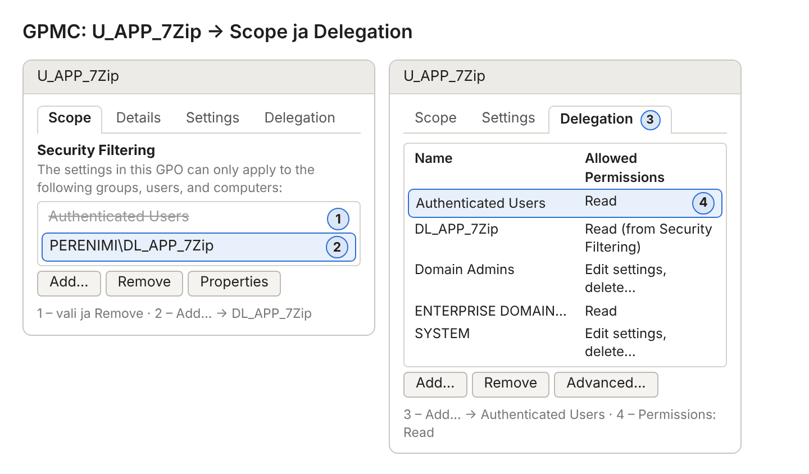
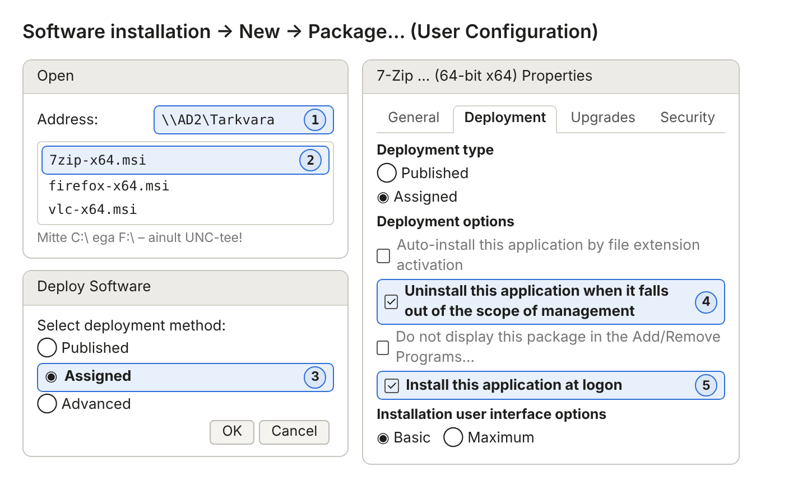
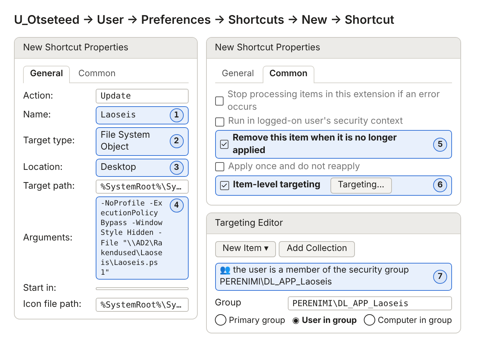
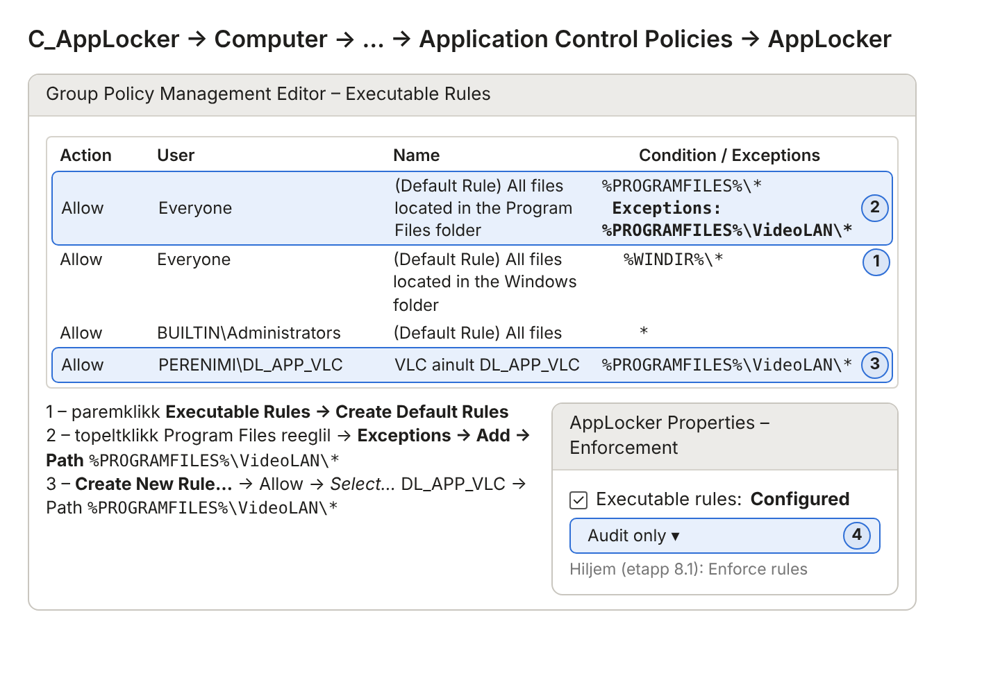

# Labor 14: rakenduste ligipääs AD rühmade järgi – praktiline juhend

**Keskkond:** Windows Server 2022 (AD1 graafilise liidesega, AD2 Server Core) ja kaks Windows 11 klienti (WIN11-01, WIN11-02).
**Kestus:** umbes 4 × 45 min (etapid 0–5 esimeses tunnis, etapid 6–9 teises).
**Teooria:** [peatükk 16](../peatykid/16-rakenduste-ligipaas-ad-ruhmadega.md) · **Simulaator enne laborit:** [rakenduste ligipääsu simulaator](https://valdonolvak.github.io/Windows-serveri-haldus/interaktiivne/rakenduste-ligipaas-simulaator.html)

## Mida sa selle laboriga teed

Ehitad ettevõttele süsteemi, kus **rakenduse saamine ja kasutamine sõltub ainult sellest, millisesse AD rühma kasutaja kuulub**. Kui uus töötaja pannakse oma osakonna rühma, saab ta automaatselt õiged programmid ja õigused. Kui ta osakonda vahetab, kaovad vanad ja tulevad uued – ilma et administraator peaks ühtki arvutit puudutama.

Labori lõpuks kehtib see tabel:

| Kasutaja | Osakond (rollirühm) | 7-Zip | Firefox | VLC | Otsetee „Raamatupidamine“ | Laoseis |
| --- | --- | --- | --- | --- | --- | --- |
| `kati.karu` | IT (`GG_IT`) | paigaldub | paigaldub | paigaldub, käivitub | – | ei näe |
| `mari.maasikas` | Raamatupidamine (`GG_Raamatupidamine`) | – | paigaldub | **AppLocker keelab** | on | ainult vaatab |
| `liis.lepp` | Müük (`GG_Myyk`) | – | paigaldub | **AppLocker keelab** | – | vaatab ja muudab |

Kasutatakse viit mehhanismi, mis kõik vaatavad ainult rakendusrühma `DL_APP_…`:

| Etapp | Mehhanism | Vastab küsimusele |
| --- | --- | --- |
| 3 | GPO tarkvara paigaldus + turvafilter | Kas programm paigaldatakse? |
| 4 | GPP otsetee + item-level targeting | Kas kasutaja näeb otseteed? |
| 5 | AppLocker | Kas programmi tohib käivitada? |
| 6 | NTFS-õigused failiserveris | Kas rakendust ja selle andmeid saab avada ja muuta? |
| 6 | Rakenduse enda kontroll (`IsInRole`) | Mida rakendus kasutajale lubab (kasutajaliides)? |

## Laborikeskkond

| Masin | OS | Roll selles laboris | IP |
| --- | --- | --- | --- |
| **AD1** | Windows Server 2022 Standard (Desktop Experience) | DC; siin tehakse kogu haldus: ADUC, GPMC, PowerShell | 192.168.10.10 |
| **AD2** | Windows Server 2022 Standard (Server Core) | DC ja failiserver: jagamised `Tarkvara` ja `Rakendused` kettal `F:` | 192.168.10.11 |
| **WIN11-01** | Windows 11 Pro/Enterprise | testarvuti: Kati ja Liis | DHCP |
| **WIN11-02** | Windows 11 Pro/Enterprise | testarvuti: Mari | DHCP |

> **Nimed.** Peatükkides 13–18 on samade masinate nimed **DC1** (= AD1) ja **CORE1** (= AD2). Kus juhendis on `perenimi`, kirjuta oma domeeni nimi (nt `tonisson.local`, NetBIOS `TONISSON`).

> **GUI või PowerShell.** Iga etapp on kirjeldatud kahel viisil: **A) GUI** ja **B) PowerShell**. Piisab ühest. Mõned asjad (MSI paketi lisamine, otseteed, AppLocker) saab teha ainult GUI-s – seal on ainult A.

### Mida on vaja enne laborit

1. **Domeen töötab:** AD1 ja AD2 on domeenikontrollerid, WIN11-01 ja WIN11-02 on domeenis (laborid 2–4).
2. **AD2-l on ketas `F:`** (labor 3 / peatükk 3.6).
3. **Paigaldusfailid** (laboris pole tavaliselt internetti – õpetaja annab need ISO-tõmmisfailina või jagatud kaustas; kopeeri AD1 kausta `C:\Install`):
   - 7-Zip 64-bitine MSI (7-zip.org) → nimeta `7zip-x64.msi`
   - Firefox MSI (mozilla.org, *Firefox for Enterprise*) → `firefox-x64.msi`
   - VLC 64-bitine MSI (videolan.org) → `vlc-x64.msi`
   - `Laoseis.ps1` ja `laoseis.csv` ([Skriptid/Laoseis](../Skriptid/Laoseis/))
   - kontrollskript `Labor14-kontroll.ps1` ([Skriptid](../Skriptid/Labor14-kontroll.ps1))

Kõik PowerShelli käsud käivitatakse **AD1-l administraatori PowerShellis** (paremklikk *Windows PowerShell* → *Run as administrator*), kui pole öeldud teisiti.

---

## Etapp 0. Lähteolukorra kontroll (10 min)

Kontrolli, et AD-s on OU-d, kasutajad ja rollirühmad olemas ning kliendid on OU-s `Arvutid` (sellele OU-le lingitakse AppLocker).

```powershell
$dom   = (Get-ADDomain).DistinguishedName          # nt DC=perenimi,DC=local
$labor = "OU=Labor,$dom"
Get-ADOrganizationalUnit -Filter * -SearchBase $labor | Select-Object Name
Get-ADGroup -Filter 'Name -like "GG_*"' | Select-Object Name
Get-ADUser -Filter * -SearchBase "OU=Kasutajad,$labor" | Select-Object SamAccountName
Get-ADComputer -Filter 'Name -like "WIN11*"' | Select-Object Name, DistinguishedName
```

**Kui midagi puudub**, loo see. Skripti võib käivitada ka siis, kui kõik on olemas – olemasolevat ei muudeta.

```powershell
$dom   = (Get-ADDomain).DistinguishedName
$labor = "OU=Labor,$dom"
if (-not (Get-ADOrganizationalUnit -Filter "Name -eq 'Labor'" -SearchBase $dom -SearchScope OneLevel)) {
  New-ADOrganizationalUnit -Name Labor -Path $dom }
foreach ($ou in 'Kasutajad','Arvutid','Ryhmad') {
  if (-not (Get-ADOrganizationalUnit -Filter "Name -eq '$ou'" -SearchBase $labor -SearchScope OneLevel)) {
    New-ADOrganizationalUnit -Name $ou -Path $labor } }

foreach ($g in 'GG_IT','GG_Raamatupidamine','GG_Myyk') {
  if (-not (Get-ADGroup -Filter "Name -eq '$g'")) {
    New-ADGroup -Name $g -GroupScope Global -GroupCategory Security -Path "OU=Ryhmad,$labor" } }

$pw = Read-Host -AsSecureString "Testkasutajate parool"
$kasutajad = @(
  @{Sam='kati.karu';     Ees='Kati'; Pere='Karu';     Grupp='GG_IT'},
  @{Sam='mari.maasikas'; Ees='Mari'; Pere='Maasikas'; Grupp='GG_Raamatupidamine'},
  @{Sam='liis.lepp';     Ees='Liis'; Pere='Lepp';     Grupp='GG_Myyk'} )
foreach ($k in $kasutajad) {
  if (-not (Get-ADUser -Filter "SamAccountName -eq '$($k.Sam)'")) {
    New-ADUser -Name "$($k.Ees) $($k.Pere)" -GivenName $k.Ees -Surname $k.Pere `
      -SamAccountName $k.Sam -UserPrincipalName "$($k.Sam)@$((Get-ADDomain).DNSRoot)" `
      -Path "OU=Kasutajad,$labor" -AccountPassword $pw -Enabled $true }
  Add-ADGroupMember -Identity $k.Grupp -Members $k.Sam }

# Kliendid OU-sse Arvutid (kui nad on veel konteineris Computers)
Get-ADComputer -Filter 'Name -like "WIN11*"' |
  Where-Object { $_.DistinguishedName -notlike "*OU=Arvutid,$labor" } |
  Move-ADObject -TargetPath "OU=Arvutid,$labor"
```

✅ **Kontroll:** kolm kasutajat on OU-s `Kasutajad`, igaüks oma `GG_` rühmas; WIN11-01 ja WIN11-02 on OU-s `Arvutid`.

---

## Etapp 1. Rakendusrühmad (15 min)

AGDLP: kasutaja (**A**) → rollirühm (**G**, *global*) → rakendusrühm (**DL**, *domain local*) → õigus (**P**). Mehhanismid tunnevad ainult `DL_APP_` rühmi.

| Rakendusrühm | Liikmed | Mida annab |
| --- | --- | --- |
| `DL_APP_7Zip` | `GG_IT` | 7-Zipi paigaldus |
| `DL_APP_Firefox` | `GG_IT`, `GG_Raamatupidamine`, `GG_Myyk` | Firefoxi paigaldus |
| `DL_APP_VLC` | `GG_IT` | VLC paigaldus ja käivitamisõigus |
| `DL_APP_Raamat` | `GG_Raamatupidamine` | otsetee „Raamatupidamine“ |
| `DL_APP_Laoseis` | `GG_Myyk`, `GG_Raamatupidamine` | Laoseisu käivitamine ja vaatamine |
| `DL_APP_Laoseis_Muutja` | `GG_Myyk` | Laoseisu andmete muutmine |

#### Variant A: GUI

1. AD1: *Server Manager → Tools → Active Directory Users and Computers*.
2. Paremklikk `Labor → Ryhmad` → *New → Group* → *Group name* `DL_APP_7Zip`, *Group scope* **Domain local**, *Group type* **Security** → OK. Korda ülejäänud viie rühmaga.
3. Topeltklikk rühmal → vahekaart **Members** → *Add...* → kirjuta liikmed (mitu korraga semikooloniga: `GG_IT; GG_Myyk`) → *Check Names* → OK → OK.

#### Variant B: PowerShell

```powershell
$ry = "OU=Ryhmad,OU=Labor,$((Get-ADDomain).DistinguishedName)"
$rakendused = [ordered]@{
  'DL_APP_7Zip'           = 'GG_IT'
  'DL_APP_Firefox'        = 'GG_IT','GG_Raamatupidamine','GG_Myyk'
  'DL_APP_VLC'            = 'GG_IT'
  'DL_APP_Raamat'         = 'GG_Raamatupidamine'
  'DL_APP_Laoseis'        = 'GG_Myyk','GG_Raamatupidamine'
  'DL_APP_Laoseis_Muutja' = 'GG_Myyk'
}
foreach ($r in $rakendused.Keys) {
  if (-not (Get-ADGroup -Filter "Name -eq '$r'")) {
    New-ADGroup -Name $r -GroupScope DomainLocal -GroupCategory Security -Path $ry }
  Add-ADGroupMember -Identity $r -Members $rakendused[$r]
}
```

✅ **Kontroll:**

```powershell
Get-ADGroup -Filter 'Name -like "DL_APP_*"' | ForEach-Object {
  "{0,-24} <- {1}" -f $_.Name, ((Get-ADGroupMember $_ | Select-Object -Expand Name) -join ', ') }
Get-ADPrincipalGroupMembership liis.lepp | Select-Object Name    # GG_Myyk + DL rühmad? (DL-e siin ei näe – vt allpool)
Get-ADGroupMember DL_APP_Laoseis -Recursive | Select-Object SamAccountName   # Liis ja Mari
```

> `Get-ADPrincipalGroupMembership` näitab ainult **otseseid** rühmi. Pesastatud rühmade nägemiseks kasuta `Get-ADGroupMember -Recursive` või hiljem kliendis `whoami /groups`.

---

## Etapp 2. Tarkvara jagamine AD2-l (15 min)

GPO paigaldab MSI paketi **võrgust**, seega peavad paketid olema jagatud kaustas, mida saavad lugeda kõik kasutajad ja arvutid (*Authenticated Users* sisaldab ka arvutikontosid).

#### Variant A: GUI (AD1-st, sest AD2-l pole graafilist liidest)

1. AD1 File Explorer → aadressiribale `\\AD2\F$` → loo kaust `Tarkvara`.
2. *Server Manager → Tools → Computer Management* → paremklikk *Computer Management (Local)* → *Connect to another computer...* → `AD2` → OK.
3. *System Tools → Shared Folders → Shares* → paremklikk → *New Share...* → *Folder path* `F:\Tarkvara` → *Share name* `Tarkvara` → *Customize permissions*: **Authenticated Users – Read**, **Administrators – Full Control** (eemalda *Everyone*) → *Finish*.
4. Kopeeri kolm MSI-faili AD1 kaustast `C:\Install` kausta `\\AD2\Tarkvara`.

#### Variant B: PowerShell

```powershell
Invoke-Command -ComputerName AD2 -ScriptBlock {
  New-Item -ItemType Directory -Path F:\Tarkvara -Force | Out-Null
  icacls F:\Tarkvara /grant "Authenticated Users:(OI)(CI)RX"
  New-SmbShare -Name Tarkvara -Path F:\Tarkvara -ReadAccess "Authenticated Users" -FullAccess "Administrators"
}
Copy-Item C:\Install\*.msi \\AD2\Tarkvara\
Get-ChildItem \\AD2\Tarkvara
```

✅ **Kontroll:** WIN11-01-l kasutajana `liis.lepp`: `\\AD2\Tarkvara` avaneb ja näitab kolme MSI-faili (lugeda saab, kirjutada mitte).

> **Alati UNC-tee!** GPO-s tuleb paketi asukoht anda kujul `\\AD2\Tarkvara\7zip-x64.msi`, mitte `F:\Tarkvara\...` – klient loeb paketti üle võrgu. Kui sul on DFS nimeruum (labor 12), võid kasutada ka `\\perenimi.local\Andmed\Tarkvara\...`.

---

## Etapp 3. Tarkvara paigaldus GPO-ga (40 min)

Iga rakenduse jaoks on oma GPO (`U_APP_7Zip`, `U_APP_Firefox`, `U_APP_VLC`), lingitud OU-le `Kasutajad`. Turvafilter määrab, kellele see rakendub.

### 3.1 Eeltingimus: oota võrku sisselogimisel

Tarkvara paigaldub ainult **sisselogimisel ja ainult siis, kui GPO-d töödeldakse enne töölaua avanemist**. Windows 11 vaikimisi kiire sisselogimine jätab selle vahele. Kui sul on GPO `C_Oota_Vorku` peatükist 15 olemas, jäta see samm vahele.

**A) GUI:** *Tools → Group Policy Management* → paremklikk OU `Labor → Arvutid` → *Create a GPO in this domain, and Link it here...* → `C_Oota_Vorku` → *Edit* → *Computer Configuration → Policies → Administrative Templates → System → Logon* → **Always wait for the network at computer startup and logon** → *Enabled*.

**B) PowerShell:**

```powershell
$arvutid = "OU=Arvutid,OU=Labor,$((Get-ADDomain).DistinguishedName)"
New-GPO -Name C_Oota_Vorku | New-GPLink -Target $arvutid
Set-GPRegistryValue -Name C_Oota_Vorku -Key "HKLM\Software\Policies\Microsoft\Windows NT\CurrentVersion\Winlogon" `
  -ValueName SyncForegroundPolicy -Type DWord -Value 1
```

### 3.2 GPO-d ja turvafilter

#### Variant A: GUI

1. GPMC → paremklikk OU `Labor → Kasutajad` → *Create a GPO in this domain, and Link it here...* → `U_APP_7Zip` → OK.
2. Vali vasakul GPO `U_APP_7Zip` → vahekaart **Scope** → *Security Filtering*: vali **Authenticated Users** → *Remove* → OK. *Add...* → `DL_APP_7Zip` → OK.
3. Vahekaart **Delegation** → *Add...* → `Authenticated Users` → *Permissions*: **Read** → OK.
4. Korda samme 1–3: `U_APP_Firefox` ↔ `DL_APP_Firefox` ja `U_APP_VLC` ↔ `DL_APP_VLC`.



*Skeem · GPMC: turvafilter (1–2) ja Delegation – Authenticated Users: Read (3–4)*

> **Miks samm 3?** Alates uuendusest MS16-072 loeb Windows ka kasutaja GPO-d **arvutikonto** õigustega. Kui eemaldasid *Authenticated Users* filtrist ega andnud neile tagasi lugemisõigust, ei saa arvuti GPO-d lugeda ja see ei rakendu **mitte kellelegi**.

#### Variant B: PowerShell

```powershell
$kasutajad = "OU=Kasutajad,OU=Labor,$((Get-ADDomain).DistinguishedName)"
foreach ($app in '7Zip','Firefox','VLC') {
  $gpo = "U_APP_$app"
  New-GPO -Name $gpo | New-GPLink -Target $kasutajad | Out-Null
  Set-GPPermission -Name $gpo -TargetName "DL_APP_$app" -TargetType Group -PermissionLevel GpoApply
  # Authenticated Users: Apply -> ainult Read (-Replace on vajalik õiguse vähendamiseks)
  Set-GPPermission -Name $gpo -TargetName "Authenticated Users" -TargetType Group -PermissionLevel GpoRead -Replace
}
Get-GPPermission -Name U_APP_7Zip -All | Select-Object @{n='Kes';e={$_.Trustee.Name}}, Permission
```

### 3.3 MSI paketi lisamine (ainult GUI)

1. Paremklikk `U_APP_7Zip` → **Edit**.
2. *User Configuration → Policies → Software Settings → Software installation* → paremklikk → *New → Package...*.
3. Failidialoogi **aadressiribale** kirjuta `\\AD2\Tarkvara` (mitte sirvi kohalikku ketast!) → vali `7zip-x64.msi` → *Open*.
4. *Deploy Software*: vali **Assigned** → OK.
5. Topeltklikk tekkinud paketil → vahekaart **Deployment**:
   - ☑ **Install this application at logon**
   - ☑ **Uninstall this application when it falls out of the scope of management**
   → OK.
6. Korda: `U_APP_Firefox` → `firefox-x64.msi`, `U_APP_VLC` → `vlc-x64.msi`.



*Skeem · Software installation: UNC-tee, Assigned ja Deployment valikud*

> **Kontrolli tee:** paketi omaduste vahekaardil *General* → *Source* peab algama `\\AD2\...`. Kui seal on `F:\` või `C:\`, kustuta pakett ja lisa uuesti.

✅ **Kontroll (AD1):**

```powershell
Get-GPInheritance -Target "OU=Kasutajad,OU=Labor,$((Get-ADDomain).DistinguishedName)" |
  Select-Object -Expand GpoLinks | Select-Object DisplayName, Enabled
```

---

## Etapp 4. Otseteed item-level targetinguga (25 min)

Üks GPO `U_Otseteed` (OU `Kasutajad`, filter *Authenticated Users* – ei muuda!) teeb kõik otseteed. Iga otsetee juures on tingimus: luua ainult siis, kui kasutaja on rühmas X.

#### Variant A: GUI (ainult GUI-s)

1. GPMC → paremklikk OU `Kasutajad` → *Create a GPO...* → `U_Otseteed` → **Edit**.
2. *User Configuration → Preferences → Windows Settings → Shortcuts* → paremklikk → *New → Shortcut*.
3. **Otsetee „Raamatupidamine“**, vahekaart *General*:
   - *Action* **Update**, *Name* `Raamatupidamine`, *Target type* **File System Object**, *Location* **Desktop**;
   - *Target path* `\\perenimi.local\Andmed\Osakonnad\Raamatupidamine` (või osakonnakaust, mille lõid laboris 7).
4. Vahekaart **Common**:
   - ☑ **Remove this item when it is no longer applied** (küsimusele vasta OK);
   - ☑ **Item-level targeting** → *Targeting...* → *New Item* → **Security Group** → *Group* `PERENIMI\DL_APP_Raamat` → jäta valituks **User in group** → OK → OK.
5. **Otsetee „Laoseis“** (sama moodi, uus otsetee):
   - *Name* `Laoseis`, *Target type* **File System Object**, *Location* **Desktop**;
   - *Target path* `%SystemRoot%\System32\WindowsPowerShell\v1.0\powershell.exe`;
   - *Arguments* `-NoProfile -ExecutionPolicy Bypass -WindowStyle Hidden -File "\\AD2\Rakendused\Laoseis\Laoseis.ps1"`;
   - *Icon file path* `%SystemRoot%\System32\shell32.dll`, vali mõni ikoon (nt kast);
   - *Common*: ☑ Remove this item…, ☑ Item-level targeting → **Security Group** `PERENIMI\DL_APP_Laoseis`.



*Skeem · otsetee „Laoseis“: General (1–4), Common (5–6) ja Targeting Editor (7)*

> **Otsetee ei ole õigus.** Kui Liis kirjutab Raamatupidamise kausta tee käsitsi, avaneb see tema NTFS-õiguste järgi – otsetee ainult näitab teed. Päris piirangu teevad etapid 5 ja 6.

---

## Etapp 5. AppLocker: VLC ainult IT-le (30 min)

AppLocker kontrollib **arvutis**, kas kasutaja tohib programmi käivitada. Reeglid tehakse arvutipoliitikas ja lingitakse OU-le `Arvutid`; reegel ise viitab kasutajarühmale.

> ⚠️ **Ettevaatust:** kui reeglikogumis on vähemalt üks reegel, on **kõik muu keelatud**. Loo alati esmalt vaikereeglid ja alusta režiimiga *Audit only*.

#### Variant A: GUI (ainult GUI-s)

1. GPMC → paremklikk OU `Labor → Arvutid` → *Create a GPO...* → `C_AppLocker` → **Edit**.
2. *Computer Configuration → Policies → Windows Settings → Security Settings → Application Control Policies → AppLocker → **Executable Rules*** → paremklikk → **Create Default Rules**. Tekib kolm reeglit (Windows ja Program Files kõigile, kõik administraatoritele).
3. Topeltklikk reeglil **(Default Rule) All files located in the Program Files folder** → vahekaart **Exceptions** → *Add...* → *Path* → `%PROGRAMFILES%\VideoLAN\*` → OK → OK. Nüüd ei luba see reegel VLC-d kellelegi.
4. Paremklikk *Executable Rules* → *Create New Rule...* → *Next* → **Allow**, *User or group* → *Select...* → `DL_APP_VLC` → *Next* → **Path** → *Next* → *Path* `%PROGRAMFILES%\VideoLAN\*` → *Next* → *Next* → *Name* `VLC ainult DL_APP_VLC` → *Create*.
5. Paremklikk **AppLocker** → *Properties* → vahekaart *Enforcement* → ☑ *Executable rules: Configured* → **Audit only** → OK.
6. *Computer Configuration → Policies → Windows Settings → Security Settings → **System Services*** → **Application Identity** → ☑ *Define this policy setting* → **Automatic** → OK.



*Skeem · AppLocker: vaikereeglid (1), VideoLAN-i erand (2), uus reegel DL_APP_VLC-le (3) ja Audit only (4)*

✅ **Kontroll kliendis** (WIN11-01, administraatorina – hiljem etapis 7):

```powershell
gpupdate /force
Get-Service AppIDSvc                       # Status: Running (pärast taaskäivitust)
Get-AppLockerPolicy -Effective | Test-AppLockerPolicy -Path "C:\Program Files\VideoLAN\VLC\vlc.exe" -User PERENIMI\liis.lepp
Get-AppLockerPolicy -Effective | Test-AppLockerPolicy -Path "C:\Program Files\VideoLAN\VLC\vlc.exe" -User PERENIMI\kati.karu
```

Esimene käsk peab andma `DeniedByDefault` (Liis), teine `Allowed` (Kati).

---

## Etapp 6. Rühmast sõltuv rakendus „Laoseis“ (40 min)

Laoseis on failiserveris asuv PowerShelli vormiga programm, mis näitab ja salvestab faili `laoseis.csv`. Rakendusel on **kaks õiguse taset**:

| Rühm | NTFS kaustal `Laoseis` | NTFS kaustal `andmed` | Rakenduses |
| --- | --- | --- | --- |
| `DL_APP_Laoseis` | Read & execute | (pärandub: lugemine) | avab, näeb tabelit |
| `DL_APP_Laoseis_Muutja` | – | **Modify** | nupp „Salvesta“ aktiivne, salvestab |
| teised (nt IT) | – (ABE peidab kausta) | – | ei saa avada |

### 6.1 Jagamine ja NTFS (AD2)

#### Variant A: GUI (AD1-st)

1. `\\AD2\F$` → loo kaustad `Rakendused\Laoseis\andmed`.
2. *Computer Management* (ühendatud AD2-ga) → *Shares* → *New Share...* → `F:\Rakendused`, nimi `Rakendused`, *Customize permissions*: **Authenticated Users – Change**, **Administrators – Full Control** → *Finish*.
   ABE (*Access-based enumeration*): *Server Manager → File and Storage Services → Shares* (AD2 peab olema *All Servers* all lisatud) → paremklikk `Rakendused` → *Properties* → *Settings* → ☑ **Enable access-based enumeration** → OK.
3. `\\AD2\F$\Rakendused` → *Properties → Security → Advanced* → **Disable inheritance** → *Remove all inherited permissions*. Lisa:
   - **SYSTEM** – Full control; **Administrators** – Full control;
   - **Authenticated Users** – *Read & execute*, *Applies to:* **This folder only**.
4. `...\Rakendused\Laoseis` → *Security → Edit → Add* → `DL_APP_Laoseis` → **Read & execute** (This folder, subfolders and files).
5. `...\Laoseis\andmed` → *Security → Edit → Add* → `DL_APP_Laoseis_Muutja` → **Modify**.

#### Variant B: PowerShell

```powershell
Invoke-Command -ComputerName AD2 -ScriptBlock {
  $d = $env:USERDOMAIN                                     # NetBIOS-nimi, nt PERENIMI
  New-Item -ItemType Directory -Path F:\Rakendused\Laoseis\andmed -Force | Out-Null
  New-SmbShare -Name Rakendused -Path F:\Rakendused -FolderEnumerationMode AccessBased `
    -ChangeAccess "Authenticated Users" -FullAccess "Administrators"
  icacls F:\Rakendused /inheritance:r /grant "SYSTEM:(OI)(CI)F" "Administrators:(OI)(CI)F" "Authenticated Users:RX"
  icacls F:\Rakendused\Laoseis        /grant "$d\DL_APP_Laoseis:(OI)(CI)RX"
  icacls F:\Rakendused\Laoseis\andmed /grant "$d\DL_APP_Laoseis_Muutja:(OI)(CI)M"
  icacls F:\Rakendused\Laoseis /T
}
# Kui jagamine oli juba olemas ilma ABE-ta:
# Invoke-Command AD2 { Set-SmbShare -Name Rakendused -FolderEnumerationMode AccessBased -Force }
```

`(OI)(CI)` – õigus pärandub failidele ja alamkaustadele. `Authenticated Users:RX` ilma nendeta kehtib ainult kausta `Rakendused` enda kohta: kõik saavad jagamise avada, aga mitte selle sisu.

### 6.2 Rakenduse failid

1. Ava AD1-l `C:\Install\Laoseis.ps1` Notepadis ja muuda rida

   ```powershell
   $juur  = '\\perenimi.local\Andmed\Rakendused\Laoseis'
   ```

   kujule

   ```powershell
   $juur  = '\\AD2\Rakendused\Laoseis'
   ```

   Salvesta: *File → Save As* → *Encoding* **UTF-8 with BOM** (muidu näitab Windows PowerShell 5.1 täpitähti valesti).
2. Kopeeri failid:

   ```powershell
   Copy-Item C:\Install\Laoseis.ps1  \\AD2\Rakendused\Laoseis\
   Copy-Item C:\Install\laoseis.csv  \\AD2\Rakendused\Laoseis\andmed\
   New-Item  \\AD2\Rakendused\Laoseis\andmed\muudatused.log -ItemType File
   ```

3. Vaata skript läbi – kõige olulisemad read:

   ```powershell
   $id     = [Security.Principal.WindowsIdentity]::GetCurrent()      # kes on sisse loginud
   $roll   = New-Object Security.Principal.WindowsPrincipal($id)
   $muutja = $roll.IsInRole("$env:USERDOMAIN\DL_APP_Laoseis_Muutja")  # kas tokenis on muutja rühm?
   ...
   $grid.ReadOnly = -not $muutja        # mitte-muutjal on tabel kirjutuskaitstud
   $nupp.Enabled  = $muutja             # ... ja nupp „Salvesta“ hall
   ```

   `IsInRole()` ei küsi AD-st – ta vaatab sisselogimisel loodud juurdepääsuluba. Rakenduse kontroll on **mugavus**; salvestamist keelab tegelikult NTFS (etapp 8).

---

## Etapp 7. Testimine (40 min)

Testi alati **uue sisselogimisega** – rühmad ja GPO-d loetakse sisselogimisel. Tarkvara paigaldus võib vajada **kahte** sisselogimist (esimesel tuvastatakse muudatus, teisel paigaldatakse).

Enne testi tee mõlemas kliendis administraatorina üks kord: `gpupdate /force` ja **taaskäivitus** (arvutipoliitikad `C_Oota_Vorku` ja `C_AppLocker` rakenduvad käivitumisel).

### 7.1 Kati (IT) – WIN11-01

| # | Tegevus | Oodatav tulemus | ☐ |
| --- | --- | --- | --- |
| 1 | Logi sisse `PERENIMI\kati.karu` | Sisselogimisel kuvatakse „Installing managed software…“ | ☐ |
| 2 | Start-menüü | 7-Zip, Firefox ja VLC on olemas | ☐ |
| 3 | Käivita VLC | Käivitub | ☐ |
| 4 | Töölaud | Otseteid „Raamatupidamine“ ja „Laoseis“ **pole** | ☐ |
| 5 | Exploreris `\\AD2\Rakendused` | Kaust on tühi – `Laoseis` pole nähtav (ABE) | ☐ |
| 6 | Exploreris `\\AD2\Rakendused\Laoseis` | *Access is denied* | ☐ |
| 7 | `whoami /groups \| findstr DL_APP` | `DL_APP_7Zip`, `DL_APP_Firefox`, `DL_APP_VLC` | ☐ |
| 8 | `gpresult /r /scope:user` | Rakendunud: `U_APP_7Zip`, `U_APP_Firefox`, `U_APP_VLC`, `U_Otseteed` | ☐ |

📸 **Ekraanitõmmis 1:** Kati Start-menüü kolme programmiga + `whoami /groups` väljund.

### 7.2 Liis (Müük) – WIN11-01 (samas arvutis!)

| # | Tegevus | Oodatav tulemus | ☐ |
| --- | --- | --- | --- |
| 1 | Logi Kati välja, sisse `liis.lepp` | Firefox paigaldub | ☐ |
| 2 | Start-menüü | Firefox on; 7-Zipi ja VLC-d **pole** | ☐ |
| 3 | Käivita käsitsi `C:\Program Files\VideoLAN\VLC\vlc.exe` (VLC on arvutis, sest Kati sai selle) | Auditirežiimis **käivitub** | ☐ |
| 4 | Töölaual otsetee „Laoseis“ → ava | Akna pealkirjas „liis.lepp – **muutja**“ | ☐ |
| 5 | Muuda toote 1002 kogus 8 → 20 → *Salvesta* | „Salvestatud.“ | ☐ |
| 6 | `gpresult /r /scope:user` | `U_APP_7Zip` ja `U_APP_VLC` all *filtered out … Denied (Security)* | ☐ |

📸 **Ekraanitõmmis 2:** Laoseis Liisi kasutajana pärast salvestamist.

Vaata nüüd **administraatorina** WIN11-01-l: *Event Viewer → Applications and Services Logs → Microsoft → Windows → AppLocker → EXE and DLL*. Seal on Liisi VLC käivitamise kohta sündmus **8003** („…was allowed to run but would have been prevented from running if the AppLocker policy were enforced“).

📸 **Ekraanitõmmis 3:** sündmus 8003.

### 7.3 Mari (Raamatupidamine) – WIN11-02

| # | Tegevus | Oodatav tulemus | ☐ |
| --- | --- | --- | --- |
| 1 | Logi sisse `mari.maasikas` | Firefox paigaldub | ☐ |
| 2 | Töölaud | Otseteed „Raamatupidamine“ ja „Laoseis“ | ☐ |
| 3 | Ava Laoseis | Pealkirjas „**ainult vaatamine**“, tabelit ei saa muuta, *Salvesta* on hall | ☐ |
| 4 | Vaata toodet 1002 | Kogus on **20** (Liisi muudatus) | ☐ |

📸 **Ekraanitõmmis 4:** Laoseis Mari kasutajana (hall nupp).

---

## Etapp 8. Turvatestid ja rühma muutmine (30 min)

### 8.1 AppLocker jõustamine

1. AD1: `C_AppLocker` → *AppLocker → Properties → Enforcement* → **Enforce rules** → OK.
2. WIN11-01 administraatorina: `gpupdate /force`, taaskäivita.
3. Logi sisse `liis.lepp` → käivita `C:\Program Files\VideoLAN\VLC\vlc.exe` → **„This app has been blocked by your system administrator“**. Logis sündmus **8004**.
4. Logi sisse `kati.karu` → VLC käivitub (sündmus **8002**).

📸 **Ekraanitõmmis 5:** blokeerimise teade Liisi kasutajana.

### 8.2 Möödaviigu katse: kasutajaliides vs NTFS

Mari proovib rakenduse kontrollist mööda minna.

1. WIN11-02, `mari.maasikas`: kopeeri `\\AD2\Rakendused\Laoseis\Laoseis.ps1` oma töölauale.
2. Ava koopia Notepadis, muuda rida `$muutja = $roll.IsInRole(...)` kujule `$muutja = $true`, salvesta.
3. Paremklikk koopial → *Run with PowerShell*. Pealkirjas on nüüd „muutja“ ja *Salvesta* on aktiivne.
4. Muuda kogust ja vajuta *Salvesta* → **„Salvestamine ebaõnnestus: Access to the path '…laoseis.csv' is denied.“**
5. Proovi avada `\\AD2\Rakendused\Laoseis\andmed\laoseis.csv` Notepadis ja salvestada → *Access is denied*.
6. Kustuta koopia.

📸 **Ekraanitõmmis 6:** veateade sammust 4.

**Järeldus:** rakenduse kontroll (peidetud nupp) on mugavus. Andmeid kaitseb server – NTFS kontrollib iga kirjutamist sõltumata programmist.

### 8.3 Rühma muutmine – millal see kasutajani jõuab?

1. AD1: lisa Raamatupidamine muutjate hulka:

   ```powershell
   Add-ADGroupMember DL_APP_Laoseis_Muutja -Members GG_Raamatupidamine
   ```

2. WIN11-02: Mari (**ei logi välja**) sulgeb ja avab Laoseisu uuesti → ikka „ainult vaatamine“. `whoami /groups | findstr Laoseis` → muutja rühma pole.
3. Mari logib **välja ja sisse** → Laoseis: „muutja“, salvestamine õnnestub.
4. Taasta algseis: `Remove-ADGroupMember DL_APP_Laoseis_Muutja -Members GG_Raamatupidamine -Confirm:$false`. Mari logib välja ja sisse → jälle vaataja.

### 8.4 Osakonna vahetus – tarkvara eemaldamine

1. AD1: Kati liigub IT-st müüki:

   ```powershell
   Remove-ADGroupMember GG_IT -Members kati.karu -Confirm:$false
   Add-ADGroupMember    GG_Myyk -Members kati.karu
   ```

2. WIN11-01: Kati logib sisse (vajadusel kaks korda) → **7-Zip ja VLC eemaldatakse**, Firefox jääb; töölauale tekib „Laoseis“ (müük on muutja). VLC käsitsi käivitamine – blokeeritud.
3. Taasta: `Remove-ADGroupMember GG_Myyk -Members kati.karu -Confirm:$false; Add-ADGroupMember GG_IT -Members kati.karu`.

📸 **Ekraanitõmmis 7:** Kati Start-menüü pärast osakonna vahetust.

---

## Etapp 9. Kontrollskript ja esitamine (10 min)

Käivita AD1-l administraatorina:

```powershell
Set-ExecutionPolicy -Scope Process Bypass -Force
C:\Install\Labor14-kontroll.ps1
```

Skript kontrollib rühmi, GPO-sid, turvafiltreid, pakette, otseteid, AppLockerit, jagamisi ja NTFS-õigusi ning näitab iga punkti juures **OK** või **VIGA** koos vihjega. Paranda vead ja käivita uuesti.

📸 **Ekraanitõmmis 8:** kontrollskripti kokkuvõte.

**Esita:** ekraanitõmmised 1–8 ühes dokumendis ja vastused küsimustele.

### Hindamine

| Osa | Punkte |
| --- | --- |
| Rakendusrühmad ja pesastus (etapp 1) | 10 |
| Tarkvara jagamine ja GPO paigaldus koos turvafiltri ja Delegationiga (etapid 2–3) | 25 |
| Otseteed item-level targetinguga (etapp 4) | 15 |
| AppLocker: vaikereeglid, erand, rühmareegel, jõustamine (etapid 5, 8.1) | 20 |
| Laoseis: jagamine, ABE, NTFS kahel tasemel, töötav rakendus (etapp 6) | 20 |
| Testid ja ekraanitõmmised, vastused küsimustele | 10 |
| **Kokku** | **100** |

### Küsimused

1. Miks on GPO turvafiltris `DL_APP_7Zip`, mitte `GG_IT`? Mis muutuks, kui firmas tekiks osakond „Arendus“, mis samuti vajab 7-Zipi?
2. Miks peab *Authenticated Users* jääma GPO-le *Read* õigusega, kuigi nad pole turvafiltris?
3. Kati sai VLC ja Liis käivitas selle samast arvutist. Miks ei aidanud see, et Liisile VLC-d ei paigaldatud? Mis teda lõpuks peatas?
4. Etapis 8.2 oli nupp „Salvesta“ aktiivne, aga salvestamine ei õnnestunud. Mis on rakenduse `IsInRole()` kontrolli ja NTFS-õiguse roll?
5. Miks jõudis Mari uus õigus Laoseisu alles pärast välja- ja sisselogimist? Kust `IsInRole()` ja GPO rühmad võtavad?
6. Mis vahe on sellel, et Kati kausta `Laoseis` **ei näe** (ABE), ja sellel, et tal pole sinna **õigust** (NTFS)?

---

## Tõrkeotsing

| Sümptom | Kontrolli | Lahendus |
| --- | --- | --- |
| Tarkvara ei paigaldu | `gpresult /r /scope:user` – kas GPO on rakendunud? | Logi välja ja sisse (vajadusel 2×); `C_Oota_Vorku` peab olema rakendunud (`gpresult /r /scope:computer`) |
| GPO ei rakendu kellelegi | GPMC → GPO → *Delegation* | *Authenticated Users – Read* puudub |
| GPO all *Denied (Security)* | `whoami /groups` | Kasutaja pole `DL_APP_` rühmas või ei loginud pärast muudatust uuesti sisse |
| *Application* logis MsiInstaller viga 1612 / paketti ei leitud | Paketi *Source* | Tee peab olema `\\AD2\Tarkvara\...`; jagamisel *Authenticated Users – Read* |
| VLC käivitub ka Liisil, logis pole sündmusi | `Get-Service AppIDSvc` | Teenus peab töötama: GPO *System Services → Application Identity → Automatic*, taaskäivitus |
| VLC käivitub, logis 8003 | AppLockeri režiim | *Audit only* → muuda *Enforce rules* |
| **Kõik** programmid on blokeeritud | AppLockeri reeglid | Vaikereeglid on puudu – *Create Default Rules* |
| Otseteed ei teki | GPP *Targeting* | Õige rühm, *User in group*; `gpupdate /force` |
| Laoseis ei avane: *Access … denied* | `whoami /groups`, kausta õigused | Kasutaja pole `DL_APP_Laoseis` liige |
| Laoseis näitab täpitähti valesti | Skripti kodeering | Salvesta UTF-8 **with BOM** |
| Laoseis: skript ei käivitu („running scripts is disabled“) | Otsetee argumendid | `-ExecutionPolicy Bypass` peab olema enne `-File` |

Täpsem tõrkeotsingu tabel: [peatükk 16.9](../peatykid/16-rakenduste-ligipaas-ad-ruhmadega.md#169-kontroll-ja-tõrkeotsing).
