# WDS ja unattended Windows 11 paigaldus: animeeritud juhend

Interaktiivsed õppematerjalid, mis selgitavad, kuidas paigaldada Windows 11 võrgust Windows Server 2022 WDS-iga ilma käsitsi klõpsimata.

## Animatsioonid

Kui GitHub Pages on sisse lülitatud (vt allpool), on animatsioonid avatavad lingi kaudu:

- **Paigalduse käik:** `https://USERNAME.github.io/REPO/` (PXE, käivitustõmmis, Setup, tõmmise leidmine WDS-ist, domeeniga liitumine, OOBE; lisaks ettevalmistuse sammud ja näidis-XML failid)
- **Vastusfailide koostamine:** `https://USERNAME.github.io/REPO/wsim-vastusfailid.html` (WDS kliendi vastusfail ja tõmmisfaili vastusfail Windows System Image Manageris)

Asenda `USERNAME` oma GitHubi kasutajanimega ja `REPO` repositooriumi nimega.

## Failid

| Fail | Sisu |
|---|---|
| `index.html` | Võrgupaigalduse animatsioon, ettevalmistuse sammud ja näidis-XML failid |
| `wsim-vastusfailid.html` | Vastusfailide koostamise animatsioon |
| `assets/wds-flow.svg` | Automaatselt korduv animatsioon selle README jaoks |
| `.nojekyll` | Ütleb GitHub Pagesile, et faile ei töödelda Jekylliga |

## Kasutamine kohalikult

Ava `index.html` brauseris. Serverit ega paigaldust ei ole vaja ja lehed ei lae midagi internetist.

## Märkused

- Näidis-XML failides on paroolide asemel kohahoidja `PAROOL_SIIA`. Ära pane repositooriumi päris paroole.
- Animatsioonid on lihtsustatud mudelid, mitte päris WDS-i või WSIM-i ekraanisalvestus.
- Proxmoxi, draiverite ja Windows 11 24H2 märkused tuleb kontrollida oma keskkonnas ja Microsofti kehtiva dokumentatsiooniga.
- Litsentsi lisa ise (nt MIT või CC BY), kui soovid materjali jagada.
