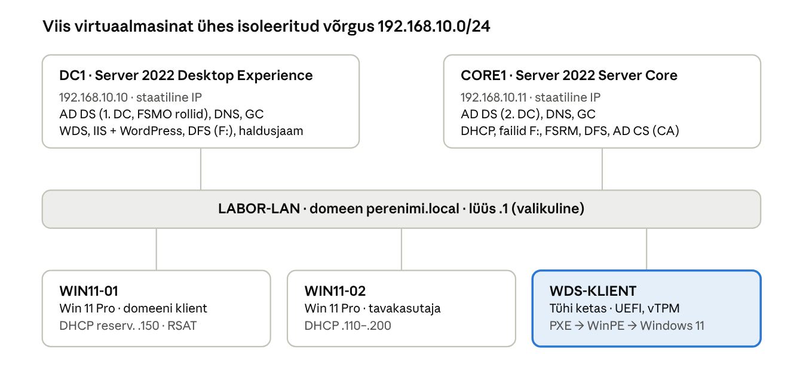

## 1. Sissejuhatus ja laborikeskkond

Selle materjali läbinud õppija suudab iseseisvalt üles ehitada ja hallata väikese ettevõtte Windowsi domeeni: kaks domeenikontrollerit, DNS, DHCP, rühmapoliitika, failiteenused ja Windows 11 võrgupaigalduse WDS-iga. Materjal koosneb teooriaosast (peatükid 2–10), kümnest laboritööst (peatükk 11) ning enesekontrollist ja käskude spikrist (peatükk 12). Osa II (peatükid 13–18, laborid 11–16) lisab FSRM-i, DFS-i, kaustade ümbersuunamise koos isikliku võrgukettaga, rakenduste ligipääsu AD rühmade järgi, IIS-i koos WordPressiga ning oma sertifikaadiasutuse HTTPS-i jaoks.

### Õpiväljundid

Õppija:

1. selgitab Windows Serveri põhimõisteid (domeen, mets, OU, GPO, DNS-kirje, DHCP rent jne) oma sõnadega ja oskab neid praktikas ära tunda;
2. paigaldab ja seadistab Windows Server 2022 nii graafilise liidesega (Desktop Experience) kui ka ilma (Server Core), sh lisab ja vormindab Server Core'is andmeketta;
3. haldab servereid nii graafiliselt kui ka PowerShelli ja kaughalduse abil;
4. loob Active Directory domeeni, lisab sellesse teise domeenikontrolleri ja liidab kliendid domeeni;
5. seadistab DHCP ja DNS teenused ning oskab nende tõrkeid diagnoosida;
6. kavandab ja rakendab rühmapoliitikaid ning failiõigusi vähima õiguse põhimõttel (AGDLP);
7. paigaldab Windows 11 üle võrgu WDS-i ja PXE abil;
8. hindab serveri turvalisust, uuenduste seisu ja varundust;
9. piirab ja jälgib failiserveri kasutust FSRM-i kvootide, failiekraanide ja aruannetega;
10. loob domeenipõhise DFS nimeruumi ja seadistab DFS replikatsiooni kahe serveri vahel ning selgitab, miks replikatsioon ei asenda varundust;
11. suunab GPO-ga kasutajate Töölaua ja Dokumendid serverisse ning annab igale kasutajale automaatselt loodava isikliku 100 MB võrgukettaga kausta;
12. annab kasutajatele ligipääsu rakendustele AD rühmade kaudu (GPO tarkvara paigaldus, otseteed, AppLocker, IIS autoriseerimine);
13. paigaldab IIS-i, PHP, MySQL-i ja WordPressi ning seadistab saidi, rakenduskogumi ja õigused;
14. loob ettevõtte sertifikaadiasutuse (AD CS), väljastab veebiserverile domeenis usaldatud sertifikaadi ja seadistab HTTPS-i ning oskab selgitada, kuidas brauser sertifikaati kontrollib;
15. seadistab domeeni ajahierarhia (PDC emulaator ja NTP) ning selgitab kella õigsuse tähtsust Kerberosele;
16. haldab uuendusi WSUS-iga: sünkroonimine, arvutirühmad, kinnitamine uuendusringide kaupa ja GPO seadistus;
17. seadistab NPS-i RADIUS-serveriks 802.1X WiFi autentimiseks AD kontodega, sh võrgupoliitikad rühmade ja VLAN-ide kaupa ning GPO WiFi-profiili.

### Laborikeskkond

Laboris on viis virtuaalmasinat ühes isoleeritud virtuaalvõrgus (Proxmox VE-s eraldi Linuxi sild, nt vmbr1, või SDN VNet ilma Proxmoxi DHCP-ta). Kõik IP-aadressid, nimed ja domeeninimi on näidisväärtused: neid võib muuta, kuid siis tuleb neid järjekindlalt muuta kõigis laboritöödes.

> **Proxmoxi labor.** Virtuaalmasinad on õpetaja poolt Proxmox VE-s ette valmistatud (Windowsid paigaldatud, VirtIO draiverid ja QEMU guest agent olemas). Õppija ei pea operatsioonisüsteeme ise paigaldama; paigalduse kirjeldus (peatükk 3.4) jääb materjali taustateadmiseks ja iseseisvaks harjutamiseks.

| Masin | Operatsioonisüsteem | Roll laboris | IP-aadress | vCPU / RAM / kettad |
| --- | --- | --- | --- | --- |
| DC1 | Windows Server 2022 Standard (Desktop Experience) | 1. domeenikontroller, DNS, WDS, haldusjaam; Osa II: DFS, IIS + WordPress | 192.168.10.10/24 (staatiline) | 2 / 4 GB / 60 GB + 40 GB `E:` (WDS) + 40 GB `F:` (DFS, Osa II) |
| CORE1 | Windows Server 2022 Standard (Server Core) | 2. domeenikontroller, DNS, DHCP, failiserver; Osa II: FSRM, DFS, AD CS | 192.168.10.11/24 (staatiline) | 2 / 2 GB / 60 GB + 40 GB `F:` (andmed) |
| WIN11-01 | Windows 11 Pro / Enterprise | domeeni klient, RSAT-iga haldusjaam | DHCP-st | 2 / 4 GB / 64 GB |
| WIN11-02 | Windows 11 Pro / Enterprise | domeeni klient (tavakasutaja) | DHCP-st | 2 / 4 GB / 64 GB |
| WDS-KLIENT | puudub (tühi ketas) | Windows 11 paigaldatakse üle võrgu PXE-ga | DHCP-st | 2 / 4 GB / 64 GB, UEFI + Secure Boot + vTPM |

*Joonis: laborikeskkonna topoloogia · 2 serverit, 3 klienti*

Serverid kasutavad staatilisi aadresse, kliendid saavad aadressi CORE1 DHCP-st; WDS-KLIENT (esile tõstetud) käivitub võrgust ja saab Windows 11 DC1 WDS-ist.

**Võrguplaan:** võrk 192.168.10.0/24, vaikelüüs 192.168.10.1 (kui laboris on ruuter/NAT internetti pääsuks; kui pole, jäetakse lüüs tühjaks), domeeninimi `perenimi.local`, NetBIOS-nimi `PERENIMI`. DHCP jagab aadresse vahemikust 192.168.10.100–192.168.10.200.

> **Domeeni nimi = sinu perekonnanimi.** Igal õppijal on oma domeen. Kus materjalis on `perenimi`, kirjuta oma perekonnanimi väikestähtedega ja ilma täpitähtedeta (nt Tõnisson → `tonisson.local`, NetBIOS `TONISSON`). Täpsem tabel on Osa II alguses.

> **Märkus domeeninime kohta.** Tootmises soovitab Microsoft kasutada registreeritud domeeni alamdomeeni (nt `ad.firma.ee`), sest `.local` on reserveeritud mDNS-ile ja võib tekitada konflikte Apple'i seadmetega. Isoleeritud laboris on `perenimi.local` lihtne ja levinud valik.

**Windows 11 nõuded Proxmoxi VM-ile:** BIOS **OVMF (UEFI)** koos EFI kettaga (eelregistreeritud Secure Boot võtmed), masina tüüp **q35**, lisatud **TPM State v2.0**, vähemalt 4 GB RAM-i ja 64 GB ketast. Ilma nendeta peatub Windows 11 paigaldus veateatega „This PC can't run Windows 11“. Ketta- ja võrgukontrolleriks sobivad **VirtIO SCSI single** ja **VirtIO** võrgukaart; nende draiverid on **virtio-win** ISO-tõmmisfailis.

---

[Sisukord](../README.md) · [2. Põhimõisted ja terminid →](02-pohimoisted.md)
