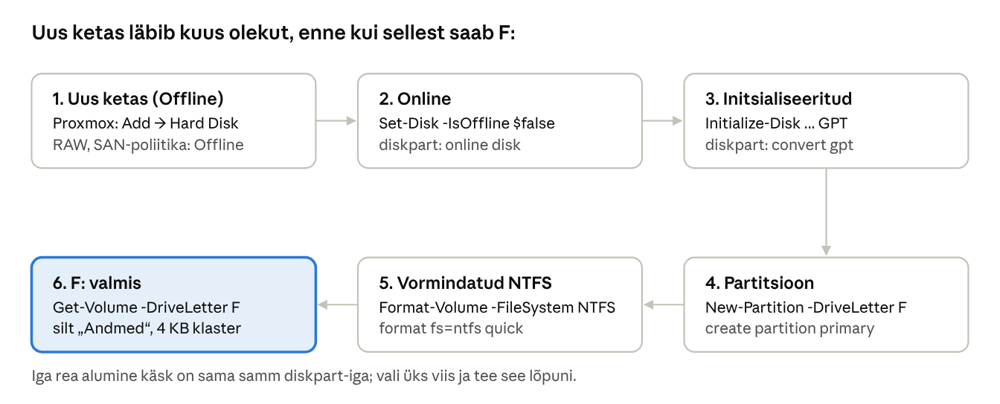

## 3. Windows Server 2022: väljaanded, paigaldus, Desktop Experience vs Server Core

Windows Server 2022 ilmus augustis 2021 LTSC väljalaskena. Selle põhitugi lõppes 13. oktoobril 2026 ja laiendatud tugi (ainult turvauuendused) kestab 14. oktoobrini 2031 ([Microsoft Lifecycle](https://learn.microsoft.com/lifecycle/products/windows-server-2022)). Uutes tootmiskeskkondades tasub kaaluda Windows Server 2025-t, kuid õppimiseks on 2022 täiesti sobiv: halduse põhimõtted on samad.

### 3.1 Väljaanded

| Väljaanne | Kellele | Virtualiseerimisõigus | Olulised erinevused |
| --- | --- | --- | --- |
| Standard | Vähese virtualiseerimisega füüsilised või virtuaalsed serverid | 2 Windows Serveri VM-i litsentsi kohta | Kõik põhirollid (AD DS, DNS, DHCP, failiteenused, WDS, IIS, Hyper-V) |
| Datacenter | Tugevalt virtualiseeritud andmekeskused | Piiramatult VM-e | Lisaks Storage Spaces Direct, tarkvaraliselt määratud võrk (SDN), Shielded VM-id, Storage Replica ilma piiranguta |
| Datacenter: Azure Edition | Azure'is või Azure Stack HCI-l | Piiramatult | Hotpatch (uuendused ilma taaskäivituseta), SMB over QUIC |
| Essentials | Väikeettevõte kuni 25 kasutajat / 50 seadet | 1 VM | Ainult OEM-kanalis, piiratud |

**Litsentsimine:** Standard ja Datacenter litsentsitakse protsessorituumade põhjal (vähemalt 16 tuuma serveri kohta) ning lisaks vajab iga kasutaja või seade, kes serverit kasutab, kliendi juurdepääsulitsentsi (**CAL**, *Client Access License*). Laboris kasutatakse tavaliselt 180-päevast hindamisversiooni (*Evaluation*).

### 3.2 Desktop Experience vs Server Core

Server Core on serveri vaikimisi paigaldusvalik: sellel puudub graafiline töölaud, Explorer ja enamik MMC tööriistu. Server hallatakse käsurealt või kaugelt. Server 2022-s ei saa paigaldusvalikut hiljem muuta – Core'ist GUI saamiseks tuleb server uuesti paigaldada.

| Omadus | Desktop Experience (DC1) | Server Core (CORE1) |
| --- | --- | --- |
| Kasutajaliides | Täielik töölaud, Server Manager, MMC | `cmd.exe` + PowerShell, `sconfig` menüü, Notepad, Task Manager, Regedit |
| Ketta- ja mälukasutus | Suurem (\~ 32 GB+ paigaldus) | Väiksem, \~ 4–6 GB vähem |
| Ründepind | Suurem: rohkem komponente, mida rünnata | Väiksem: vähem kooti, vähem haavatavusi |
| Uuendused ja taaskäivitused | Rohkem paikasid | Vähem paikasid, harvemini taaskäivitus |
| Sobivad rollid | Kõik, sh rakendused, mis vajavad GUI-d (nt RDS Session Host) | AD DS, DNS, DHCP, failiserver, Hyper-V, IIS, WDS jpm |
| Haldus | Kohapeal ja kaugelt | Peamiselt kaugelt: Server Manager, RSAT, WAC, PowerShell Remoting |

> **Hea tava:** taristuteenused (DC, DNS, DHCP, failiserver) paigalda Server Core'ile ja halda neid ühest haldusjaamast. Laboris on DC1 haldusjaama rollis, tootmises oleks selleks pigem administraatori Windows 11 tööjaam RSAT-iga (nn PAW – *Privileged Access Workstation*).

### 3.3 Riistvaranõuded

| Komponent | Miinimum (Microsoft) | Soovitus laboris |
| --- | --- | --- |
| Protsessor | 1,4 GHz 64-bit, NX, DEP, SSE4.2, POPCNT | 2 vCPU |
| Mälu | 512 MB (Core), 2 GB (Desktop Experience) | 2 GB Core, 4 GB GUI |
| Ketas | 32 GB | 60 GB |
| Võrk | 1 Gbit/s Etherneti adapter | VirtIO (NetKVM draiver virtio-win ISO-st) |
| Muu | UEFI 2.3.1c + Secure Boot ja TPM 2.0 teatud funktsioonidele | UEFI püsivara |

### 3.4 Paigaldus samm-sammult

> Proxmoxi laboris on see osa õpetaja poolt tehtud. Loe see läbi, et mõista, kuidas server tekkis; iseseisvalt saad seda harjutada oma Proxmoxi või Hyper-V keskkonnas.

1. Loo virtuaalmasin (tüüp *Windows Server 2022*), vali UEFI püsivara, ühenda ISO-tõmmisfail ja labori virtuaalvõrk.
2. Käivita VM ja vajuta ükskõik millist klahvi, kui ekraanile ilmub *Press any key to boot from CD or DVD*.
3. Vali keel, kellaaja- ja valuutavorming (nt *Estonian*) ning klaviatuur (*Estonian*). Paigaldaja keel jääb inglise keeleks.
4. Vajuta **Install now** ja sisesta tootevõti või vali *I don't have a product key* (hindamisversiooni puhul ei küsita).
5. Vali **Windows Server 2022 Standard (Desktop Experience)** DC1 jaoks või **Windows Server 2022 Standard** (ilma sulgudeta = Server Core) CORE1 jaoks.
6. Nõustu litsentsitingimustega ja vali **Custom: Install Microsoft Server Operating System only (advanced)**.
7. Vali ketas (tühi *Unallocated Space*) ja vajuta **Next**. Paigaldaja loob ise EFI-, MSR-, Windowsi- ja taastepartitsiooni.
8. Pärast taaskäivitust määra kohaliku `Administrator` konto parool (nõuded: vähemalt 8 märki, 3 eri tüüpi märki 4-st).
9. Paigalda VirtIO draiverid ja QEMU guest agent: ühenda **virtio-win** ISO ja käivita `virtio-win-guest-tools.exe` (Core'is CD-draivilt, nt `E:\virtio-win-guest-tools.exe /quiet /norestart`). VirtIO SCSI kettadraiveri (`vioscsi\2k22\amd64`) pead laadima juba sammus 7 nupuga *Load driver*, muidu paigaldaja ketast ei näe. Proxmoxis lülita VM-i *Options* all sisse *QEMU Guest Agent*.

### 3.5 Esmane seadistus pärast paigaldust

Iga uue serveriga tehakse alati samad sammud ja samas järjekorras. Järjekord on oluline: arvutinime muutmine pärast domeeni liitmist või DC-ks ülendamist on tüütu.

1. **Arvutinimi** – muuda kohe (vaikimisi nimi on näiteks `WIN-4J2K8L1PQR`). Nimi max 15 märki.
2. **Staatiline IP-aadress, mask, lüüs ja DNS** – serverid ei kasuta DHCP-d.
3. **Ajavöönd ja kell** – Kerberos lubab maksimaalselt 5-minutilist kellaaja erinevust.
4. **Uuendused** – paigalda viimased kumulatiivsed uuendused.
5. **Kaughalduse lubamine** – WinRM on vaikimisi sees; vajadusel luba kaugtöölaud (RDP) ja tulemüüri reeglid (nt ICMP ping testimiseks).
6. **Domeeni liitmine või DC-ks ülendamine** – alles siis, kui eelnevad sammud on tehtud.

GUI-serveris tehakse need **Server Manager → Local Server** vaates. Server Core'is käivitub sisselogimisel automaatselt `sconfig` menüü:

```
===============================================================================
                         Welcome to Windows Server 2022 Standard
===============================================================================
  1)  Domain/workgroup:                   Workgroup:  WORKGROUP
  2)  Computer name:                      WIN-4J2K8L1PQR
  3)  Add local administrator
  4)  Remote management:                  Enabled
  5)  Update setting:                     Download only
  6)  Install updates
  7)  Remote desktop:                     Disabled
  8)  Network settings
  9)  Date and time
  10) Telemetry setting:                  Required
  11) Windows activation
  12) Log off user
  13) Restart server
  14) Shut down server
  15) Exit to command line (PowerShell)
```

Samad sammud PowerShellis (CORE1 näitel):

```powershell
# 1. Arvutinimi (taaskäivitus tehakse hiljem)
Rename-Computer -NewName CORE1

# 2. Võrk: leia adapteri nimi ja määra staatiline IP
Get-NetAdapter
New-NetIPAddress -InterfaceAlias "Ethernet0" -IPAddress 192.168.10.11 -PrefixLength 24 -DefaultGateway 192.168.10.1
Set-DnsClientServerAddress -InterfaceAlias "Ethernet0" -ServerAddresses 192.168.10.10

# 3. Ajavöönd
Set-TimeZone -Id "FLE Standard Time"   # Tallinn, Riia, Helsingi

# 5. Luba ping (ICMPv4) testimiseks
Enable-NetFirewallRule -DisplayName "File and Printer Sharing (Echo Request - ICMPv4-In)"

Restart-Computer
```

### 3.6 Teise ketta initsialiseerimine Server Core'is (F:)

Andmed (failiserveri kaustad, DFS, kasutajakaustad) hoitakse eraldi kettal, mitte süsteemikettal `C:`. Nii ei täida kasutajate failid süsteemiketast, andmeketast saab eraldi varundada ja laiendada ning kvoodid ja varjukoopiad kehtivad ainult andmetele. Laboris on CORE1 andmeketas ja (Osa II-s) DC1 teine andmeketas **F:**.



*Joonis: andmeketta olekud · uuest kettast F: köiteks*

Uus ketas läbib alati samad olekud. Graafilises serveris teeb seda *Disk Management* (`diskmgmt.msc`), Server Core'is PowerShell või `diskpart`.

| Mõiste | Selgitus |
| --- | --- |
| Offline / Online | Windows Server jätab uued kettad vaikimisi võrguühenduseta olekusse (**SAN-poliitika** *Offline Shared*), et kogemata ei kirjutataks jagatud või võõrale kettale. Ketas tuleb käsitsi *Online* olekusse viia. |
| RAW | Initsialiseerimata ketas: partitsioonitabelit pole. |
| Partitsioonistiil GPT / MBR | Partitsioonitabeli tüüp. **GPT** on kaasaegne (kettad üle 2 TB, kuni 128 partitsiooni, varukoopia tabelist); MBR on vana stiil. Andmekettale vali GPT. |
| Partitsioon | Ketta osa, millele antakse draivitäht. |
| Köide ja failisüsteem | Vormindatud partitsioon. **NTFS** toetab õigusi (ACL), kvoote (FSRM), varjukoopiaid ja DFS replikatsiooni. ReFS-il FSRM ei tööta. |
| Klastri suurus (*allocation unit*) | Väikseim kettaruumi ühik. Failiserverile sobib vaikimisi 4 KB. |

**Proxmoxis (õpetaja teeb):** VM → *Hardware → Add → Hard Disk*: Bus/Device **SCSI** (kontroller *VirtIO SCSI single*), suurus 40 GB, *Discard* ja *IO thread* sees. VirtIO SCSI ketast saab lisada ka töötavale VM-ile.

#### Variant A: PowerShell (soovitatav)

```powershell
# 1. Leia uus ketas: OperationalStatus = Offline, PartitionStyle = RAW
Get-Disk | Format-Table Number, FriendlyName, Size, PartitionStyle, OperationalStatus, IsReadOnly

# 2. Online ja kirjutatavaks (eeldame, et uus ketas on number 1 - KONTROLLI!)
Set-Disk -Number 1 -IsOffline $false
Set-Disk -Number 1 -IsReadOnly $false

# 3. Initsialiseeri GPT-na
Initialize-Disk -Number 1 -PartitionStyle GPT

# 4. Partitsioon kogu kettale, täht F
New-Partition -DiskNumber 1 -UseMaximumSize -DriveLetter F

# 5. Vorminda NTFS-iks
Format-Volume -DriveLetter F -FileSystem NTFS -NewFileSystemLabel "Andmed" -AllocationUnitSize 4096 -Confirm:$false

# 6. Kontroll
Get-Volume -DriveLetter F
Get-Partition -DiskNumber 1
```

> **Ettevaatust:** `Initialize-Disk`, `Clear-Disk` ja `format` hävitavad kettal olevad andmed. Kontrolli alati enne käsku ketta numbrit, suurust ja olekut – ketas 0 on süsteemiketas.

**Kui täht F: on juba hõivatud** (sageli CD-draiv, kuhu on ühendatud virtio-win ISO), vii CD-draiv teisele tähele:

```powershell
Get-Volume | Where-Object DriveType -eq 'CD-ROM'
Get-CimInstance Win32_Volume -Filter "DriveLetter='F:'" | Set-CimInstance -Property @{DriveLetter='R:'}
```

**Kui uut ketast pole `Get-Disk` nimekirjas**, puudub VirtIO SCSI draiver või Windows pole riistvara muutust märganud:

```powershell
Update-HostStorageCache                                   # otsi kettaid uuesti
pnputil /add-driver E:\vioscsi\2k22\amd64\*.inf /install    # E: = virtio-win CD
```

#### Variant B: diskpart

```text
diskpart
DISKPART> list disk
DISKPART> select disk 1
DISKPART> attributes disk clear readonly
DISKPART> online disk
DISKPART> convert gpt
DISKPART> create partition primary
DISKPART> format fs=ntfs label="Andmed" quick
DISKPART> assign letter=F
DISKPART> list volume
DISKPART> exit
```

#### Variant C: kaugelt DC1-st

- **Server Manager** → *File and Storage Services → Volumes → Disks* → vali CORE1 ketas → paremklikk *Bring Online* → *New Volume* viisard (täht F, NTFS, silt Andmed).
- **Disk Management** (`diskmgmt.msc`) → *Action → Connect to another computer* → CORE1. Eeldab, et mõlemas serveris on lubatud tulemüüri rühm *Remote Volume Management* ja CORE1-l käib teenus *Virtual Disk*: `Set-Service vds -StartupType Automatic; Start-Service vds`.
- **PowerShell Remoting:** samad Variant A käsud `Invoke-Command -ComputerName CORE1 -ScriptBlock { ... }` sees.

**Kontrollküsimused:** miks on uus ketas Windows Serveris vaikimisi Offline? Miks valitakse andmekettale GPT ja NTFS, mitte ReFS?

---

[← 2. Põhimõisted ja terminid](02-pohimoisted.md) · [Sisukord](../README.md) · [4. Haldusvahendid →](04-haldusvahendid.md)
