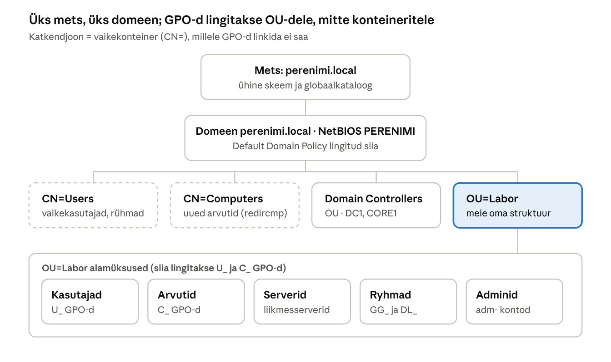

## 5. Active Directory Domain Services ja DNS

Active Directory on Windowsi võrgu „telefoniraamat ja turvamees“ korraga: see teab, kes on kasutajad ja arvutid, kontrollib nende identiteeti ning ütleb, mida neil lubatud on. DNS on AD vereringe – ilma korrektselt töötava DNS-ita ei leia kliendid domeenikontrollerit ning sisselogimine, GPO-d ja replikatsioon lakkavad töötamast. **Enamik AD probleeme on tegelikult DNS-i probleemid.**

### 5.1 Loogiline ja füüsiline struktuur

AD-l on kaks vaadet, mis on teineteisest sõltumatud:

- **Loogiline struktuur** (mets → domeen → OU → objektid) peegeldab organisatsiooni ja haldust: kes keda haldab, millised poliitikad kehtivad.
- **Füüsiline struktuur** (saidid → alamvõrgud → domeenikontrollerid) peegeldab võrku: kus serverid asuvad ja kuidas replikatsioon liigub.

Laboris on üks mets, üks domeen ja üks sait. Kavandatav OU-struktuur on näidatud allolevas skeemis.



*Joonis: perenimi.local loogiline struktuur · mets, domeen, konteinerid ja OU-d*

Vaikekonteinerid `Users` ja `Computers` on olemas igas domeenis, kuid neile GPO-sid linkida ei saa; seetõttu luuakse oma OU `Labor` ja selle alla üksused.

### 5.2 Kuidas klient domeenikontrolleri leiab

1. Klient teab oma domeeni nime (`perenimi.local`) ja DNS-serveri aadressi (DHCP valik 006).
2. Klient küsib DNS-ilt SRV-kirjet `_ldap._tcp.dc._msdcs.perenimi.local`.
3. DNS vastab DC-de nimede ja portidega (`dc1.perenimi.local:389`, `core1.perenimi.local:389`).
4. Klient küsib nende A-kirjed, saab IP-aadressid ja võtab ühendust (LDAP 389, Kerberos 88).
5. DC vastab ja kinnitab, millises saidis klient asub; klient eelistab edaspidi oma saidi DC-d.

Seetõttu kehtib kõige olulisem AD reegel: **domeeni liikmete (kõik kliendid ja serverid) DNS-serveriks tohib olla ainult domeeni DNS-server.** Kui Windows 11 kliendi DNS on 8.8.8.8, ei leia ta domeeni üles. Interneti nimed lahendab domeeni DNS edastaja (*forwarder*) kaudu.

> **Interaktiivne harjutus:** [Autentimise ja autoriseerimise simulaator](https://valdonolvak.github.io/windows-server-2022-oppematerjal/interaktiivne/autentimise-simulaator.html) – domeeniga liitmine, arvuti käivitamine, kasutaja sisselogimine (Kerberos, PAC, token, GPO-d) ja ligipääs failiserverile samm-sammult; lülita sisse rikkeid ja vaata, kus ahel katkeb.

### 5.3 Domeenikontrolleri paigaldus

DC loomine on kaheastmeline: esmalt paigaldatakse roll (binaarfailid), seejärel **ülendatakse** (*promote*) server domeenikontrolleriks. Ülendamisel tuleb valida üks kolmest:

| Valik | Millal | PowerShelli käsk |
| --- | --- | --- |
| Add a new forest | Esimene DC uues organisatsioonis | `Install-ADDSForest` |
| Add a domain controller to an existing domain | Lisa-DC olemasolevasse domeeni (tõrkekindlus, koormus) | `Install-ADDSDomainController` |
| Add a new domain to an existing forest | Uus laps- või puudomeen | `Install-ADDSDomain` |

Ülendamisel tekivad: AD andmebaas `C:\Windows\NTDS\ntds.dit`, logifailid, `SYSVOL` kaust, DNS-tsoonid (kui DNS valiti) ja vaikimisi konteinerid (`Users`, `Computers`, `Builtin`, `Domain Controllers`). Server taaskäivitub ja kohalik administraator muutub domeeni administraatoriks (`PERENIMI\Administrator`).

```powershell
# DC1: uus mets
Install-WindowsFeature AD-Domain-Services -IncludeManagementTools
Install-ADDSForest -DomainName "perenimi.local" -DomainNetbiosName "PERENIMI" `
  -ForestMode WinThreshold -DomainMode WinThreshold `
  -InstallDns -SafeModeAdministratorPassword (Read-Host -AsSecureString "DSRM parool")

# CORE1: teine DC samasse domeeni (CORE1 peab olema domeeni liidetud või saama domeeni admin tunnused)
Install-WindowsFeature AD-Domain-Services -IncludeManagementTools
Install-ADDSDomainController -DomainName "perenimi.local" -InstallDns `
  -Credential (Get-Credential PERENIMI\Administrator) `
  -SafeModeAdministratorPassword (Read-Host -AsSecureString "DSRM parool")
```

`WinThreshold` tähendab Windows Server 2016 funktsionaaltaset – see on Server 2022 kõrgeim tase.

### 5.4 DNS-i seadistus kahe DC-ga

Kahe DC korral peab iga DC kasutama DNS-ina esmalt **partnerit**, teisena iseennast loopback-aadressiga. Nii ei jää DC käivitumisel üksi „ootama“ ja replikatsioon käivitub kiiremini.

| Server | Eelistatud DNS | Alternatiivne DNS |
| --- | --- | --- |
| DC1 | 192.168.10.11 (CORE1) | 127.0.0.1 |
| CORE1 | 192.168.10.10 (DC1) | 127.0.0.1 |
| Kliendid (DHCP valik 006) | 192.168.10.10 | 192.168.10.11 |

Lisaks tuleb DNS-is teha:

1. **Pöördtsoon** (*reverse lookup zone*) `192.168.10.0/24` jaoks, et IP→nimi päringud (nt `nslookup` väljund ja logid) töötaksid.
2. **Edastajad** (*forwarders*) internetinimede jaoks, kui laboril on internetiühendus.
3. **Vananenud kirjete puhastus** (*scavenging*) – kustutab automaatselt dünaamilised kirjed, mida pole ammu uuendatud.

```powershell
# Pöördtsoon, replikeeritakse kogu domeeni DNS-serveritesse
Add-DnsServerPrimaryZone -NetworkId "192.168.10.0/24" -ReplicationScope Domain -DynamicUpdate Secure

# Edastaja
Set-DnsServerForwarder -IPAddress 1.1.1.1, 9.9.9.9

# Staatiline A-kirje ja PTR koos
Add-DnsServerResourceRecordA -ZoneName "perenimi.local" -Name "printer1" -IPv4Address 192.168.10.50 -CreatePtr

# CNAME (varjunimi)
Add-DnsServerResourceRecordCName -ZoneName "perenimi.local" -Name "failid" -HostNameAlias "core1.perenimi.local"
```

### 5.5 Kasutajad, rühmad, arvutid ja OU-d

**Nimekonventsioon** on administraatori parim sõber. Lepi see kokku enne objektide loomist ja dokumenteeri. Näide:

| Objekt | Konventsioon | Näide |
| --- | --- | --- |
| Kasutaja | `eesnimi.perenimi` | `mari.maasikas` |
| Administraatori konto | `adm-eesnimi.perenimi` (eraldi igapäevasest kontost) | `adm-mari.maasikas` |
| Globaalrühm (inimesed) | `GG_<osakond>` | `GG_Raamatupidamine` |
| Domeenilokaalne rühm (õigused) | `DL_<ressurss>_<õigus>` | `DL_Raamatupidamine_RW` |
| GPO | `<C/U>_<eesmärk>` | `U_Draivid`, `C_Tulemüür` |
| Arvuti | `<tüüp>-<nr>` | `WIN11-01` |

```powershell
# OU-struktuur
New-ADOrganizationalUnit -Name "Labor" -Path "DC=perenimi,DC=local"
"Kasutajad","Arvutid","Serverid","Ryhmad","Adminid" | ForEach-Object {
  New-ADOrganizationalUnit -Name $_ -Path "OU=Labor,DC=perenimi,DC=local"
}

# Kasutaja
New-ADUser -Name "Mari Maasikas" -GivenName Mari -Surname Maasikas `
  -SamAccountName mari.maasikas -UserPrincipalName mari.maasikas@perenimi.local `
  -Path "OU=Kasutajad,OU=Labor,DC=perenimi,DC=local" `
  -AccountPassword (Read-Host -AsSecureString "Algparool") `
  -ChangePasswordAtLogon $true -Enabled $true

# Rühm ja liikmesus
New-ADGroup -Name GG_Raamatupidamine -GroupScope Global -GroupCategory Security -Path "OU=Ryhmad,OU=Labor,DC=perenimi,DC=local"
Add-ADGroupMember GG_Raamatupidamine -Members mari.maasikas

# Uued arvutid otse õigesse OU-sse (mitte konteinerisse Computers)
redircmp "OU=Arvutid,OU=Labor,DC=perenimi,DC=local"
```

### 5.6 Kliendi liitmine domeeni

Eeldused: kliendi DNS osutab DC-le, kliendil on Windows 11 **Pro, Education või Enterprise** (Home ei saa domeeniga liituda) ja kell on õige.

- GUI: *Settings → System → About → Domain or workgroup* (või `sysdm.cpl`) → *Change* → *Domain*: `perenimi.local` → domeeni konto tunnused → taaskäivitus.
- PowerShell: `Add-Computer -DomainName perenimi.local -Credential PERENIMI\Administrator -Restart`

Domeeni liitmisel luuakse AD-sse arvutiobjekt ning arvuti ja domeeni vahel tekib turvakanal (*secure channel*) arvutikonto parooliga, mis vahetub automaatselt iga 30 päeva tagant. Turvakanali kontroll: `Test-ComputerSecureChannel -Verbose`.

### 5.7 Tervise kontroll

```powershell
dcdiag /v                       # DC üldtervis, sh DNS ja SYSVOL
dcdiag /test:dns /v             # ainult DNS
repadmin /replsummary           # replikatsiooni koond
repadmin /showrepl              # replikatsioon partneritega
netdom query fsmo               # kes hoiab FSMO rolle
nltest /dsgetdc:perenimi.local     # millise DC klient leiab
nslookup -type=SRV _ldap._tcp.dc._msdcs.perenimi.local
```

---

[← 4. Haldusvahendid](04-haldusvahendid.md) · [Sisukord](../README.md) · [6. DHCP →](06-dhcp.md)
