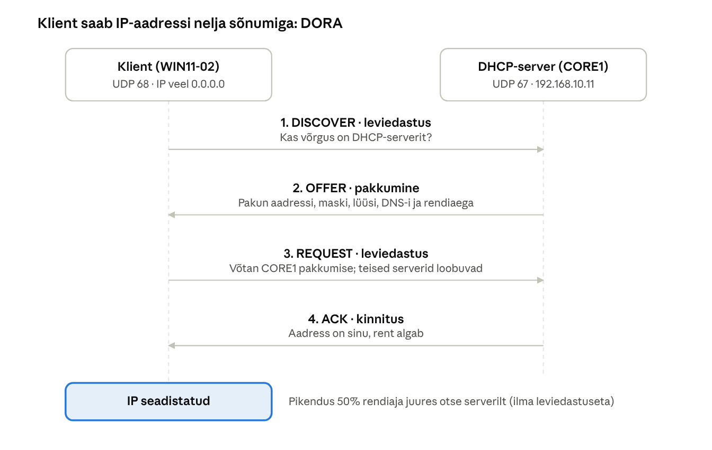

## 6. DHCP

DHCP säästab administraatorit iga kliendi käsitsi seadistamisest ja väldib aadressikonflikte. Laboris jagab aadresse CORE1; DC1-l DHCP-d ei ole, et WDS ja DHCP ei konkureeriks samal serveril pordi 67 pärast (vt peatükk 9).

### 6.1 Kuidas aadress saadakse (DORA)

Klient, kellel pole veel IP-aadressi, saadab kogu võrku leviedastuse (*broadcast*). Server vastab pakkumisega, klient valib selle ja server kinnitab. Kogu vestlus käib UDP portidel 67 (server) ja 68 (klient). Kuna leviedastus ei läbi ruuterit, vajab teises alamvõrgus asuv DHCP-server ruuteril **DHCP relay** (*IP helper*) seadistust.

Rendi pikendamine toimub ilma leviedastuseta: 50% rendiaja möödudes saadab klient serverile otse uue *Request*-i; kui server ei vasta, proovib ta uuesti 87,5% juures kõigi serverite poole.



*Joonis: DHCP DORA · 4 sõnumit kliendi ja serveri vahel*

Discover ja Request on leviedastused, sest kliendil pole veel aadressi; Request on leviedastus ka selleks, et teised DHCP-serverid teaksid oma pakkumise tagasi võtta.

### 6.2 Ulatus ja valikud

| Seade | Väärtus laboris | Selgitus |
| --- | --- | --- |
| Ulatuse nimi | `Labor-LAN` | Vabalt valitav kirjeldus |
| Vahemik | 192.168.10.100 – 192.168.10.200 | 101 aadressi klientidele |
| Mask | 255.255.255.0 | /24 |
| Välistus | 192.168.10.100 – 192.168.10.109 | Jäetud printeritele jm seadmetele |
| Rendiaeg | 8 päeva | Lühike (nt 4 h) külaliste WiFi-s, pikk kontoris |
| 003 Router | 192.168.10.1 | Vaikelüüs (jäta ära, kui laboris ruuterit pole) |
| 006 DNS Servers | 192.168.10.10, 192.168.10.11 | **Ainult** domeeni DNS-serverid |
| 015 DNS Domain Name | `perenimi.local` | Lisatakse lühinimedele |
| Reserveering | WIN11-01 MAC → 192.168.10.150 | Alati sama aadress |

Valikuid saab seada kolmel tasandil: **serveri** (kehtib kõigile ulatustele), **ulatuse** ja **reserveeringu** tasandil. Kitsam tasand võidab.

### 6.3 Paigaldus ja seadistus PowerShelliga

```powershell
# Kas otse CORE1-l või DC1-st: Enter-PSSession CORE1
Install-WindowsFeature DHCP -IncludeManagementTools

# Turvarühmad DHCP Administrators ja DHCP Users (GUI-s teeb seda post-install viisard)
netsh dhcp add securitygroups
Restart-Service DHCPServer

# Autoriseeri AD-s (vajab Enterprise Admins õigusi)
Add-DhcpServerInDC -DnsName core1.perenimi.local -IPAddress 192.168.10.11

# Ümber Server Manageri hoiatuse "configuration required"
Set-ItemProperty -Path HKLM:\SOFTWARE\Microsoft\ServerManager\Roles\12 -Name ConfigurationState -Value 2

# Ulatus, välistus, valikud
Add-DhcpServerv4Scope -Name "Labor-LAN" -StartRange 192.168.10.100 -EndRange 192.168.10.200 `
  -SubnetMask 255.255.255.0 -LeaseDuration 8.00:00:00 -State Active
Add-DhcpServerv4ExclusionRange -ScopeId 192.168.10.0 -StartRange 192.168.10.100 -EndRange 192.168.10.109
Set-DhcpServerv4OptionValue -ScopeId 192.168.10.0 -Router 192.168.10.1 `
  -DnsServer 192.168.10.10, 192.168.10.11 -DnsDomain perenimi.local

# Reserveering (MAC kujul 00-50-56-xx-xx-xx)
Add-DhcpServerv4Reservation -ScopeId 192.168.10.0 -IPAddress 192.168.10.150 -ClientId "00-50-56-AA-BB-CC" -Name WIN11-01

# Kontroll
Get-DhcpServerv4Scope
Get-DhcpServerv4Lease -ScopeId 192.168.10.0
```

### 6.4 DHCP ja DNS koostöö

DHCP-server võib klientide eest DNS-kirjeid registreerida (*DNS dynamic updates*). See on oluline mitte-Windowsi seadmete puhul. Soovitused: määra DHCP-le eraldi teenusekonto DNS-kirjete registreerimiseks (*DNS Dynamic Update Credentials*) ja lülita sisse kirjete kustutamine rendi lõppemisel.

### 6.5 Tõrkekindlus

Üks DHCP-server on üks rikkepunkt. Windows Server toetab **DHCP failover**'it kahe serveri vahel:

- **Load balance** – mõlemad serverid jagavad aadresse korraga (vaikimisi 50/50).
- **Hot standby** – üks on aktiivne, teine ootel ja võtab üle, kui esimene kaob (sobib harukontorile).

Laboris on see lisaülesanne (Labor 4, boonus), kui DC1-le paigaldada samuti DHCP. Sel juhul tuleb WDS-i jaoks teha erilised seaded (peatükk 9).

### 6.6 Tüüpilised probleemid

| Sümptom | Tõenäoline põhjus | Kontroll / lahendus |
| --- | --- | --- |
| Klient saab 169.254.x.x aadressi | DHCP-server ei vasta: teenus seisab, ulatus pole aktiivne, server pole autoriseeritud, VM vales võrgus | `Get-Service DHCPServer`, `Get-DhcpServerInDC`, VM-i võrguadapter |
| Klient saab vale DNS-i | Valik 006 vale või võrgus on teine DHCP (nt Proxmoxi SDN-i DHCP või koolivõrgu DHCP) | `ipconfig /all` – vaata *DHCP Server* rida |
| Aadressid otsas | Vahemik liiga väike või rendid liiga pikad | `Get-DhcpServerv4ScopeStatistics` |
| Kliendil vana aadress | Rent pole veel aegunud | `ipconfig /release` ja `ipconfig /renew` |

> **Proxmoxi lõks:** kui laboritääb Proxmoxi SDN-i *Simple* tsooni, saab VNetil sisse lülitada Proxmoxi enda DHCP (dnsmasq). Laborivõrgus peab see olema väljas ja sild ei tohi olla ühendatud võrku, kus on teine DHCP-server (nt kooli võrk), muidu saavad kliendid aadressi valelt serverilt.

---

[← 5. Active Directory Domain Services ja DNS](05-active-directory-ja-dns.md) · [Sisukord](../README.md) · [7. Rühmapoliitika (GPO) →](07-ruhmapoliitika-gpo.md)
