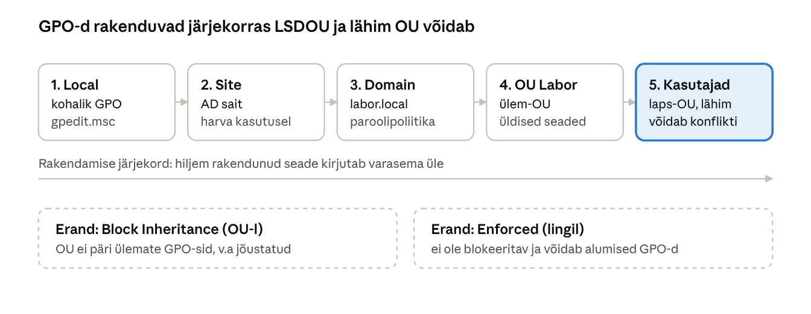
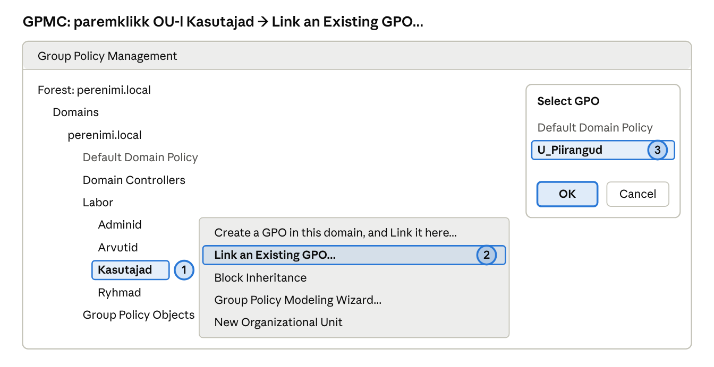

## 7. Rühmapoliitika (GPO)

Rühmapoliitika lubab ühe muudatusega seadistada sadu arvuteid ja kasutajaid. Selle asemel, et iga arvuti juurde minna, kirjeldab administraator soovitud seisundi GPO-s, lingib selle õigesse kohta AD-s ja kliendid rakendavad selle ise.

### 7.1 GPO ülesehitus

- **Group Policy Container (GPC)** asub AD andmebaasis (`CN=Policies,CN=System`) ning hoiab GPO nime, versiooni ja õigusi.
- **Group Policy Template (GPT)** asub kaustas `\\perenimi.local\SYSVOL\perenimi.local\Policies\{GUID}` ning hoiab seadeid ennast (`Registry.pol`, skriptid, turvaseaded).

Mõlemad replikeeritakse kõigile DC-dele (GPC AD replikatsiooniga, GPT DFSR-iga). Kui need lahku lähevad, tekivad imelikud vead – seetõttu kontrollib `dcdiag` ka SYSVOL-i.

Igal GPO-l on kaks poolt:

| Pool | Rakendub | Millal | Näited |
| --- | --- | --- | --- |
| Computer Configuration | Arvutiobjektidele OU-s | Arvuti käivitumisel ja iga 90 ± 30 min tagant | Tulemüür, BitLocker, tarkvara paigaldus, kohalikud administraatorid, auditeerimine |
| User Configuration | Kasutajaobjektidele OU-s | Sisselogimisel ja iga 90 ± 30 min tagant | Töölaua taust, draivide kaardistamine, juhtpaneeli keelamine, kaustade ümbersuunamine |

DC-del värskenevad poliitikad iga 5 minuti tagant. Kohe rakendamiseks: `gpupdate /force` kliendil või GPMC-s OU paremklikk → *Group Policy Update*.

### 7.2 Rakendamise järjekord ja pärimine

Poliitikad rakenduvad järjekorras **L → S → D → OU** (vt skeem allpool). Kui kaks GPO-d seavad sama seade erinevalt, võidab **viimasena rakendunud**, st arvutile või kasutajale lähim OU. Ühe lingi juures olevate GPO-de puhul rakendatakse esmalt suurima *Link Order* numbriga ja viimasena nr 1, seega nr 1 võidab.



*Joonis: GPO rakendamise järjekord LSDOU · 5 tasandit, 2 erandit*

Mida lähemal objektile GPO on lingitud, seda hiljem see rakendub ja seda suurem on tema sõna konflikti korral.

> **Interaktiivne harjutus:** [GPO rakendamise simulaator](https://valdonolvak.github.io/Windows-serveri-haldus/interaktiivne/gpo-simulaator.html) – lülita linke, *Enforced*, *Block Inheritance* ja turvafiltrit, käi rakendamine samm-sammult läbi ja lahenda kuus stsenaariumiülesannet.

Erandid tavajärjekorrast:

1. **Block Inheritance** OU-l – ülemate GPO-sid ei pärita (v.a jõustatud).
2. **Enforced** lingil – GPO ei ole blokeeritav ja võidab ka alumisi GPO-sid.
3. **Security filtering** – GPO rakendub ainult valitud kasutajatele/arvutitele/rühmadele. Kui eemaldad *Authenticated Users*, lisa *Delegation* vahekaardil *Domain Computers* lugemisõigus, muidu GPO ei rakendu (MS16-072 muudatus).
4. **WMI-filter** – tingimus arvuti omaduste põhjal.
5. **Loopback processing** – kasutajaseaded tulevad arvuti OU-st (arvutiklassid).

### 7.3 Vaikimisi GPO-d

| GPO | Lingitud | Mida sisaldab | Soovitus |
| --- | --- | --- | --- |
| Default Domain Policy | Domeen | Paroolipoliitika, konto lukustus, Kerberose seaded | Muuda **ainult** konto- ja paroolipoliitikat; muud seaded tee eraldi GPO-sse |
| Default Domain Controllers Policy | OU `Domain Controllers` | DC-de kasutajaõigused ja auditeerimine | Ära kasuta üldiseks seadistuseks |

Oluline: domeeni kasutajate paroolipoliitika (pikkus, keerukus, vanus) saab kehtida **ainult domeeni tasandil lingitud GPO-st**. OU-le lingitud paroolipoliitika mõjutab vaid selle OU arvutite kohalikke kontosid. Erinevate paroolinõuete jaoks eri rühmadele kasuta **Fine-Grained Password Policy** (ADAC → *System → Password Settings Container*).

### 7.4 Levinud GPO-d, mida laboris tehakse

| GPO nimi | Link | Seade (asukoht) |
| --- | --- | --- |
| `Default Domain Policy` (muuda) | Domeen | *Computer → Policies → Windows Settings → Security Settings → Account Policies*: min parool 12 märki, lukustus 10 vale katse järel 15 min |
| `U_Draivid` | OU Kasutajad | *User → Preferences → Windows Settings → Drive Maps*: `H:` = `\\perenimi.local\Andmed\Kasutajad\%LogonUser% (vt ptk 15)`, `S:` = `\\core1\Osakonnad` |
| `U_Piirangud` | OU Kasutajad | *User → Policies → Administrative Templates → Control Panel*: *Prohibit access to Control Panel and PC settings* |
| `U_Taust` | OU Kasutajad | *User → Policies → Admin Templates → Desktop → Desktop*: *Desktop Wallpaper* = `\\perenimi.local\NETLOGON\taust.jpg` |
| `C_Tulemyyr` | OU Arvutid | *Computer → Policies → Windows Settings → Security Settings → Windows Defender Firewall*: domeeniprofiil sees, ICMP lubatud |
| `C_KohalikudAdminid` | OU Arvutid | *Computer → Preferences → Control Panel Settings → Local Users and Groups*: rühma *Administrators* lisatakse `PERENIMI\GG_IT` |
| `C_Uuendused` | OU Arvutid | *Computer → Policies → Admin Templates → Windows Components → Windows Update*: automaatne paigaldus kell 03:00 |

### 7.5 GPO-de loomine ja haldus

> **NB!** Allpool on sama töö kahel viisil: **A) GUI** ja **B) PowerShell**. Piisab ühest – kui teed GUI juhendi järgi, pole PowerShelli osa vaja (ja vastupidi).

#### Variant A: GUI (samm-sammult)

1. DC1: *Server Manager → Tools → Group Policy Management* (`gpmc.msc`) → *Forest → Domains → perenimi.local*.
2. **Loo GPO:** paremklikk *Group Policy Objects* → **New** → *Name* `U_Piirangud` → OK.
3. **Seade:** paremklikk `U_Piirangud` → **Edit** → *User Configuration → Policies → Administrative Templates → Control Panel* → **Prohibit access to Control Panel and PC settings** → *Enabled* → OK. Kommentaari saab lisada redaktoris: paremklikk GPO nimel puu tipus → *Properties → Comment*. Sulge redaktor.
4. **Lingi:** paremklikk OU-l *Labor → Kasutajad* → **Link an Existing GPO...** → `U_Piirangud` → OK.
5. **Pärimine:** vali OU *Kasutajad* → vahekaart **Group Policy Inheritance** näitab kõiki sinna mõjuvaid GPO-sid järjekorras.
6. **Varundus:** paremklikk *Group Policy Objects* → **Back Up All...** → kaust `C:\GPO-varukoopia` → *Back Up*.
7. **Aruanne:** vali GPO → vahekaart **Settings** (või paremklikk GPO → *Save Report...* → HTML).



*Skeem · GPMC: Link an Existing GPO*

#### Variant B: PowerShell

```powershell
New-GPO -Name "U_Piirangud" -Comment "Keelab juhtpaneeli tavakasutajatel"
New-GPLink -Name "U_Piirangud" -Target "OU=Kasutajad,OU=Labor,DC=perenimi,DC=local"
Set-GPRegistryValue -Name "U_Piirangud" -Key "HKCU\Software\Microsoft\Windows\CurrentVersion\Policies\Explorer" `
  -ValueName NoControlPanel -Type DWord -Value 1

Get-GPInheritance -Target "OU=Kasutajad,OU=Labor,DC=perenimi,DC=local"   # mis sinna päritakse
Backup-GPO -All -Path C:\GPO-varukoopia                                # varunda kõik GPO-d
Get-GPOReport -Name "U_Piirangud" -ReportType Html -Path C:\aruanne.html
```

### 7.6 Tõrkeotsing

1. **Kas GPO üldse rakendus?** Kliendil `gpresult /r` (kokkuvõte) või `gpresult /h C:\gp.html` (täielik HTML-aruanne). Vaata *Applied GPOs* ja *Denied GPOs* (põhjus, nt *Security filtering* või *Empty*).
2. **Kas objekt on õiges OU-s?** Kasutajaseadega GPO arvutite OU-l ei mõju (v.a loopback).
3. **Kas link on lubatud ja GPO pool sisse lülitatud?** GPMC → GPO → *Details* → *GPO Status*.
4. **Kas replikatsioon on lõppenud?** `repadmin /showrepl`.
5. **Mudeldamine ette:** GPMC → *Group Policy Modeling* (mis juhtuks) ja *Group Policy Results* (mis juhtus).
6. **Logid:** Event Viewer → *Applications and Services Logs → Microsoft → Windows → GroupPolicy → Operational*.

---

[← 6. DHCP](06-dhcp.md) · [Sisukord](../README.md) · [8. Failiteenused ja õigused →](08-failiteenused-ja-oigused.md)
