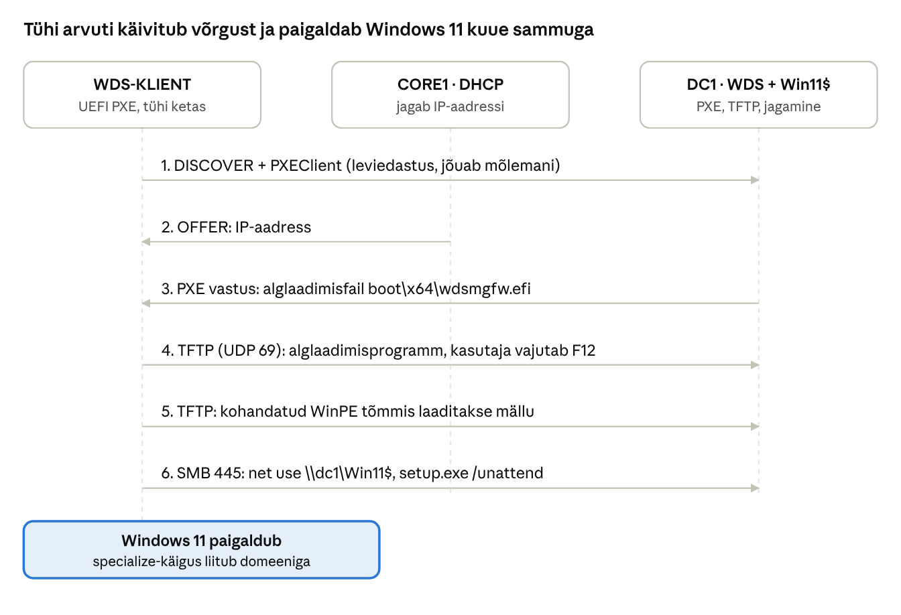

## 9. WDS ja võrgupaigaldus (PXE)

WDS laseb tühja kettaga arvutil käivituda võrgust ja paigaldada operatsioonisüsteemi ilma USB-pulga või DVD-ta. Windows 11 puhul on WDS-i roll 2026. aastaks kitsenenud: WDS jagab endiselt PXE-alglaadimist ja kohandatud WinPE alglaadimistõmmist, kuid Windows 11 paigaldust ennast **ei saa enam teha ainult WDS-i vahenditega**.

### 9.1 Mis on muutunud (oluline!)

| Muudatus | Mida see tähendab laboris |
| --- | --- |
| Windows 11 paigaldusmeedia `boot.wim` kasutamine WDS-i alglaadimistõmmisena on blokeeritud. Microsofti tabeli järgi on Windows 11 paigaldus WDS-režiimis blokeeritud kõigi meedia `boot.wim` versioonidega ([WDS boot.wim support](https://learn.microsoft.com/windows/deployment/wds-boot-support)). | Klassikaline „lisa `boot.wim` ja `install.wim` ISO-st“ meetod Windows 11 puhul ei toimi. |
| PXE-alglaadimist see ei mõjuta: WDS-iga saab endiselt käivitada kohandatud alglaadimistõmmiseid ning Windows Setupi saab käivitada võrgujagamiselt. | Laboris teeme Windows ADK-ga oma WinPE tõmmise, mis käivitab `setup.exe` jagamiselt. |
| CVE-2026-0386 tõttu on WDS-i nn *hands-free* paigaldus (vastusfail `unattend.xml` WDS-i kaudu) alates 14.04.2026 uuendustest vaikimisi keelatud. Taaslubamine registrivõtmega `AllowHandsFreeFunctionality = 1` on võimalik, kuid Microsoft seda ei soovita ([KB5074952](https://support.microsoft.com/kb/5074952)). | WDS-i serveri omadustes vastusfaili määramine (*Client → Enable unattended installation*) enam ei tööta. Vastusfail antakse `setup.exe`-le otse. |

Tootmises soovitab Microsoft WDS-i täieliku paigaldusahela asemel kasutada Configuration Managerit, Windows Autopiloti või muud kohandatud WinPE-l põhinevat lahendust. WDS-i õppimine on endiselt kasulik, sest PXE, DHCP koostöö, WinPE ja vastusfailid on samad mõisted ka nendes tööriistades.

### 9.2 Kuidas PXE-paigaldus töötab

1. WDS-KLIENT lülitatakse sisse, püsivara käivitab võrgukaardi PXE kliendi.
2. Klient saadab DHCPDISCOVER-i koos märkega „olen PXE klient“ (valik 60 = `PXEClient`) ja arhitektuuriga (valik 93, nt x64 UEFI).
3. CORE1 (DHCP) pakub IP-aadressi. Samal ajal vastab DC1 (WDS) PXE-pakkumisega: „alglaadimisfail on minu juures, `boot\x64\wdsmgfw.efi`“.
4. Klient laeb TFTP-ga (UDP 69) alglaadimisprogrammi, kasutaja vajutab **F12** (või Enter) võrgust käivitamiseks.
5. Laaditakse WDS-i alglaadimishaldur ja valitud alglaadimistõmmis (meie kohandatud WinPE) mällu.
6. WinPE käivitub, `startnet.cmd` ühendab paigaldusjagamise ja käivitab `setup.exe` vastusfailiga.
7. Windows Setup kirjutab Windows 11 kettale, taaskäivitab arvuti ja OOBE järel on arvuti kasutusvalmis (soovi korral ka domeeni liidetud).



*Joonis: PXE-paigaldus laboris · klient, DHCP ja WDS*

DHCP ja WDS vastavad samale DISCOVER-ile eraldi: CORE1 annab aadressi, DC1 ütleb, kust alglaadimisfail tuleb.

### 9.3 WDS ja DHCP samas või eri serveris

| Olukord | Mis tuleb teha |
| --- | --- |
| DHCP ja WDS eri serverites, samas alamvõrgus (**meie labor**) | Midagi lisaks: WDS kuulab DHCP leviedastusi ja vastab PXE klientidele ise. |
| DHCP ja WDS **samas** serveris | WDS ei tohi kasutada porti 67: `wdsutil /Set-Server /UseDhcpPorts:No /DhcpOption60:Yes` (GUI-s *WDS Properties → DHCP*: mõlemad linnukesed). |
| Klient teises alamvõrgus | Ruuteril IP helper / DHCP relay nii DHCP- kui ka WDS-serveri aadressile. |
| DHCP valikud 066/067 | Väldi: need suunavad kõik kliendid ühe faili juurde ega erista BIOS-i ja UEFI-t. Sobivad ainult siis, kui muud võimalust pole. |

### 9.4 WDS-i paigaldus ja seadistus DC1-l

WDS vajab: AD-d (integreeritud režiimis), toimivat DNS-i ja DHCP-d võrgus ning NTFS-köidet tõmmiste jaoks (mitte süsteemiketast).

```powershell
Install-WindowsFeature WDS -IncludeManagementTools

# RemoteInstall kaust andmekettal E:, AD-integreeritud režiim
wdsutil /Initialize-Server /RemInst:"E:\RemoteInstall"

# Vasta kõigile PXE klientidele (ka tundmatutele), nõua F12
wdsutil /Set-Server /AnswerClients:All
wdsutil /Set-Server /PxePromptPolicy /Known:OptIn /New:OptIn

# Uued arvutiobjektid õigesse OU-sse
wdsutil /Set-Server /NewMachineOU /Type:Custom /OU:"OU=Arvutid,OU=Labor,DC=perenimi,DC=local"
```

GUI-s: `wdsmgmt.msc` → server → paremklikk *Configure Server* → *Integrated with Active Directory* → tee `E:\RemoteInstall` → *Respond to all client computers (known and unknown)*.

### 9.5 Kohandatud WinPE alglaadimistõmmis

Kohandatud WinPE tehakse **Windows ADK** ja selle **WinPE lisandmooduli** abil (mõlemad tasuta Microsofti saidilt; vali Windows 11 versioonile vastav ADK). Paigalda need DC1-le.

1. Ava *Deployment and Imaging Tools Environment* administraatorina.
2. Loo töökaust: `copype amd64 C:\WinPE_amd64`
3. Haagi tõmmis muutmiseks: `dism /Mount-Image /ImageFile:C:\WinPE_amd64\media\sources\boot.wim /Index:1 /MountDir:C:\WinPE_amd64\mount`
4. Muuda faili `C:\WinPE_amd64\mount\Windows\System32\startnet.cmd` (vt allpool).
5. Vajadusel lisa võrgu- ja kettadraiverid: `dism /Image:C:\WinPE_amd64\mount /Add-Driver /Driver:C:\Draiverid /Recurse` (Proxmoxi VirtIO võrgukaardi ja VirtIO SCSI puhul vajalik: virtio-win ISO kaustad NetKVM\\w11\\amd64 ja vioscsi\\w11\\amd64; võrgukaardi mudel Intel E1000E töötab ilma lisadraiverita).
6. Salvesta: `dism /Unmount-Image /MountDir:C:\WinPE_amd64\mount /Commit`
7. Lisa WDS-i: `wdsmgmt.msc` → *Boot Images* → *Add Boot Image* → `C:\WinPE_amd64\media\sources\boot.wim`, nimi näiteks „Windows 11 paigaldus (WinPE)“. PowerShellis: `Import-WdsBootImage -Path C:\WinPE_amd64\media\sources\boot.wim -NewImageName "Win11 WinPE"`

`startnet.cmd` näidis:

```bat
wpeinit
rem Oota, kuni võrk on üleval
ping -n 6 dc1.perenimi.local >nul
rem Paigaldusjagamine, ainult lugemisõigusega teenusekonto
net use Z: \\dc1.perenimi.local\Win11$ /user:PERENIMI\svc-deploy
Z:\setup.exe /unattend:Z:\autounattend.xml
```

`net use` küsib parooli, kui see pole käsureal. **Ära kirjuta domeeniadministraatori parooli** `startnet.cmd`-sse ega vastusfaili: WinPE tõmmisfail ja vastusfail on võrgus loetavad. Kasuta eraldi kontot `svc-deploy`, millel on ainult lugemisõigus jagamisele `Win11$`.

### 9.6 Paigaldusjagamine ja vastusfail

1. Kopeeri Windows 11 ISO-tõmmisfaili kogu sisu kausta `E:\Win11` ja jaga see nimega `Win11$` (õigus: `svc-deploy` – Read).
2. Koosta vastusfail **WSIM**-iga (*Windows System Image Manager*, tuleb ADK-ga): ava `install.wim`-i kataloog, lisa komponendid ja salvesta `E:\Win11\autounattend.xml`.

Vastusfaili seaded on jagatud **konfiguratsioonikäikudesse** (*configuration passes*):

| Käik | Millal täidetakse | Tavalised seaded |
| --- | --- | --- |
| windowsPE | WinPE-s enne kettale kirjutamist | Keel, kettapartitsioonid, tootevõti, millist väljaannet paigaldada, EULA nõusolek |
| offlineServicing | Tõmmisele enne esimest käivitust | Draiverid, uuendused |
| specialize | Esimesel käivitusel | Arvutinimi, ajavöönd, **domeeni liitmine** (*UnattendedJoin*) |
| oobeSystem | OOBE ajal | OOBE kuvade vahelejätmine, kohalik konto, piirkond |

Peatükis 11 (Labor 9) on toodud minimaalne vastusfail. WDS-KLIENT VM peab olema **UEFI + Secure Boot + vTPM**, muidu peatub Windows 11 paigaldus nõuete kontrollil.

### 9.7 Tõrkeotsing

| Sümptom | Põhjus ja lahendus |
| --- | --- |
| *PXE-E16: No offer received* / *No valid offer received* | Klient ei saa DHCP pakkumist: VM vales võrgus, DHCP ei tööta, Proxmoxi SDN-i või muu võõras DHCP segab. |
| *PXE-E53: No boot filename received* | DHCP vastab, kuid WDS mitte: `WDSServer` teenus seisab, WDS pole konfigureeritud, *AnswerClients* = None, DHCP ja WDS samas serveris ilma seadeteta (9.3). |
| *TFTP timeout* / aeglane laadimine | Tulemüür blokeerib UDP 69 või 64001–65000; proovi `wdsutil /Set-TransportServer /ObtainIpv4From:Range` ja vaata TFTP ploki suurust (*Boot Image Properties → TFTP*). |
| UEFI Secure Boot keelab käivituse | Kasuta ADK WinPE-d (Microsofti allkirjaga); ära kasuta allkirjata draivereid. |
| WinPE-s puudub võrk | Puudub võrgukaardi draiver (VirtIO NetKVM) – lisa see tõmmisesse või kasuta E1000E adapterit. |
| *Windows 11 can't run on this PC* | VM-il puudub TPM 2.0, Secure Boot või on alla 4 GB mälu. |
| *Windows Deployment Services client functionality is being partly deprecated* | Kasutasid meedia `boot.wim`-i. Kasuta kohandatud WinPE-d (9.5). |

---

[← 8. Failiteenused ja õigused](08-failiteenused-ja-oigused.md) · [Sisukord](../README.md) · [10. Uuendused, monitooring, varundus ja turvalisus →](10-uuendused-monitooring-varundus-turvalisus.md)
