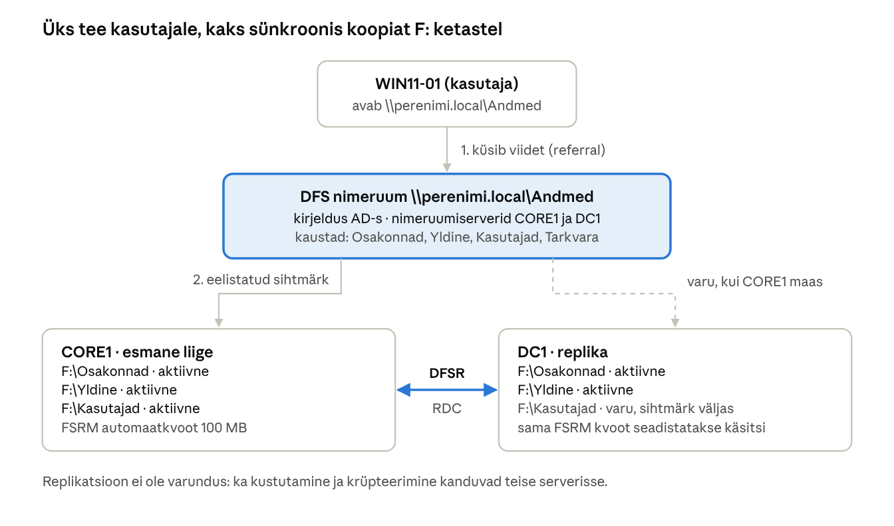
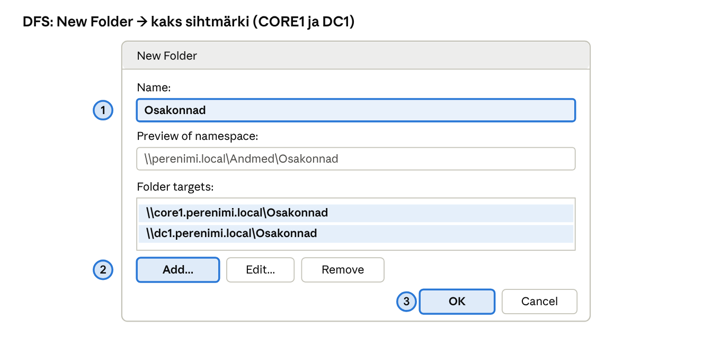
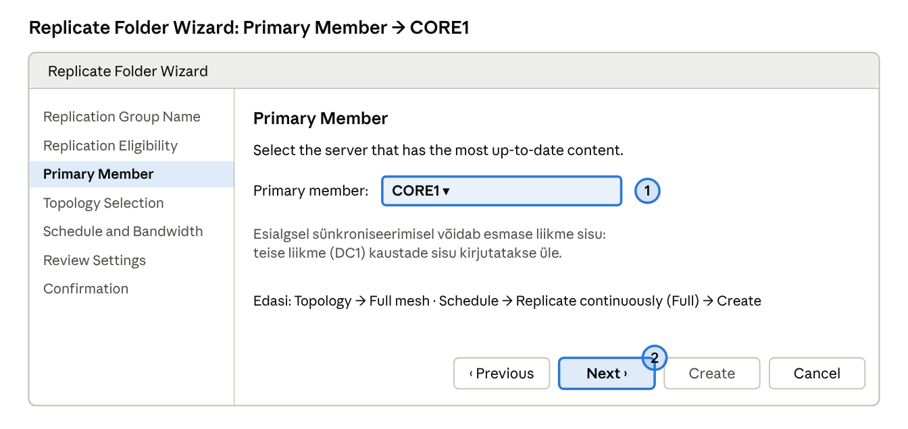

## 14. DFS – hajutatud failisüsteem

DFS (*Distributed File System*) koosneb kahest iseseisvast tehnoloogiast, mida tavaliselt kasutatakse koos. **DFS Namespaces** (nimeruum) annab kasutajatele ühe püsiva tee `\\perenimi.local\Andmed`, mis peidab, millises serveris failid tegelikult asuvad. **DFS Replication** (replikatsioon) hoiab sama kausta sisu mitmes serveris sünkroonis. Koos annavad need tõrkekindluse: kui CORE1 on maas, suunatakse kliendid DC1 koopia juurde ja kasutaja ei pea midagi muutma.

### 14.1 Mõisted

| Termin (EN) | Selgitus | Näide laboris |
| --- | --- | --- |
| Nimeruum (*namespace*) | Virtuaalne kaustapuu, mille kaudu kasutajad faile leiavad. | `\\perenimi.local\Andmed` |
| Domeenipõhine nimeruum (*domain-based*) | Nimeruumi kirjeldus hoitakse AD-s ja tee algab domeeninimega; mitu nimeruumiserverit annavad tõrkekindluse. Režiim *Windows Server 2008 mode* toetab ABE-d ja suurt kaustade arvu. | Meie valik |
| Eraldiseisev nimeruum (*stand-alone*) | Tee algab serveri nimega (`\\core1\Andmed`), tõrkekindlus ainult klastriga. | Ei kasuta |
| Nimeruumiserver (*namespace server*) | Server, mis hoiab nimeruumi juurt ja vastab klientide päringutele. | CORE1 ja DC1 |
| Juur (*namespace root*) | Nimeruumi tipp; igal nimeruumiserveril on selle jaoks jagatud kaust. | `F:\DFSRoots\Andmed` |
| Kaust (*folder*) | Nimeruumi alamkaust, mis viitab ühele või mitmele tegelikule jagamisele. | `Osakonnad`, `Yldine`, `Kasutajad` |
| Kausta sihtmärk (*folder target*) | Tegelik UNC-tee, kuhu nimeruumi kaust viitab. Mitu sihtmärki = tõrkekindlus. | `\\core1\Osakonnad`, `\\dc1\Osakonnad` |
| Viide (*referral*) | Nimeruumiserveri vastus kliendile: sihtmärkide nimekiri eelistuse järjekorras. Klient hoiab seda vahemälus (vaikimisi 300 s kaustadele). | `dfsutil cache referral flush` |
| Replikatsioonirühm (*replication group*) | Serverite kogum, mis replikeerivad ühte või mitut kausta omavahel. | `RG-Osakonnad` |
| Replikeeritav kaust (*replicated folder*) | Kaust, mille sisu hoitakse liikmetes ühesugusena. | `F:\Osakonnad` mõlemas serveris |
| Liige / ühendus (*member / connection*) | Liige on replikatsioonis osalev server; ühendus on suunatud replikatsioonitee kahe liikme vahel. | CORE1 ↔ DC1 |
| Topoloogia | Ühenduste muster: **full mesh** (kõik kõigiga, kuni \~10 liiget) või **hub and spoke** (keskus + harud). | Full mesh, 2 liiget |
| Esmane liige (*primary member*) | Esimesel sünkroniseerimisel autoriteetne liige: tema sisu võidab. | CORE1 |
| Ettevalmistuskaust (*staging*) | Ajutine kaust failide pakkimiseks enne saatmist; vaikimisi kvoot 4 GB. Peab olema suurem kui suurimad failid. | `F:\Osakonnad\DfsrPrivate\Staging` |
| Konfliktid (*Conflict and Deleted*) | Kui sama faili muudetakse kahes serveris korraga, võidab **viimane salvestaja**; kaotaja fail teisaldatakse kausta `ConflictAndDeleted`. | — |
| RDC (*Remote Differential Compression*) | Saadetakse ainult faili muutunud plokid, mitte terve fail. | Vaikimisi sees |

> **DFS replikatsioon ei ole varundus.** Kui kasutaja kustutab faili või lunavara krüpteerib selle, replikeeritakse kustutamine ja krüpteeritud fail sekunditega kõigisse serveritesse.

### 14.2 Laboris kavandatav nimeruum

| Nimeruumi kaust | Sihtmärgid | Replikatsioon | Selgitus |
| --- | --- | --- | --- |
| `\\perenimi.local\Andmed\Osakonnad` | `\\core1\Osakonnad` (F:), `\\dc1\Osakonnad` (F:) | `RG-Osakonnad`, mõlemad aktiivsed | Osakondade kaustad, tõrkekindel |
| `\\perenimi.local\Andmed\Yldine` | `\\core1\Yldine` (F:), `\\dc1\Yldine` (F:) | `RG-Yldine`, mõlemad aktiivsed | Üldkaust kõigile |
| `\\perenimi.local\Andmed\Kasutajad` | `\\core1\Kasutajad$` (aktiivne), `\\dc1\Kasutajad$` (**väljalülitatud**) | `RG-Kasutajad`, DC1 on „soe varu“ | Isiklikud kaustad (peatükk 15) |
| `\\perenimi.local\Andmed\Tarkvara` | `\\core1\Tarkvara` | ei replikeerita | MSI paketid (peatükk 16) |

Miks on kasutajakaustade teine sihtmärk välja lülitatud? Kasutaja dokumente muudetakse pidevalt. Kui kaks sihtmärki oleksid korraga aktiivsed ja kasutaja satuks eri seanssides eri serverisse, tekiksid failikonfliktid ning võidaks viimane salvestaja. Microsoft toetab ümbersuunatud kaustade replikeerimist ainult siis, kui korraga kasutatakse ühte sihtmärki. CORE1 rikke korral lülitab administraator DC1 sihtmärgi käsitsi sisse.



*Joonis: DFS nimeruum ja replikatsioon · CORE1 ja DC1 F: kettad*

Nimeruum ainult suunab: klient küsib viite ja avab faili otse serverist. Andmeid kopeerib serverite vahel DFS replikatsioon.

### 14.3 Paigaldus ja seadistus

> **NB!** Allpool on sama töö kahel viisil: **A) GUI** ja **B) PowerShell**. Piisab ühest – kui teed GUI juhendi järgi, pole PowerShelli osa vaja (ja vastupidi). Kõik GUI-sammud tehakse DC1-st.

#### Variant A: GUI (samm-sammult)

1. **Rollid:** *Server Manager → Add Roles and Features* → server **CORE1** → *File and Storage Services → File and iSCSI Services* → märgi **File Server**, **DFS Namespaces**, **DFS Replication** → *Add Features* → *Install*. Korda sama serverile **DC1** (DC1-le tuleb nii ka konsool *DFS Management*).
2. **DC1 ketas F:** `diskmgmt.msc` → uus ketas *Online* → *Initialize Disk* (GPT) → *New Simple Volume* → täht **F**, NTFS, silt `Andmed` (vt 3.6).
3. **Jagamised mõlemas serveris:** *File and Storage Services → Shares → TASKS → New Share... → SMB Share – Quick* → server CORE1 → *Type a custom path* (puuduva kausta loob viisard ise):
   - `F:\Osakonnad` → nimi `Osakonnad`, **Enable access-based enumeration**, *Share*-õigused: *Authenticated Users* **Change**, *Domain Admins* **Full Control**;
   - `F:\Yldine` → nimi `Yldine`, samad õigused;
   - `F:\Kasutajad` → nimi `Kasutajad$`, **Enable access-based enumeration**, *Authenticated Users* **Full Control** (NTFS-õigused vt 15.3).

   Korda sama serverile **DC1**. Juurkausta jagamise `Andmed` loob nimeruumi viisard järgmises sammus ise.
4. **Nimeruum:** *Tools → DFS Management* → paremklikk *Namespaces* → **New Namespace...** → *Server* `CORE1` → *Name* `Andmed` → *Edit Settings...*: *Local path* `F:\DFSRoots\Andmed`, *Administrators have full access; other users have read-only permissions* → **Domain-based namespace**, märgitud **Enable Windows Server 2008 mode** → *Create*.
5. **ABE nimeruumis:** paremklikk `\\perenimi.local\Andmed` → *Properties → Advanced* → märgi **Enable access-based enumeration for this namespace** → OK.
6. **Teine nimeruumiserver:** paremklikk nimeruum → **Add Namespace Server...** → `DC1` → *Edit Settings*: `F:\DFSRoots\Andmed` → OK.
7. **Kaust ja replikatsioon (Osakonnad):** paremklikk nimeruum → **New Folder...** → *Name* `Osakonnad` → *Add...* `\\core1.perenimi.local\Osakonnad` → *Add...* `\\dc1.perenimi.local\Osakonnad` → OK. Küsimusele replikatsioonirühma loomise kohta vasta **Yes** → *Replicate Folder Wizard*:
   - *Replication group name* `RG-Osakonnad`, *Replicated folder name* `Osakonnad`;
   - *Primary Member*: **CORE1** (tema sisu on esialgsel sünkroniseerimisel „õige“);
   - *Topology*: **Full mesh**; *Replication schedule*: *Replicate continuously using the specified bandwidth* (Full) → *Create*.
8. Korda sammu 7 kaustale `Yldine` (`RG-Yldine`).
9. **Kasutajad:** *New Folder...* → `Kasutajad` → sihtmärgid `\\core1.perenimi.local\Kasutajad$` ja `\\dc1.perenimi.local\Kasutajad$` → replikatsioon nagu sammus 7 (`RG-Kasutajad`, esmane liige CORE1). Seejärel kaustal `Kasutajad` vahekaardil *Folder Targets* paremklikk DC1 sihtmärgil → **Disable Folder Target** (jääb ainult varukoopiaks).
10. Kontroll: *Replication → RG-...* → vahekaart *Memberships*; esialgne sünkroniseerimine algab kuni 15 minuti jooksul.



*Skeem · DFS Management: New Folder*



*Skeem · DFS: Replicate Folder Wizard, Primary Member*

#### Variant B: PowerShell

```powershell
# 1. Mõlemale serverile (DC1 ja CORE1) DFS rollid; DC1-le ka haldusvahend
Invoke-Command -ComputerName DC1, CORE1 -ScriptBlock {
  Install-WindowsFeature FS-DFS-Namespace, FS-DFS-Replication, FS-FileServer
}
Install-WindowsFeature RSAT-DFS-Mgmt-Con   # DC1-l: dfsmgmt.msc

# 2. DC1 uus ketas F: (kui pole veel tehtud)
Get-Disk | Where-Object PartitionStyle -eq 'RAW' | Initialize-Disk -PartitionStyle GPT -PassThru |
  New-Partition -DriveLetter F -UseMaximumSize | Format-Volume -FileSystem NTFS -NewFileSystemLabel "Andmed" -Confirm:$false

# 3. Kaustad ja jagamised mõlemas serveris
Invoke-Command -ComputerName DC1, CORE1 -ScriptBlock {
  'F:\DFSRoots\Andmed','F:\Osakonnad','F:\Yldine','F:\Kasutajad' | ForEach-Object { New-Item $_ -ItemType Directory -Force | Out-Null }
  New-SmbShare -Name Andmed     -Path F:\DFSRoots\Andmed -ReadAccess 'Everyone' -FullAccess 'PERENIMI\Domain Admins'
  New-SmbShare -Name Osakonnad  -Path F:\Osakonnad -ChangeAccess 'Authenticated Users' -FullAccess 'PERENIMI\Domain Admins' -FolderEnumerationMode AccessBased
  New-SmbShare -Name Yldine     -Path F:\Yldine    -ChangeAccess 'Authenticated Users' -FullAccess 'PERENIMI\Domain Admins'
  New-SmbShare -Name 'Kasutajad$' -Path F:\Kasutajad -FullAccess 'Authenticated Users' -FolderEnumerationMode AccessBased
}

# 4. Domeenipõhine nimeruum kahe nimeruumiserveriga
New-DfsnRoot -Path "\\perenimi.local\Andmed" -TargetPath "\\core1.perenimi.local\Andmed" -Type DomainV2 -EnableAccessBasedEnumeration $true
New-DfsnRootTarget -Path "\\perenimi.local\Andmed" -TargetPath "\\dc1.perenimi.local\Andmed"

# 5. Nimeruumi kaustad ja sihtmärgid
New-DfsnFolder       -Path "\\perenimi.local\Andmed\Osakonnad" -TargetPath "\\core1.perenimi.local\Osakonnad"
New-DfsnFolderTarget -Path "\\perenimi.local\Andmed\Osakonnad" -TargetPath "\\dc1.perenimi.local\Osakonnad"
New-DfsnFolder       -Path "\\perenimi.local\Andmed\Yldine"    -TargetPath "\\core1.perenimi.local\Yldine"
New-DfsnFolderTarget -Path "\\perenimi.local\Andmed\Yldine"    -TargetPath "\\dc1.perenimi.local\Yldine"
New-DfsnFolder       -Path "\\perenimi.local\Andmed\Kasutajad" -TargetPath "\\core1.perenimi.local\Kasutajad$"
New-DfsnFolderTarget -Path "\\perenimi.local\Andmed\Kasutajad" -TargetPath "\\dc1.perenimi.local\Kasutajad$" -State Offline

# 6. Replikatsioon F: ketaste vahel (CORE1 = esmane liige)
foreach ($k in 'Osakonnad','Yldine','Kasutajad') {
  New-DfsReplicationGroup -GroupName "RG-$k" | New-DfsReplicatedFolder -FolderName $k | Add-DfsrMember -ComputerName CORE1, DC1
  Add-DfsrConnection -GroupName "RG-$k" -SourceComputerName CORE1 -DestinationComputerName DC1
  Set-DfsrMembership -GroupName "RG-$k" -FolderName $k -ComputerName CORE1 -ContentPath "F:\$k" -PrimaryMember $true -Force
  Set-DfsrMembership -GroupName "RG-$k" -FolderName $k -ComputerName DC1   -ContentPath "F:\$k" -Force
}
Update-DfsrConfigurationFromAD -ComputerName CORE1, DC1
```

`Add-DfsrConnection` loob vaikimisi kahesuunalise ühenduse. Esialgne sünkroniseerimine algab, kui mõlemad liikmed on AD-st konfiguratsiooni lugenud (kuni 15 min või kohe pärast `Update-DfsrConfigurationFromAD`). Lõppu näitab DC1 logis *DFS Replication* sündmus **4104** (esialgne replikatsioon lõpetatud).

**FSRM ja DFSR:** kvoodid ja failiekraanid ei replikeeru. Kuna `F:\Kasutajad` replikeeritakse DC1-le, seadista sama automaatkvoot ka DC1-l, muidu oleks varukoopias piirang puudu.

### 14.4 Kontroll ja tõrkeotsing

```powershell
Get-DfsnRootTarget -Path \\perenimi.local\Andmed          # nimeruumiserverid
Get-DfsnFolderTarget -Path \\perenimi.local\Andmed\Osakonnad
Get-DfsrBacklog -GroupName RG-Osakonnad -FolderName Osakonnad -SourceComputerName CORE1 -DestinationComputerName DC1   # ootel failid
Get-DfsrState -ComputerName DC1                           # mis praegu replikeerub
Write-DfsrHealthReport -GroupName RG-Osakonnad -ReferenceComputerName CORE1 -Path C:\Labor\DFSR
# Kliendil: milline sihtmärk on kasutusel? (Exploreris: kausta Properties -> DFS vahekaart)
dfsutil cache referral flush
```

| Sümptom | Põhjus ja lahendus |
| --- | --- |
| `\\perenimi.local\Andmed` ei avane | DNS, nimeruumiserveri teenus `Dfs` seisab, jagamine `Andmed` puudub; `Get-DfsnRoot` |
| Fail ei jõua teise serverisse | Esialgne sünkroniseerimine pole lõppenud (oota 4104), backlog suur, staging liiga väike (sündmus 4202), fail avatud (lukus) |
| Kasutaja näeb vana versiooni | Klient on teises sihtmärgis ja replikatsioon pole jõudnud; viite vahemälu |
| `ConflictAndDeleted` kasvab | Samu faile muudetakse kahes kohas korraga – kaalu ühe aktiivse sihtmärgiga lahendust |

### Labor 12. DFS nimeruum ja replikatsioon

**Eesmärk:** luua domeenipõhine nimeruum `\\perenimi.local\Andmed`, replikeerida kaustad CORE1 ja DC1 F: ketaste vahel ning testida tõrkekindlust.

**Sammud:**

1. Lisa DC1 virtuaalmasinale uus 40 GB ketas ja `initsialiseeri see F: kettaks (peatükk 3.6; DC1-l saab kasutada ka Disk Managementi`).
2. Paigalda mõlemale serverile DFS Namespaces ja DFS Replication ning DC1-le haldusvahend `dfsmgmt.msc`.
3. Loo mõlemas serveris kaustad ja jagamised 14.3 järgi. CORE1-l on `Osakonnad` ja `Yldine` Labor 7-st juba olemas – kontrolli `Get-SmbShare`-ga, et need osutavad F: kettale, ja loo ainult puuduvad.
4. Loo nimeruum GUI-s: `dfsmgmt.msc` → *Namespaces → New Namespace* → server CORE1 → nimi `Andmed` → *Edit Settings*: kohalik tee `F:\DFSRoots\Andmed` → *Domain-based namespace*, *Enable Windows Server 2008 mode*. Lisa teine nimeruumiserver: nimeruumi paremklikk → *Add Namespace Server* → DC1.
5. Lisa kaustad `Osakonnad`, `Yldine` ja `Kasutajad` (*New Folder* → *Add* sihtmärk). Kui lisad kaustale teise sihtmärgi, pakub viisard replikatsioonirühma loomist: vasta **Yes** ja vali esmaseks liikmeks CORE1, topoloogiaks *Full mesh*.
6. `Kasutajad` kausta DC1 sihtmärgil vali *Disable Folder Target*.
7. Oota, kuni DC1 logisse tekib sündmus 4104 iga replikeeritava kausta kohta: `Get-WinEvent -FilterHashtable @{LogName='DFS Replication'; Id=4104}`.
8. Seadista DC1-l sama FSRM automaatkvoot `F:\Kasutajad` (13.4).
9. WIN11-01-l kasutajana `mari.maasikas`: ava `\\perenimi.local\Andmed\Yldine`, loo fail `test.txt`. Kontrolli DC1-l, et `F:\Yldine\test.txt` ilmus.
10. Vaata kausta *Properties → DFS* vahekaarti: milline sihtmärk on aktiivne?
11. **Tõrkekatse:** lülita CORE1 välja. Kliendil `dfsutil cache referral flush`, ava kaust uuesti – see peab avanema DC1-st. Muuda faili. Käivita CORE1 ja kontrolli, et muudatus replikeerus tagasi.
12. Tee tervisearuanne `Write-DfsrHealthReport` ja ava see brauseris.

**Kontrollpunkt:** `\\perenimi.local\Andmed` avaneb, `Get-DfsrBacklog` on tühi, tõrkekatse õnnestub, aruandes pole vigu.

**Küsimused:**

1. Mis vahe on DFS nimeruumil ja DFS replikatsioonil? Kas ühte saab kasutada ilma teiseta?
2. Miks on `Kasutajad` teine sihtmärk välja lülitatud?
3. Mida tähendab „esmane liige“ ja millal see on oluline?
4. Mis juhtub, kui kasutaja kustutab faili? Miks ei asenda DFS varundust?

---

[← 13. FSRM – failiserveri ressursihaldur](13-fsrm.md) · [Sisukord](../README.md) · [15. Kaustade ümbersuunamine ja isiklik võrguketas →](15-kaustade-umbersuunamine-ja-vorguketas.md)
