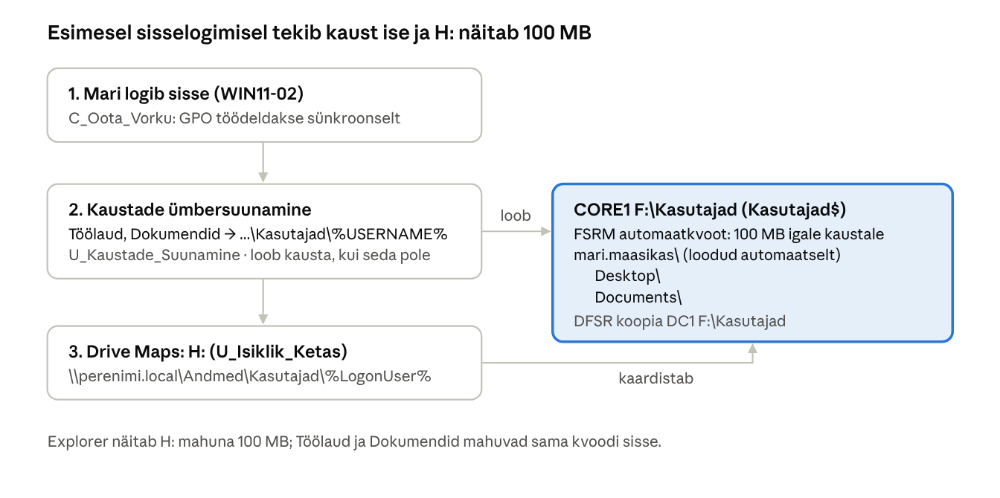
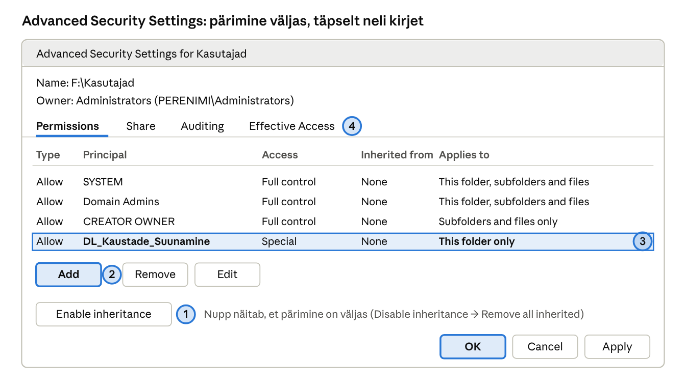
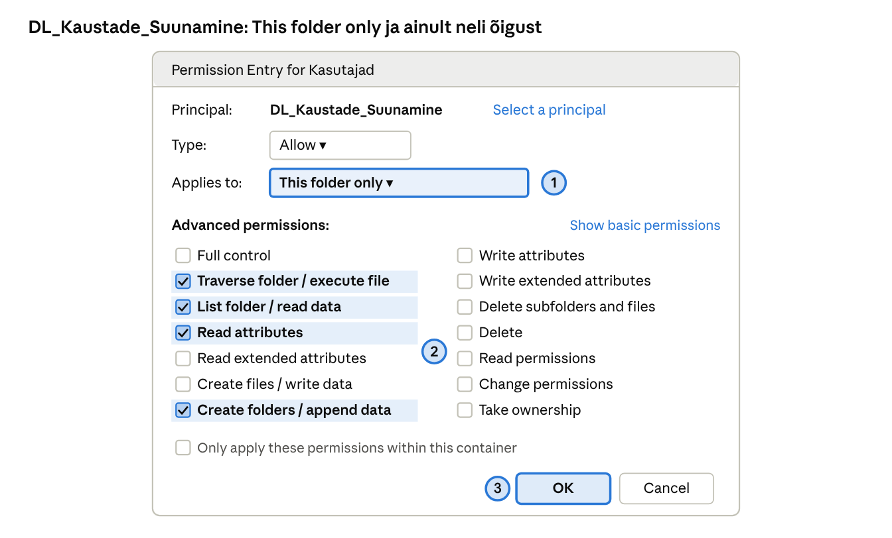

## 15. Kaustade ümbersuunamine ja isiklik võrguketas

Eesmärk: iga kasutaja **Töölaud** ja **Dokumendid** asuvad serveris, mitte arvutis, ning kasutaja näeb oma isiklikku serverikausta võrgukettana `H:`, mille maht on **100 MB**. Kausta ei loo administraator käsitsi: see tekib automaatselt kasutaja esimesel sisselogimisel kausta `F:\Kasutajad` alla CORE1-l. Kasu: arvuti võib katki minna või kasutaja võib istuda mis tahes arvuti taha, failid on alati samas kohas, varundatud ja DFS-iga DC1-le replikeeritud.

### 15.1 Mõisted

| Termin (EN) | Selgitus |
| --- | --- |
| Kaustade ümbersuunamine (*Folder Redirection*) | GPO laiendus, mis muudab kasutaja tuntud kaustade (*known folders*: Desktop, Documents, Pictures jt) asukoha võrgukaustaks. Programmid salvestavad ikka „Dokumentidesse“, kuid tegelikult läheb fail serverisse. |
| Tuntud kaust (*known folder*) | Windowsi standardkaust kasutajaprofiilis, millele viitab GUID (nt `FOLDERID_Desktop`). |
| Basic / Advanced ümbersuunamine | *Basic* – kõik GPO kasutajad samasse juurkausta; *Advanced* – eri rühmadele eri juurkaust (nt osakonniti). |
| Juurkaust (*root path*) | Kaust, mille alla luuakse igale kasutajale oma alamkaust `%USERNAME%`. Meil `\\perenimi.local\Andmed\Kasutajad`. |
| Exclusive rights | Ümbersuunamise valik, mis annab kasutajale ja SYSTEM-ile ainuisikulise õiguse kaustale (ka administraator ei pääse ligi). Laboris lülitame selle välja ja juhime õigusi juurkausta pärimisega. |
| Move contents | Olemasolev sisu (nt Töölaua failid) teisaldatakse esimesel korral serverisse. |
| Offline Files (CSC) | Kliendi vahemälu, mis hoiab ümbersuunatud failide koopiat arvutis, et need oleksid kasutatavad ka ilma võrguta. Sülearvutitele kasulik, laboris võib välja lülitada. |
| Rändprofiil (*roaming profile*) | Vanem lahendus, mis kopeerib kogu profiili sisse- ja väljalogimisel. Kaustade ümbersuunamine on kiirem, sest failid ei liigu igal sisselogimisel. |
| Drive Maps (GPP) | Rühmapoliitika eelistus, mis kaardistab võrgukausta draivitäheks. Tegevused: *Create*, *Replace*, *Update*, *Delete*. |
| %USERNAME% / %LogonUser% | Muutujad, mis asendatakse sisse loginud kasutaja nimega. GPP-s soovitatakse `%LogonUser%`, Folder Redirection kasutab `%USERNAME%`. |
| Sünkroonne töötlus | Arvuti ootab sisselogimisel võrku ja töötleb GPO-d enne töölaua näitamist. Kaustade ümbersuunamine rakendub ainult sünkroonselt; ilma selleta jõustub see alles teisel sisselogimisel. |

### 15.2 Kuidas kaust automaatselt tekib

Lahendus koosneb kolmest osast, mis töötavad kindlas järjekorras (vt skeemi):

1. **Arvuti GPO** `C_Oota_Vorku` lülitab sisse *Always wait for the network at computer startup and logon*, et kasutaja GPO-d töödeldakse sünkroonselt.
2. **Kasutaja GPO** `U_Kaustade_Suunamine` suunab Töölaua ja Dokumendid juurkausta `\\perenimi.local\Andmed\Kasutajad`, valikuga *Create a folder for each user under the root path*. Kui kausta `Kasutajad\mari.maasikas` pole, **loob kaustade ümbersuunamine selle ise** koos alamkaustadega `Desktop` ja `Documents`. Kuna laiendus töötab enne draivide kaardistamist, on kaust olemas, kui järgmine samm käivitub.
3. **Kasutaja GPO** `U_Isiklik_Ketas` kaardistab `H:` → `\\perenimi.local\Andmed\Kasutajad\%LogonUser%`. Samasse GPO-sse lisatakse turvavõrgu jaoks *Preferences → Folders* üksus tegevusega *Create* sama tee jaoks, et kaust tekiks ka kasutajal, kellele ümbersuunamine mingil põhjusel ei rakendu.

FSRM automaatkvoot `F:\Kasutajad` (peatükk 13) märkab uue alamkausta ja rakendab sellele kohe 100 MB range kvoodi. Kasutaja näeb Exploreris `H:` draivi mahuna 100 MB. NB! Töölaud ja Dokumendid asuvad samas kaustas, seega mahtuvad kõik kolm kokku 100 MB sisse.



*Joonis: isikliku kausta automaatne loomine · 3 sammu sisselogimisel*

Kaustade ümbersuunamine loob kausta enne, kui Drive Maps üritab seda `H:`-ks kaardistada; FSRM paneb uuele kaustale kohe 100 MB piiri.

### 15.3 Turvarühm ja juurkausta õigused

#### Turvarühm `DL_Kaustade_Suunamine`

Kaustade ümbersuunamine ja isiklik võrguketas ei rakendu kõigile domeeni kasutajatele, vaid ainult neile, kes kuuluvad turvarühma `DL_Kaustade_Suunamine`. Rühma kasutatakse kahes kohas:

- **juurkausta NTFS-õigustes** – ainult rühma liikmed saavad `F:\Kasutajad` alla oma kausta luua;
- **GPO-de turvafiltris** (15.4) – `U_Kaustade_Suunamine` ja `U_Isiklik_Ketas` rakenduvad ainult rühma liikmetele.

Nii saab ümbersuunamise sisse lülitada järk-järgult (nt esmalt ainult IT-osakonnale) ja kasutaja eemaldamine rühmast lülitab selle tema jaoks välja. AGDLP järgi on rühma liikmed globaalrühmad, mitte üksikud kasutajad.

> **NB!** Allpool on rühma loomine kahel viisil: **A) GUI** ja **B) PowerShell**. Piisab ühest.

**Variant A: GUI**

1. DC1: `dsa.msc` → paremklikk `Labor → Ryhmad` → *New → Group* → nimi `DL_Kaustade_Suunamine`, *Group scope* **Domain local**, *Group type* **Security** → OK.
2. Topeltklikk rühmal → vahekaart *General* → *Description*: „Kaustade ümbersuunamine ja H: ketas“.
3. Vahekaart **Members** → *Add...* → `GG_IT; GG_Raamatupidamine; GG_Myyk` → *Check Names* → OK → OK.
4. Kontroll: kasutaja omadustes vahekaart *Member Of* näitab tema globaalrühma. Rühma liikmesus jõustub kasutaja **järgmisel sisselogimisel**.

**Variant B: PowerShell**

```powershell
New-ADGroup -Name DL_Kaustade_Suunamine -GroupScope DomainLocal -GroupCategory Security `
  -Path "OU=Ryhmad,OU=Labor,DC=perenimi,DC=local" -Description "Kaustade ümbersuunamine ja H: ketas"
Add-ADGroupMember DL_Kaustade_Suunamine -Members GG_IT, GG_Raamatupidamine, GG_Myyk
Get-ADGroupMember DL_Kaustade_Suunamine -Recursive | Select-Object SamAccountName
```

#### Juurkausta NTFS- ja jagamisõigused

Õiged õigused on kõige olulisem osa: kasutaja peab saama juurkausta **luua oma kausta**, kuid ei tohi **näha ega avada teiste kaustu**. Microsofti soovitus kaustade ümbersuunamise juurkaustale:

| Kellele | Õigus | Kehtib |
| --- | --- | --- |
| SYSTEM | Full control | See kaust, alamkaustad ja failid |
| PERENIMI\\Domain Admins | Full control | See kaust, alamkaustad ja failid |
| CREATOR OWNER | Full control | Ainult alamkaustad ja failid |
| PERENIMI\\DL\_Kaustade\_Suunamine | List folder / read data, Create folders / append data, Traverse folder, Read attributes | **Ainult see kaust** |
| Jagamine `Kasutajad$` | Authenticated Users: Full control (piirab NTFS), ABE sees | — |

Kuidas see töötab: Mari saab juurkausta luua kausta (`Create folders`). Loodud kausta omanikuks saab Mari ning *CREATOR OWNER* reegel muutub tema jaoks täielikuks õiguseks just sellele kaustale. Teised kasutajad ei saa Mari kausta avada, sest nende õigus juurkaustas kehtib „ainult sellele kaustale“. ABE peidab teiste kaustad ka nimekirjast.

> **NB!** Allpool on sama töö kahel viisil: **A) GUI** ja **B) PowerShell (icacls)**. Piisab ühest – kui teed GUI juhendi järgi, pole käsurea osa vaja (ja vastupidi).

#### Variant A: GUI (samm-sammult)

1. DC1 File Exploreris ava `\\CORE1\F$` → paremklikk `Kasutajad` → *Properties → Security → Advanced*.
2. **Disable inheritance** → **Remove all inherited permissions from this object**.
3. *Add* → *Select a principal* `SYSTEM` → *Basic permissions*: **Full control**, *Applies to*: *This folder, subfolders and files* → OK.
4. *Add* → `Domain Admins` → **Full control**, *This folder, subfolders and files* → OK.
5. *Add* → `CREATOR OWNER` → **Full control**, *Applies to*: **Subfolders and files only** → OK.
6. *Add* → `DL_Kaustade_Suunamine` → *Applies to*: **This folder only** → *Show advanced permissions* → jäta märgituks ainult **Traverse folder / execute file**, **List folder / read data**, **Read attributes**, **Create folders / append data** → OK.
7. *Apply* → OK. Kontroll: *Advanced* aknas on täpselt neli kirjet ja veerus *Inherited from* „None“.



*Skeem · NTFS: Advanced Security Settings for Kasutajad*



*Skeem · NTFS: Permission Entry, DL\_Kaustade\_Suunamine*

**Päris aknad** varasemast materjalist (seal on kaust `F:\RedirFolder` ja rühm `RedirectFolders`, põhimõte sama):


*juurkausta õiguste kirjed*


*rühma õigused „This folder only“*


*jagamisõigused: Authenticated Users Full Control*

#### Variant B: PowerShell (icacls)

```powershell
# CORE1-l: pärimine maha ja õigused Microsofti soovituse järgi
icacls F:\Kasutajad /inheritance:r
icacls F:\Kasutajad /grant:r "SYSTEM:(OI)(CI)F" "PERENIMI\Domain Admins:(OI)(CI)F" "CREATOR OWNER:(OI)(CI)(IO)F"
icacls F:\Kasutajad /grant "PERENIMI\DL_Kaustade_Suunamine:(RD,AD,X,RA)"
icacls F:\Kasutajad
```

### 15.4 GPO-d

| GPO | Link | Asukoht GPMC-s | Seaded |
| --- | --- | --- | --- |
| `C_Oota_Vorku` | OU Arvutid | *Computer → Policies → Admin Templates → System → Logon* | *Always wait for the network at computer startup and logon* = Enabled |
| `U_Kaustade_Suunamine` | OU Kasutajad | *User → Policies → Windows Settings → Folder Redirection → Desktop* ja *→ Documents* | Setting: **Basic**; Target: *Create a folder for each user under the root path*; Root path: `\\perenimi.local\Andmed\Kasutajad`. Vahekaart *Settings*: **eemalda** *Grant the user exclusive rights*, jäta *Move the contents*; *Policy Removal*: *Redirect the folder back to the local userprofile location* |
| `U_Isiklik_Ketas` | OU Kasutajad | *User → Preferences → Windows Settings → Folders* | Action *Create*, Path `\\perenimi.local\Andmed\Kasutajad\%LogonUser%`; *Common* vahekaart: **Run in logged-on user's security context** (muidu proovib kausta luua arvutikonto, kellel pole õigust) |
| `U_Isiklik_Ketas` | (sama GPO) | *User → Preferences → Windows Settings → Drive Maps* | Action *Update*, Location `\\perenimi.local\Andmed\Kasutajad\%LogonUser%`, Reconnect, Label `Minu kaust`, Drive letter **H:** |

Kaustade ümbersuunamise seadeid ei saa PowerShelli `Set-GPRegistryValue`-ga seada (need on failis `fdeploy1.ini`, mitte registris), seetõttu tehakse see osa GPMC-s.

#### Turvafilter: GPO rakendub ainult rühmale

Mõlemal kasutaja-GPO-l (`U_Kaustade_Suunamine` ja `U_Isiklik_Ketas`):

1. GPMC-s vali GPO → vahekaart **Scope** → *Security Filtering*: vali *Authenticated Users* → **Remove** → *Add...* → `DL_Kaustade_Suunamine` → OK.
2. Vahekaart **Delegation** → *Add...* → `Authenticated Users` → õigus **Read** (mitte *Apply*). Alates turvauuendusest MS16-072 loeb kasutaja GPO-d arvutikonto kaudu; ilma selleta ei rakendu GPO kellelegi. (Varasemas materjalis lisati sama eesmärgiga turvafiltrisse *Domain Computers* – ka see töötab.)
3. Kontroll kliendil: `gpresult /r` – rühma liikmel on GPO-d *Applied GPOs* all, mitteliikmel *Denied GPOs* all põhjusega *Security Filtering*.

**Päris aknad** varasemast materjalist:


*turvafilter*


*Documents → Target: Basic ja Root Path*


*vahekaart Settings: Grant exclusive rights ja Move the contents*

> **OneDrive'i hoiatus.** Kui arvutis on OneDrive'i *Known Folder Move* (Töölaua ja Dokumentide varundus OneDrive'i) sees, on sellel ja kaustade ümbersuunamisel konflikt. Domeeniarvutites kasuta korraga ainult ühte neist.

### 15.5 Tõrkeotsing

| Sümptom | Põhjus ja lahendus |
| --- | --- |
| Ümbersuunamine ei rakendu esimesel sisselogimisel | `C_Oota_Vorku` puudub või pole veel rakendunud – taaskäivita arvuti, logi kaks korda sisse |
| Logis viga 502 / 1006 „Access denied“ | Juurkausta õigused valed (15.3) või jagamisõigus puudu |
| `H:` ei ilmu | Kaust puudub (vaata *Folders* üksust), Drive Maps üksus vale kasutaja kontekstis, kasutaja pole OU-s Kasutajad |
| „There is not enough space“ | 100 MB kvoot täis; kontrolli `Get-FsrmQuota -Path F:\Kasutajad\<nimi>` |
| Administraator ei pääse kasutaja kausta | *Grant the user exclusive rights* jäi sisse – kaust loodi ainuõigusega |
| Ümbersuunamine ja H: ei rakendu kellelegi või mõnele kasutajale | Kasutaja pole rühmas DL\_Kaustade\_Suunamine (või pole pärast rühma lisamist uuesti sisse loginud); GPO vahekaardil Delegation puudub Authenticated Users: Read. gpresult /r näitab GPO-d Denied GPOs all. |

Logid kliendil: *Applications and Services Logs → Microsoft → Windows → Folder Redirection → Operational* (sündmus **1001** = edukas ümbersuunamine) ning `gpresult /h C:\gp.html`.

### Labor 13. Kaustade ümbersuunamine ja isiklik 100 MB võrguketas

**Eesmärk:** suunata kasutajate Töölaud ja Dokumendid serverisse ning anda igale kasutajale automaatselt loodav 100 MB võrguketas `H:`.

**Eeldused:** Labor 11 (automaatkvoot `F:\Kasutajad`) ja Labor 12 (DFS kaust `Kasutajad`) on tehtud.

**Sammud:**

1. Loo rühm `DL_Kaustade_Suunamine` ja lisa liikmed (15.3). Kontrolli, et `juhan.juurikas` kuulub mõnda liikmeks lisatud globaalrühma (vajadusel lisa ta ühte neist).

   Sea `F:\Kasutajad` õigused 15.3 järgi ja kontrolli `icacls`-iga. Kontrolli, et jagamine `Kasutajad$` on olemas ja ABE sees.
2. Loo ja lingi GPO `C_Oota_Vorku` OU-le `Arvutid`.
3. Loo GPO `U_Kaustade_Suunamine` ja seadista *Desktop* ning *Documents* tabeli 15.4 järgi. Lingi OU-le `Kasutajad`.
4. Loo GPO `U_Isiklik_Ketas`: *Folders* üksus ja *Drive Maps* üksus `H:`. Lingi OU-le `Kasutajad`.
5. Eemalda Osa I Labor 7 kodukaustade seaded, kui need olid (ADUC *Profile → Home folder* tühjaks), et `H:` ei oleks kahes kohas määratud.
6. WIN11-02: `gpupdate /force`, taaskäivita, logi sisse kui `juhan.juurikas` (kasutaja, kes pole varem sisse loginud).
7. Kontrolli kliendil: Explorer → *Töölaud* → paremklikk *Properties → Location*: peab olema `\\perenimi.local\Andmed\Kasutajad\juhan.juurikas\Desktop`. `H:` draiv on olemas ja selle maht on 100 MB.

   

   *Vaata, milline see aken välja näeb (Documents → Location)*
8. Kontrolli CORE1-l: `F:\Kasutajad\juhan.juurikas` on tekkinud, `Get-FsrmQuota -Path F:\Kasutajad\juhan.juurikas` näitab 100 MB. Kontrolli DC1-l, et kaust replikeerus ka `F:\Kasutajad`.
9. Salvesta Töölauale fail ja logi sisse **teise** arvutisse (WIN11-01) sama kasutajaga: fail on Töölaual olemas.
10. Testi kvooti: kopeeri `H:`-le 120 MB faile – peab ebaõnnestuma.
11. Testi privaatsust: kasutajana `liis.lepp` ava `\\perenimi.local\Andmed\Kasutajad` – näha on ainult tema enda kaust; `\\perenimi.local\Andmed\Kasutajad\juhan.juurikas` annab *Access denied*.

**Kontrollpunkt:** uue kasutaja kaust tekib automaatselt, Töölaud ja Dokumendid asuvad serveris, `H:` on 100 MB ja teiste kaustad pole nähtavad.

**Küsimused:**

1. Kes loob kasutaja kausta: administraator, kaustade ümbersuunamine või Drive Maps? Mis järjekorras need töötavad?
2. Miks on vaja arvuti poliitikat *Always wait for the network*?
3. Selgita, kuidas CREATOR OWNER ja „ainult see kaust“ õigused koos tagavad privaatsuse.
4. Mis vahe on kaustade ümbersuunamisel ja rändprofiilil?

---

[← 14. DFS – hajutatud failisüsteem](14-dfs.md) · [Sisukord](../README.md) · [16. Rakenduste ligipääs AD rühmade järgi →](16-rakenduste-ligipaas-ad-ruhmadega.md)
