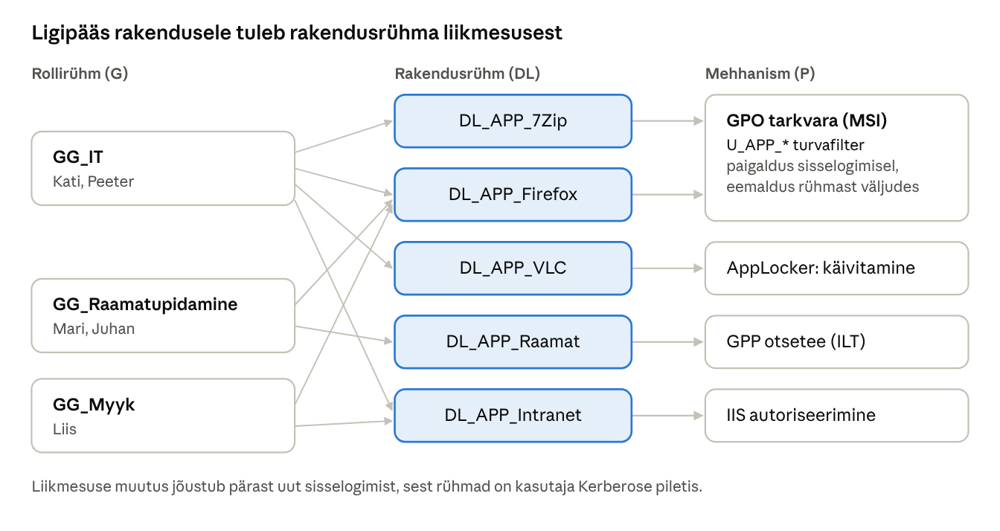

## 16. Rakenduste ligipääs AD rühmade järgi

Põhimõte on sama mis failide puhul (AGDLP, peatükk 8): **iga rakendus on ressurss, millel on oma domeenilokaalne rühm** `DL_APP_<rakendus>`. Rollirühmad `GG_<osakond>` pannakse rakendusrühmadesse ja tehnilised mehhanismid (GPO, AppLocker, IIS) vaatavad ainult rakendusrühma. Kui uus raamatupidaja tuleb tööle, lisatakse ta üksnes `GG_Raamatupidamine` rühma ja ta saab automaatselt kõik raamatupidaja rakendused; kui ta lahkub, kaovad need samuti.

### 16.1 Mõisted

| Termin (EN) | Selgitus |
| --- | --- |
| Rakendusrühm | Turvarühm, mille liikmesus tähendab õigust rakendusele, nt `DL_APP_Firefox`. |
| Tarkvara paigaldus GPO-ga (*Group Policy Software Installation*) | GPO laiendus, mis paigaldab **MSI** paketi võrgujagamiselt. Ei toeta EXE-paigaldajaid. |
| Assign / Publish | *Assigned* – rakendus paigaldatakse kohustuslikult (kasutajale sisselogimisel või arvutile käivitumisel). *Published* – kasutaja saab selle ise paigaldada: *Control Panel → Programs → Install a program from the network* (ainult kasutajale). |
| Turvafiltreerimine (*security filtering*) | GPO rakendub ainult rühmale, kellel on GPO-l õigus *Apply group policy*. Vt 7.2. |
| Item-level targeting (ILT) | Rühmapoliitika eelistuste (GPP) üksuse tingimus: nt otsetee luuakse ainult siis, kui kasutaja on rühmas X. Saab kombineerida OS-i, IP-vahemiku, arvutinime jm tingimustega. |
| AppLocker | Windowsi rakenduste kontroll, mis lubab või keelab programmide käivitamise **kasutaja või rühma kaupa** (reeglid tee, avaldaja või räsi järgi). Alates KB5024351 uuendustest ei sõltu AppLockeri jõustamine enam Windowsi väljaandest, seega töötab see ka Windows 11 Pro-l ([Microsoft Learn](https://learn.microsoft.com/windows/security/application-security/application-control/app-control-for-business/applocker/requirements-to-use-applocker)). |
| Application Identity teenus (`AppIDSvc`) | Teenus, mis AppLockeri reegleid kliendis jõustab. Peab olema käivitatud, muidu AppLocker ei tööta. |
| App Control for Business | AppLockeri uuem ja tugevam järglane (endine WDAC). Kehtib terve seadme kohta, mitte kasutajapõhiselt. Kui reegel peab sõltuma kasutaja rühmast, sobib AppLocker. |
| URL-i autoriseerimine (IIS) | Veebiserveri reegel, mis lubab saidile või kaustale ainult teatud kasutajaid või rühmi; töötab koos Windowsi autentimisega. |

### 16.2 Neli mehhanismi

| Mehhanism | Mida kontrollib | Millal kasutada | Laboris |
| --- | --- | --- | --- |
| GPO tarkvara paigaldus + turvafilter | **Kas rakendus paigaldatakse** | MSI paketid, väike ja keskmine keskkond | 7-Zip ja Firefox |
| GPP otsetee + item-level targeting | **Kas kasutaja näeb rakendust** (otsetee, link) | Veebirakendused, jagatud programmid, mis on kõigil arvutis olemas | Raamatupidamise kaust ja intraneti link |
| AppLocker | **Kas programmi tohib käivitada** | Kui rakendus on arvutis olemas, kuid kõik ei tohi seda kasutada | VLC ainult IT-le |
| IIS URL-i autoriseerimine | **Kas veebirakendus/kaust avaneb** | Intranet, sisesed veebirakendused | `https://veeb.perenimi.local/sisene` |

Märkus: paigaldus ja otsetee ei ole turvameetmed – kui kasutaja leiab programmi käsitsi, saab ta selle käivitada. Tõeliselt keelab käivitamise ainult AppLocker (või rakenduse enda õigused).

### 16.3 Rühmad laboris

| Rakendusrühm | Liikmed (rollirühmad) | Mehhanism |
| --- | --- | --- |
| `DL_APP_7Zip` | `GG_IT` | GPO `U_APP_7Zip` (Assigned, paigaldus sisselogimisel) |
| `DL_APP_Firefox` | `GG_IT`, `GG_Raamatupidamine`, `GG_Myyk` | GPO `U_APP_Firefox` |
| `DL_APP_VLC` | `GG_IT` | GPO `U_APP_VLC` + AppLocker luba |
| `DL_APP_Raamat` | `GG_Raamatupidamine` | GPP otsetee (ILT) |
| `DL_APP_Intranet` | `GG_Myyk`, `GG_IT` | IIS URL-i autoriseerimine (Labor 15) |



*Joonis: rakenduste ligipääs AGDLP mudelis · 3 rollirühma, 5 rakendusrühma, 4 mehhanismi*

Mehhanismid ei tea midagi osakondadest: nad vaatavad ainult `DL_APP_` rühma. Kes millise rakenduse saab, otsustab rühmade pesastus.

```powershell
$ou = "OU=Ryhmad,OU=Labor,DC=perenimi,DC=local"
'7Zip','Firefox','VLC','Raamat','Intranet' | ForEach-Object {
  New-ADGroup -Name "DL_APP_$_" -GroupScope DomainLocal -GroupCategory Security -Path $ou
}
Add-ADGroupMember DL_APP_7Zip     -Members GG_IT
Add-ADGroupMember DL_APP_Firefox  -Members GG_IT, GG_Raamatupidamine, GG_Myyk
Add-ADGroupMember DL_APP_VLC      -Members GG_IT
Add-ADGroupMember DL_APP_Raamat   -Members GG_Raamatupidamine
Add-ADGroupMember DL_APP_Intranet -Members GG_Myyk, GG_IT
```

**Rühmaliikmesus ja Kerberos:** kasutaja rühmad kirjutatakse tema Kerberose piletisse sisselogimisel. Pärast rühma muutmist peab kasutaja **välja ja uuesti sisse logima** (või `klist purge`), arvutirühma muutmisel tuleb arvuti taaskäivitada.

### 16.4 Tarkvara paigaldus GPO-ga

1. **Jagamine:** CORE1 `F:\Tarkvara`, jagatud nimega `Tarkvara` ja lisatud DFS nimeruumi kaustana `\\perenimi.local\Andmed\Tarkvara`. Õigused: *Authenticated Users* ja *Domain Computers* – Read, *Domain Admins* – Full. GPO-s tuleb paketi tee alati anda **UNC-teena**, mitte `F:\...`, sest klient loeb paketti võrgust.
2. **MSI paketid:** laadi tootja kodulehelt alla 64-bitised MSI-failid (7-Zip `7z...-x64.msi`, Firefox MSI, VLC MSI) ja kopeeri kausta.
3. **GPO iga rakenduse jaoks**, nt `U_APP_7Zip`, lingitud OU-le `Kasutajad`: *User → Policies → Software Settings → Software installation → New → Package* → `\\perenimi.local\Andmed\Tarkvara\7z-x64.msi` → **Assigned**. Paketi omadused → *Deployment*: märgi **Install this application at logon** ja **Uninstall this application when it falls out of the scope of management**.
4. **Turvafilter:** GPO *Scope* vahekaardil eemalda *Authenticated Users*, lisa `DL_APP_7Zip`. Vahekaardil *Delegation* lisa *Authenticated Users* õigusega **Read** (ilma *Apply*), sest MS16-072 järel loeb kasutaja GPO-d arvutikonto kaudu; ilma selleta ei rakendu GPO kellelegi.

Tulemus: Kati (IT) saab sisselogimisel 7-Zipi paigalduse; Liis (Müük) ei saa. Kui Kati eemaldatakse `GG_IT`-st, eemaldatakse 7-Zip tema järgmisel sisselogimisel. Paigaldus toimub sisselogimisel sünkroonselt, seega peab kehtima `C_Oota_Vorku` (peatükk 15).

> **Kasutaja või arvuti?** Kasutajale määratud paketti jälgib kasutaja, arvutile määratud paketti arvuti (paigaldub käivitumisel enne sisselogimist). Ettevõtetes on levinum arvutipõhine paigaldus ja kasutajapõhine *käivitamisõigus* (AppLocker). Laboris näitame kasutajapõhist, sest ülesanne on ligipääs **kasutajarühmade** järgi.

### 16.5 Otseteed item-level targetinguga

GPO `U_Otseteed` (OU Kasutajad) → *User → Preferences → Windows Settings → Shortcuts → New*:

| Otsetee | Sihtmärk | Asukoht | Targeting |
| --- | --- | --- | --- |
| Raamatupidamine | `\\perenimi.local\Andmed\Osakonnad\Raamatupidamine` (File System Object) | Desktop | *Security Group* `PERENIMI\DL_APP_Raamat`, *User in group* |
| Intranet | `https://veeb.perenimi.local/sisene` (URL) | Desktop | *Security Group* `PERENIMI\DL_APP_Intranet` |

*Common* vahekaardil märgi **Item-level targeting** → *Targeting...* ja **Remove this item when it is no longer applied** (kui kasutaja rühmast eemaldatakse, kaob ka otsetee).

### 16.6 AppLocker: käivitamine rühma järgi

AppLockeri loogika: kui reeglikogumis (nt *Executable Rules*) on vähemalt üks reegel, on **kõik, mida ükski reegel ei luba, keelatud**. Seetõttu luuakse alati kõigepealt vaikereeglid (Windows ja Program Files kõigile, kõik administraatoritele). VLC piiramiseks:

1. GPO `C_AppLocker` (OU Arvutid) → *Computer → Policies → Windows Settings → Security Settings → Application Control Policies → AppLocker → Executable Rules* → *Create Default Rules*.
2. Ava vaikereegel *All files located in the Program Files folder* (Everyone) → *Exceptions* → lisa tee-erand `%PROGRAMFILES%\VideoLAN\*`.
3. Uus reegel: *Allow*, kasutaja/rühm `PERENIMI\DL_APP_VLC`, tingimus *Path* `%PROGRAMFILES%\VideoLAN\*`.
4. AppLocker → *Properties → Enforcement*: *Executable rules* → **Audit only** (esmalt ainult logimine!).
5. Samas GPO-s: *Computer → Policies → Windows Settings → Security Settings → System Services → Application Identity* → *Automatic*.
6. Testi, vaata logi *Applications and Services Logs → Microsoft → Windows → AppLocker → EXE and DLL*: **8002** lubatud, **8003** oleks keelatud (auditirežiimis), **8004** keelatud. Kui logis pole ootamatuid 8003 sündmusi, muuda režiim **Enforce rules**.

```powershell
# Kliendil: kehtiv poliitika ja test konkreetsele kasutajale
Get-AppLockerPolicy -Effective -Xml | Out-File C:\Users\Public\applocker.xml
Get-AppLockerPolicy -Effective | Test-AppLockerPolicy -Path "C:\Program Files\VideoLAN\VLC\vlc.exe" -User PERENIMI\liis.lepp
Get-Service AppIDSvc
```

> **Ettevaatust:** vale AppLockeri reegel võib takistada kõigil käivitamast mis tahes programmi. Seetõttu alusta alati režiimiga *Audit only*, ära kustuta vaikereegleid ja testi esmalt ühes arvutis (nt eraldi test-OU-s).

### 16.7 Veebirakenduse ligipääs rühma järgi (IIS)

IIS-is saab saidi alamkausta piirata AD rühmaga. Selleks lülitatakse kaustal välja anonüümne autentimine ja sisse Windowsi autentimine (Kerberos/NTLM) ning lisatakse autoriseerimisreegel. Kaust `C:\inetpub\veeb\sisene` faili `web.config` sisu:

```xml
<configuration>
  <system.webServer>
    <security>
      <authorization>
        <remove users="*" roles="" verbs="" />
        <add accessType="Allow" roles="PERENIMI\DL_APP_Intranet" />
      </authorization>
    </security>
  </system.webServer>
</configuration>
```

Autentimise seaded tehakse IIS Manageris (*Sites → veeb → sisene → Authentication*: *Anonymous* = Disabled, *Windows Authentication* = Enabled), sest need sektsioonid on vaikimisi serveri tasemel lukus. Et brauser logiks domeenikasutaja automaatselt sisse (ilma parooliküsimuseta), peab sait olema **Local Intranet** tsoonis: GPO `U_Intranet_Tsoon` → *User → Admin Templates → Windows Components → Internet Explorer → Internet Control Panel → Security Page → Site to Zone Assignment List*: `https://veeb.perenimi.local` = `1`. Kerberose jaoks registreeri SPN: `setspn -S HTTP/veeb.perenimi.local DC1`. Praktiline seadistus tehakse Labor 15-s.

### Labor 14. Rakenduste ligipääs AD rühmade järgi

**Eesmärk:** anda rakendusi kasutajatele ainult AD rühmade kaudu: paigaldus, otseteed ja käivitamisõigus.

**Sammud:**

1. Loo rakendusrühmad ja liikmesused (16.3 skript). Kontrolli `Get-ADGroupMember DL_APP_Firefox -Recursive`.
2. Loo CORE1-l `F:\Tarkvara`, jaga see ja lisa DFS nimeruumi kaustana `Tarkvara`. Kopeeri sinna 7-Zip, Firefox ja VLC MSI-failid.
3. Loo GPO-d `U_APP_7Zip`, `U_APP_Firefox`, `U_APP_VLC` (16.4), igal oma turvafilter ja *Delegation* → *Authenticated Users: Read*.
4. Loo `U_Otseteed` kahe otseteega ja item-level targetinguga (16.5).
5. Loo `C_AppLocker` VLC reegliga režiimis *Audit only* (16.6).
6. WIN11-01: logi sisse kui `kati.karu` (IT). Kontrolli: 7-Zip, Firefox ja VLC on paigaldatud, VLC käivitub, otsetee „Intranet“ on Töölaual, „Raamatupidamine“ pole.
7. Logi samasse arvutisse sisse kui `liis.lepp` (Müük). Kontrolli: Firefoxi otsetee on, VLC-d menüüs pole. Käivita käsitsi `C:\Program Files\VideoLAN\VLC\vlc.exe` – auditirežiimis käivitub, kuid logisse tekib sündmus 8003.
8. Muuda AppLocker režiimiks *Enforce rules*, `gpupdate /force` ja taaskäivita WIN11-01. Liisi katse VLC-d käivitada lõpeb teatega „This app has been blocked by your system administrator“ (sündmus 8004). Kati saab VLC-d endiselt kasutada.
9. WIN11-02: logi sisse kui `mari.maasikas` – Töölaual on „Raamatupidamine“, Firefox paigaldub, 7-Zipi pole.
10. Eemalda Kati rühmast `GG_IT` ja lisa `GG_Myyk`. Kati logib välja ja sisse: 7-Zip ja VLC eemaldatakse, otsetee „Intranet“ jääb alles (Müük on `DL_APP_Intranet` liige). Taasta Kati rühmad.

**Kontrollpunkt:** iga kasutaja saab täpselt oma rühmade rakendused; rühmast eemaldamine eemaldab ka rakenduse; AppLocker blokeerib VLC mitte-IT kasutajale.

**Küsimused:**

1. Miks pannakse GPO turvafiltrisse `DL_APP_` rühm, mitte otse `GG_IT`?
2. Miks on tarkvara paigaldus ja otsetee „mugavus“, aga AppLocker „turvalisus“?
3. Miks peab GPO-l olema *Authenticated Users: Read*, kui turvafiltris neid enam pole?
4. Mis juhtub AppLockeriga, kui teenus *Application Identity* ei käi?

---

[← 15. Kaustade ümbersuunamine ja isiklik võrguketas](15-kaustade-umbersuunamine-ja-vorguketas.md) · [Sisukord](../README.md) · [17. IIS ja WordPress →](17-iis-ja-wordpress.md)
