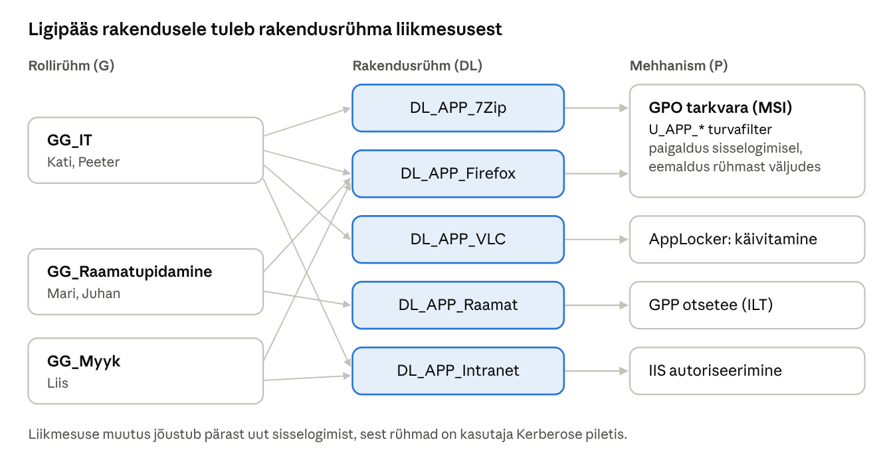

## 16. Rakenduste ligipääs AD rühmade järgi

Põhimõte on sama mis failide puhul (AGDLP, peatükk 8): **iga rakendus on ressurss, millel on oma domeenilokaalne rühm** `DL_APP_<rakendus>`. Rollirühmad `GG_<osakond>` pannakse rakendusrühmadesse ja tehnilised mehhanismid (GPO, AppLocker, IIS) vaatavad ainult rakendusrühma. Kui uus raamatupidaja tuleb tööle, lisatakse ta üksnes `GG_Raamatupidamine` rühma ja ta saab automaatselt kõik raamatupidaja rakendused; kui ta lahkub, kaovad need samuti.

> **Interaktiivne simulaator:** [Rakenduste ligipääs AD rühmade järgi](https://valdonolvak.github.io/Windows-serveri-haldus/interaktiivne/rakenduste-ligipaas-simulaator.html) – muuda rühmaliikmesusi, logi kasutajana tööjaama sisse ja vaata, mis paigaldub, mis käivitub ja mis keelatakse. Näed ka, miks muudatus jõuab kasutajani alles pärast uut sisselogimist.

### 16.1 Mõisted

| Termin (EN) | Selgitus |
| --- | --- |
| Rakendusrühm | Turvarühm, mille liikmesus tähendab õigust rakendusele, nt `DL_APP_Firefox`. |
| Tarkvara paigaldus GPO-ga (*Group Policy Software Installation*) | GPO laiendus, mis paigaldab **MSI** paketi võrgujagamiselt. Ei toeta EXE-paigaldajaid. |
| Assign / Publish | *Assigned* – rakendus paigaldatakse kohustuslikult (kasutajale sisselogimisel või arvutile käivitumisel). *Published* – kasutaja saab selle ise paigaldada: *Control Panel → Programs → Install a program from the network* (ainult kasutajale). |
| Turvafiltreerimine (*security filtering*) | GPO rakendub ainult rühmale, kellel on GPO-l õigus *Apply group policy*. Vt 7.2. |
| Item-level targeting (ILT) | Rühmapoliitika eelistuste (GPP) üksuse tingimus: nt otsetee luuakse ainult siis, kui kasutaja on rühmas X. Saab kombineerida OS-i, IP-vahemiku, arvutinime jm tingimustega. |
| AppLocker | Windowsi rakenduste kontroll, mis lubab või keelab programmide käivitamise **kasutaja või rühma kaupa** (reeglid tee, avaldaja või räsi järgi). Alates KB5024351 uuendustest ei sõltu AppLockeri jõustamine enam Windowsi väljaandest, seega töötab see ka Windows 11 Pro-l ([Microsoft Learn](https://learn.microsoft.com/windows/security/application-security/application-control/app-control-for-business/applocker/requirements-to-use-applocker)). |
| Application Identity teenus (`AppIDSvc`) | Teenus, mis AppLockeri reegleid kliendis jõustab. Peab olema käivitatud, muidu AppLocker ei tööta. |
| App Control for Business | AppLockeri uuem ja tugevam järglane (endine WDAC). Kehtib terve seadme kohta, mitte kasutajapõhiselt. Kui reegel peab sõltuma kasutaja rühmast, sobib AppLocker. |
| URL-i autoriseerimine (IIS) | Veebiserveri reegel, mis lubab saidile või kaustale ainult teatud kasutajaid või rühmi; töötab koos Windowsi autentimisega. |

### 16.2 Viis mehhanismi

| Mehhanism | Mida kontrollib | Millal kasutada | Laboris |
| --- | --- | --- | --- |
| GPO tarkvara paigaldus + turvafilter | **Kas rakendus paigaldatakse** | MSI paketid, väike ja keskmine keskkond | 7-Zip ja Firefox |
| GPP otsetee + item-level targeting | **Kas kasutaja näeb rakendust** (otsetee, link) | Veebirakendused, jagatud programmid, mis on kõigil arvutis olemas | Raamatupidamise kaust ja intraneti link |
| AppLocker | **Kas programmi tohib käivitada** | Kui rakendus on arvutis olemas, kuid kõik ei tohi seda kasutada | VLC ainult IT-le |
| IIS URL-i autoriseerimine | **Kas veebirakendus/kaust avaneb** | Intranet, sisesed veebirakendused | `https://veeb.perenimi.local/sisene` |
| Rakenduse enda õigused (NTFS + rakenduse kontroll) | **Mida kasutaja rakenduses teha tohib** (vaadata, muuta) | Rakendused, mille andmed on failiserveris või andmebaasis | Laoseis (16.8, Labor 14B) |

Märkus: paigaldus ja otsetee ei ole turvameetmed – kui kasutaja leiab programmi käsitsi, saab ta selle käivitada. Tõeliselt keelab käivitamise ainult AppLocker (või rakenduse enda õigused). Sama kehtib rakenduse sees: kui rakendus peidab nupu „Salvesta“, on see mugavus – andmeid kaitseb alles failiserveri või andmebaasi õigus.

### 16.3 Rühmad laboris

| Rakendusrühm | Liikmed (rollirühmad) | Mehhanism |
| --- | --- | --- |
| `DL_APP_7Zip` | `GG_IT` | GPO `U_APP_7Zip` (Assigned, paigaldus sisselogimisel) |
| `DL_APP_Firefox` | `GG_IT`, `GG_Raamatupidamine`, `GG_Myyk` | GPO `U_APP_Firefox` |
| `DL_APP_VLC` | `GG_IT` | GPO `U_APP_VLC` + AppLocker luba |
| `DL_APP_Raamat` | `GG_Raamatupidamine` | GPP otsetee (ILT) |
| `DL_APP_Intranet` | `GG_Myyk`, `GG_IT` | IIS URL-i autoriseerimine (Labor 15) |



*Joonis: rakenduste ligipääs AGDLP mudelis · 3 rollirühma, 5 rakendusrühma, 4 mehhanismi*

Mehhanismid ei tea midagi osakondadest: nad vaatavad ainult `DL_APP_` rühma. Kes millise rakenduse saab, otsustab rühmade pesastus.

> **NB!** Allpool on sama töö kahel viisil: **A) GUI** ja **B) PowerShell**. Piisab ühest – kui teed GUI juhendi järgi, pole PowerShelli osa vaja (ja vastupidi).

#### Variant A: GUI (samm-sammult)

1. DC1: `dsa.msc` → paremklikk `Labor → Ryhmad` → *New → Group* → nimi `DL_APP_7Zip`, *Group scope* **Domain local**, *Group type* **Security** → OK. Korda rühmadele `DL_APP_Firefox`, `DL_APP_VLC`, `DL_APP_Raamat`, `DL_APP_Intranet`.
2. Topeltklikk rühmal → vahekaart **Members** → *Add...* → kirjuta globaalrühmad (mitu korraga semikooloniga, nt `GG_IT; GG_Myyk`) → *Check Names* → OK:
   - `DL_APP_7Zip` ← `GG_IT`
   - `DL_APP_Firefox` ← `GG_IT`, `GG_Raamatupidamine`, `GG_Myyk`
   - `DL_APP_VLC` ← `GG_IT`
   - `DL_APP_Raamat` ← `GG_Raamatupidamine`
   - `DL_APP_Intranet` ← `GG_Myyk`, `GG_IT`
3. Kontroll: globaalrühma omadustes vahekaart **Member Of** näitab, millistesse `DL_APP_` rühmadesse ta kuulub.

#### Variant B: PowerShell

```powershell
$ou = "OU=Ryhmad,OU=Labor,DC=perenimi,DC=local"
'7Zip','Firefox','VLC','Raamat','Intranet' | ForEach-Object {
  New-ADGroup -Name "DL_APP_$_" -GroupScope DomainLocal -GroupCategory Security -Path $ou
}
Add-ADGroupMember DL_APP_7Zip     -Members GG_IT
Add-ADGroupMember DL_APP_Firefox  -Members GG_IT, GG_Raamatupidamine, GG_Myyk
Add-ADGroupMember DL_APP_VLC      -Members GG_IT
Add-ADGroupMember DL_APP_Raamat   -Members GG_Raamatupidamine
Add-ADGroupMember DL_APP_Intranet -Members GG_Myyk, GG_IT
```

**Rühmaliikmesus ja Kerberos:** kasutaja rühmad kirjutatakse tema Kerberose piletisse sisselogimisel. Pärast rühma muutmist peab kasutaja **välja ja uuesti sisse logima** (või `klist purge`), arvutirühma muutmisel tuleb arvuti taaskäivitada.

### 16.4 Tarkvara paigaldus GPO-ga

1. **Jagamine:** CORE1 `F:\Tarkvara`, jagatud nimega `Tarkvara` ja lisatud DFS nimeruumi kaustana `\\perenimi.local\Andmed\Tarkvara`. Õigused: *Authenticated Users* ja *Domain Computers* – Read, *Domain Admins* – Full. GPO-s tuleb paketi tee alati anda **UNC-teena**, mitte `F:\...`, sest klient loeb paketti võrgust.
2. **MSI paketid:** laadi tootja kodulehelt alla 64-bitised MSI-failid (7-Zip `7z...-x64.msi`, Firefox MSI, VLC MSI) ja kopeeri kausta.
3. **GPO iga rakenduse jaoks**, nt `U_APP_7Zip`, lingitud OU-le `Kasutajad`: *User → Policies → Software Settings → Software installation → New → Package* → `\\perenimi.local\Andmed\Tarkvara\7z-x64.msi` → **Assigned**. Paketi omadused → *Deployment*: märgi **Install this application at logon** ja **Uninstall this application when it falls out of the scope of management**.
4. **Turvafilter:** GPO *Scope* vahekaardil eemalda *Authenticated Users*, lisa `DL_APP_7Zip`. Vahekaardil *Delegation* lisa *Authenticated Users* õigusega **Read** (ilma *Apply*), sest MS16-072 järel loeb kasutaja GPO-d arvutikonto kaudu; ilma selleta ei rakendu GPO kellelegi.

Tulemus: Kati (IT) saab sisselogimisel 7-Zipi paigalduse; Liis (Müük) ei saa. Kui Kati eemaldatakse `GG_IT`-st, eemaldatakse 7-Zip tema järgmisel sisselogimisel. Paigaldus toimub sisselogimisel sünkroonselt, seega peab kehtima `C_Oota_Vorku` (peatükk 15).

> **Kasutaja või arvuti?** Kasutajale määratud paketti jälgib kasutaja, arvutile määratud paketti arvuti (paigaldub käivitumisel enne sisselogimist). Ettevõtetes on levinum arvutipõhine paigaldus ja kasutajapõhine *käivitamisõigus* (AppLocker). Laboris näitame kasutajapõhist, sest ülesanne on ligipääs **kasutajarühmade** järgi.

### 16.5 Otseteed item-level targetinguga

GPO `U_Otseteed` (OU Kasutajad) → *User → Preferences → Windows Settings → Shortcuts → New*:

| Otsetee | Sihtmärk | Asukoht | Targeting |
| --- | --- | --- | --- |
| Raamatupidamine | `\\perenimi.local\Andmed\Osakonnad\Raamatupidamine` (File System Object) | Desktop | *Security Group* `PERENIMI\DL_APP_Raamat`, *User in group* |
| Intranet | `https://veeb.perenimi.local/sisene` (URL) | Desktop | *Security Group* `PERENIMI\DL_APP_Intranet` |

*Common* vahekaardil märgi **Item-level targeting** → *Targeting...* ja **Remove this item when it is no longer applied** (kui kasutaja rühmast eemaldatakse, kaob ka otsetee).

### 16.6 AppLocker: käivitamine rühma järgi

AppLockeri loogika: kui reeglikogumis (nt *Executable Rules*) on vähemalt üks reegel, on **kõik, mida ükski reegel ei luba, keelatud**. Seetõttu luuakse alati kõigepealt vaikereeglid (Windows ja Program Files kõigile, kõik administraatoritele). VLC piiramiseks:

1. GPO `C_AppLocker` (OU Arvutid) → *Computer → Policies → Windows Settings → Security Settings → Application Control Policies → AppLocker → Executable Rules* → *Create Default Rules*.
2. Ava vaikereegel *All files located in the Program Files folder* (Everyone) → *Exceptions* → lisa tee-erand `%PROGRAMFILES%\VideoLAN\*`.
3. Uus reegel: *Allow*, kasutaja/rühm `PERENIMI\DL_APP_VLC`, tingimus *Path* `%PROGRAMFILES%\VideoLAN\*`.
4. AppLocker → *Properties → Enforcement*: *Executable rules* → **Audit only** (esmalt ainult logimine!).
5. Samas GPO-s: *Computer → Policies → Windows Settings → Security Settings → System Services → Application Identity* → *Automatic*.
6. Testi, vaata logi *Applications and Services Logs → Microsoft → Windows → AppLocker → EXE and DLL*: **8002** lubatud, **8003** oleks keelatud (auditirežiimis), **8004** keelatud. Kui logis pole ootamatuid 8003 sündmusi, muuda režiim **Enforce rules**.

```powershell
# Kliendil: kehtiv poliitika ja test konkreetsele kasutajale
Get-AppLockerPolicy -Effective -Xml | Out-File C:\Users\Public\applocker.xml
Get-AppLockerPolicy -Effective | Test-AppLockerPolicy -Path "C:\Program Files\VideoLAN\VLC\vlc.exe" -User PERENIMI\liis.lepp
Get-Service AppIDSvc
```

> **Ettevaatust:** vale AppLockeri reegel võib takistada kõigil käivitamast mis tahes programmi. Seetõttu alusta alati režiimiga *Audit only*, ära kustuta vaikereegleid ja testi esmalt ühes arvutis (nt eraldi test-OU-s).

### 16.7 Veebirakenduse ligipääs rühma järgi (IIS)

IIS-is saab saidi alamkausta piirata AD rühmaga. Selleks lülitatakse kaustal välja anonüümne autentimine ja sisse Windowsi autentimine (Kerberos/NTLM) ning lisatakse autoriseerimisreegel. Kaust `C:\inetpub\veeb\sisene` faili `web.config` sisu:

```xml
<configuration>
  <system.webServer>
    <security>
      <authorization>
        <remove users="*" roles="" verbs="" />
        <add accessType="Allow" roles="PERENIMI\DL_APP_Intranet" />
      </authorization>
    </security>
  </system.webServer>
</configuration>
```

Autentimise seaded tehakse IIS Manageris (*Sites → veeb → sisene → Authentication*: *Anonymous* = Disabled, *Windows Authentication* = Enabled), sest need sektsioonid on vaikimisi serveri tasemel lukus. Et brauser logiks domeenikasutaja automaatselt sisse (ilma parooliküsimuseta), peab sait olema **Local Intranet** tsoonis: GPO `U_Intranet_Tsoon` → *User → Admin Templates → Windows Components → Internet Explorer → Internet Control Panel → Security Page → Site to Zone Assignment List*: `veeb.perenimi.local` = `1`. Kirjuta nimi **ilma protokollita** – siis kehtib tsoon nii `http://` kui ka `https://` aadressile (Labor 15 kasutab esmalt HTTP-d, peatükis 18 lisandub HTTPS). Kontroll kliendis: `gpresult /r /scope:user` peab näitama `U_Intranet_Tsoon` rakendununa. Kerberose jaoks registreeri SPN: `setspn -S HTTP/veeb.perenimi.local DC1`. Praktiline seadistus tehakse Labor 15-s.

### 16.8 Rakenduse enda õigused: kaks taset ühes rakenduses

Eelmised mehhanismid vastavad küsimusele „kas kasutaja saab rakenduse **kätte**“. Päris töös on sageli vaja ka teist taset: **mida ta rakenduses teha tohib**. Näiteks laoseisu peavad nägema nii müük kui ka raamatupidamine, aga muuta tohib ainult müük. Ka siin kasutame AGDLP-d – rakendusel on kaks rühma:

| Rakendusrühm | Liikmed | Õigus |
| --- | --- | --- |
| `DL_APP_Laoseis` | `GG_Myyk`, `GG_Raamatupidamine` | Rakendus käivitub, andmeid saab vaadata (NTFS **Read & execute**) |
| `DL_APP_Laoseis_Muutja` | `GG_Myyk` | Andmeid saab muuta (andmekaustal NTFS **Modify**) |

Rakendus `Laoseis.ps1` on lihtne PowerShelli vormiga programm, mis loeb ja salvestab faili `laoseis.csv` (skript ja näidisandmed: [Skriptid/Laoseis](../Skriptid/Laoseis/)). Rakendus asub failiserveris ja kontrollid on kahes kohas:

| Kontroll | Kus | Mida teeb | Kas on turvameede? |
| --- | --- | --- | --- |
| Otsetee (GPP + ILT) | Kasutaja töölaud | Otsetee on ainult `DL_APP_Laoseis` liikmetel | Ei – mugavus |
| NTFS kaustal `Laoseis` | CORE1 | Programmi ja andmeid saavad lugeda ainult `DL_APP_Laoseis` liikmed; ABE peidab kausta teistelt | **Jah** |
| Rakenduse kontroll `IsInRole()` | Rakendus ise | Kui kasutaja pole `DL_APP_Laoseis_Muutja` liige, on tabel kirjutuskaitstud ja nupp „Salvesta“ hall | Ei – mugavus (kasutaja saab skripti kopeerida ja muuta) |
| NTFS kaustal `andmed` | CORE1 | Faili saavad muuta ainult `DL_APP_Laoseis_Muutja` liikmed | **Jah** |

Rakendus küsib rühmaliikmesust Windowsilt nii:

```powershell
$id     = [Security.Principal.WindowsIdentity]::GetCurrent()      # sisselogitud kasutaja juurdepääsuluba
$roll   = New-Object Security.Principal.WindowsPrincipal($id)
$muutja = $roll.IsInRole("$env:USERDOMAIN\DL_APP_Laoseis_Muutja")  # $true või $false
```

`IsInRole()` ei küsi AD-st midagi: ta vaatab juurdepääsuluba (*access token*), mis loodi sisselogimisel. Seepärast jõuab rühmamuudatus rakendusse alles pärast **välja- ja sisselogimist** – täpselt nagu GPO-de ja AppLockeri puhul.

> **Põhimõte:** kasutajaliides (peidetud nupp, puuduv otsetee) teeb rakenduse mugavaks, aga turvalisuse annab alati **serveri pool** – failiserveri NTFS-õigus, andmebaasi õigus või veebiserveri autoriseerimine. Labor 14B näitab seda praktiliselt: kui Mari muudab rakenduse koopiat nii, et nupp on aktiivne, keelab failiserver ikkagi salvestamise.

### 16.9 Kontroll ja tõrkeotsing

Kõik mehhanismid vaatavad kasutaja **juurdepääsuluba**. Seepärast on esimene samm alati kontrollida, kas rühm on AD-s õigesti **ja** kas see on jõudnud kasutaja tokenisse.

```powershell
# DC1: kas rühmad on AD-s õigesti?
Get-ADPrincipalGroupMembership liis.lepp | Select-Object Name
Get-ADGroupMember DL_APP_VLC -Recursive | Select-Object SamAccountName

# Kliendis kasutajana: mis on tokenis praegu?
whoami /groups | findstr DL_APP
klist                                  # Kerberose piletid; klist purge kustutab need
gpresult /r /scope:user                # rakendunud ja välja filtreeritud GPO-d (filtreerimise põhjusega)
gpresult /h C:\Users\Public\gp.html     # sama HTML-aruandena
```

| Sümptom | Tõenäoline põhjus | Lahendus |
| --- | --- | --- |
| Rühm lisati, aga kasutajal midagi ei muutu | Token on vana – rühmad loetakse sisselogimisel | Kasutaja logib välja ja sisse; `whoami /groups` |
| GPO ei rakendu **kellelegi**, ka õigetele rühmadele | Turvafiltrist eemaldati *Authenticated Users*, aga *Delegation* all puudub neil **Read** (MS16-072) | Lisa *Authenticated Users: Read* (ilma *Apply*-ta) |
| `gpresult` näitab GPO-d all *Denied GPOs – Security* | Kasutaja pole turvafiltri rühmas | Kontrolli rühmade pesastust |
| Tarkvara ei paigaldu, `gpupdate` ütleb „Software Installation … next logon“ | Paigaldus toimub ainult sisselogimisel; kiire sisselogimine (*Fast Logon Optimization*) jätab selle vahele | `C_Oota_Vorku` (peatükk 15); logi välja ja sisse (vajadusel kaks korda) |
| Paigaldus ebaõnnestub, *Application* logis MsiInstaller/Application Management viga | Paketi tee pole UNC või kliendil pole jagamisele lugemisõigust | Kasuta `\\perenimi.local\Andmed\Tarkvara\...`; *Domain Computers* ja *Authenticated Users*: Read |
| Rühmast eemaldatud kasutajal jäi programm alles | Paketil pole märgitud *Uninstall this application when it falls out of the scope of management* | Märgi see; eemaldamine toimub järgmisel sisselogimisel |
| Otsetee jäi alles | GPP üksusel pole *Remove this item when it is no longer applied* | Märgi see *Common* vahekaardil |
| AppLocker ei keela midagi, logis pole sündmusi | Teenus `AppIDSvc` ei tööta või reeglikogum on tühi | `Get-Service AppIDSvc`; GPO-s teenus *Automatic* |
| AppLocker lubab, aga logis on 8003 | Režiim on *Audit only* | Kui logi on korras, muuda *Enforce rules* |
| **Kõik** programmid on keelatud | Vaikereeglid on kustutatud | Taasta *Create Default Rules*; testi alati enne test-OU-s |
| Intranet küsib parooli | Sait pole *Local Intranet* tsoonis | `U_Intranet_Tsoon`, nimi ilma protokollita |
| Intranet: 401.2 | Kasutaja pole `DL_APP_Intranet` liige (autoriseerimine) | Lisa õige globaalrühm DL-rühma |
| Laoseis: „Access to the path … is denied“ | Kasutaja pole `DL_APP_Laoseis` (avamine) või `DL_APP_Laoseis_Muutja` (salvestamine) liige | Kontrolli NTFS-i: *Properties → Security → Advanced → Effective Access* |

### Labor 14. Rakenduste ligipääs AD rühmade järgi

> **Praktiline juhend:** laborid 14 ja 14B on samm-sammult (GUI + PowerShell, testitabelid, ekraanitõmmised, hindamine ja kontrollskript) kirjas failis [Labor 14 – praktiline juhend](../Materjalid/Labor-14-rakenduste-ligipaas-praktiline-juhend.md).

**Eesmärk:** anda rakendusi kasutajatele ainult AD rühmade kaudu: paigaldus, otseteed ja käivitamisõigus.

**Sammud:**

1. Loo rakendusrühmad ja liikmesused (16.3 skript). Kontrolli `Get-ADGroupMember DL_APP_Firefox -Recursive`.
2. Loo CORE1-l `F:\Tarkvara`, jaga see ja lisa DFS nimeruumi kaustana `Tarkvara`. Kopeeri sinna 7-Zip, Firefox ja VLC MSI-failid.
3. Loo GPO-d `U_APP_7Zip`, `U_APP_Firefox`, `U_APP_VLC` (16.4), igal oma turvafilter ja *Delegation* → *Authenticated Users: Read*.
4. Loo `U_Otseteed` kahe otseteega ja item-level targetinguga (16.5).
5. Loo `C_AppLocker` VLC reegliga režiimis *Audit only* (16.6).
6. WIN11-01: logi sisse kui `kati.karu` (IT). Kontrolli: 7-Zip, Firefox ja VLC on paigaldatud, VLC käivitub, otsetee „Intranet“ on Töölaual, „Raamatupidamine“ pole.
7. Logi samasse arvutisse sisse kui `liis.lepp` (Müük). Kontrolli: Firefoxi otsetee on, VLC-d menüüs pole. Käivita käsitsi `C:\Program Files\VideoLAN\VLC\vlc.exe` – auditirežiimis käivitub, kuid logisse tekib sündmus 8003.
8. Muuda AppLocker režiimiks *Enforce rules*, `gpupdate /force` ja taaskäivita WIN11-01. Liisi katse VLC-d käivitada lõpeb teatega „This app has been blocked by your system administrator“ (sündmus 8004). Kati saab VLC-d endiselt kasutada.
9. WIN11-02: logi sisse kui `mari.maasikas` – Töölaual on „Raamatupidamine“, Firefox paigaldub, 7-Zipi pole.
10. Eemalda Kati rühmast `GG_IT` ja lisa `GG_Myyk`. Kati logib välja ja sisse: 7-Zip ja VLC eemaldatakse, otsetee „Intranet“ jääb alles (Müük on `DL_APP_Intranet` liige). Taasta Kati rühmad.

**Kontrollpunkt:** iga kasutaja saab täpselt oma rühmade rakendused; rühmast eemaldamine eemaldab ka rakenduse; AppLocker blokeerib VLC mitte-IT kasutajale.

**Küsimused:**

1. Miks pannakse GPO turvafiltrisse `DL_APP_` rühm, mitte otse `GG_IT`?
2. Miks on tarkvara paigaldus ja otsetee „mugavus“, aga AppLocker „turvalisus“?
3. Miks peab GPO-l olema *Authenticated Users: Read*, kui turvafiltris neid enam pole?
4. Mis juhtub AppLockeriga, kui teenus *Application Identity* ei käi?

### Labor 14B. Rühmast sõltuv rakendus „Laoseis“

**Eesmärk:** paigaldada failiserverisse rakendus, mille kasutamine sõltub ainult AD rühmast: müük saab laoseisu muuta, raamatupidamine ainult vaadata ja IT ei näe seda üldse. Näha, et rakenduse kasutajaliidese kontroll on mugavus, aga turvalisuse annab NTFS.

**Eeldused:** Labor 7 (failiserver, `GG_` rühmad), Labor 12 (DFS nimeruum `\\perenimi.local\Andmed`), Labor 14 (`U_Otseteed`).

**Oodatav tulemus:**

| Kasutaja | Rollirühm | Otsetee | Rakendus avaneb | Saab salvestada |
| --- | --- | --- | --- | --- |
| `liis.lepp` | `GG_Myyk` | on | jah | jah |
| `mari.maasikas` | `GG_Raamatupidamine` | on | jah, ainult vaatamiseks | ei |
| `kati.karu` | `GG_IT` | pole | ei (kaust on ABE-ga peidetud) | ei |

**Sammud:**

1. **Rühmad** (DC1). GUI: `dsa.msc` → `Labor → Ryhmad` → *New → Group* → `DL_APP_Laoseis` ja `DL_APP_Laoseis_Muutja` (*Domain local*, *Security*) → liikmed nagu tabelis 16.8. PowerShell:

   ```powershell
   $ou = "OU=Ryhmad,OU=Labor,DC=perenimi,DC=local"
   New-ADGroup -Name DL_APP_Laoseis        -GroupScope DomainLocal -GroupCategory Security -Path $ou
   New-ADGroup -Name DL_APP_Laoseis_Muutja -GroupScope DomainLocal -GroupCategory Security -Path $ou
   Add-ADGroupMember DL_APP_Laoseis        -Members GG_Myyk, GG_Raamatupidamine
   Add-ADGroupMember DL_APP_Laoseis_Muutja -Members GG_Myyk
   ```

2. **Kaustad ja jagamine** (CORE1 konsoolis või DC1-st `Enter-PSSession core1`):

   ```powershell
   New-Item -ItemType Directory F:\Rakendused\Laoseis\andmed -Force
   New-SmbShare -Name Rakendused -Path F:\Rakendused -FolderEnumerationMode AccessBased `
     -ChangeAccess "Authenticated Users" -FullAccess "PERENIMI\Domain Admins"
   ```

   Jagamisõigus on lai (*Change*), tegeliku õiguse määrab NTFS. `-FolderEnumerationMode AccessBased` lülitab sisse ABE: kasutaja ei näe kaustu, kuhu tal õigust pole.

3. **NTFS-õigused** (CORE1):

   ```powershell
   # Juurkaust: pärimine maha, kõigil ainult selle kausta sisu nägemine
   icacls F:\Rakendused /inheritance:r /grant "SYSTEM:(OI)(CI)F" "Administrators:(OI)(CI)F" "Authenticated Users:RX"
   # Rakenduse kaust: käivitamine ja lugemine rakendusrühmale
   icacls F:\Rakendused\Laoseis /grant "PERENIMI\DL_APP_Laoseis:(OI)(CI)RX"
   # Andmekaust: muutmine ainult muutjatele
   icacls F:\Rakendused\Laoseis\andmed /grant "PERENIMI\DL_APP_Laoseis_Muutja:(OI)(CI)M"
   icacls F:\Rakendused\Laoseis /T
   ```

   `(OI)(CI)` = õigus pärandub failidele (*object inherit*) ja alamkaustadele (*container inherit*). `Authenticated Users:RX` ilma `(OI)(CI)`-ta kehtib ainult kausta `F:\Rakendused` enda kohta.

4. **DFS** (DC1): `dfsmgmt.msc` → nimeruum `\\perenimi.local\Andmed` → *New Folder* → nimi `Rakendused`, sihtkoht `\\core1\Rakendused`. PowerShell: `New-DfsnFolder -Path "\\perenimi.local\Andmed\Rakendused" -TargetPath "\\core1\Rakendused"`.

5. **Rakendus ja andmed:** kopeeri failid `Laoseis.ps1` ja `laoseis.csv` ([Skriptid/Laoseis](../Skriptid/Laoseis/)) kaustadesse `\\perenimi.local\Andmed\Rakendused\Laoseis\` ja `...\Laoseis\andmed\`. Muuda skripti real `$juur = ...` `perenimi` oma domeeni nimeks. Salvesta skript kodeeringus **UTF-8 with BOM** (Windows PowerShell 5.1 loeb muidu täpitähed valesti).

6. **Otsetee** GPO-s `U_Otseteed` → *User → Preferences → Windows Settings → Shortcuts → New → Shortcut*:
   - *Name* `Laoseis`, *Target type* **File System Object**, *Location* **Desktop**;
   - *Target path* `%SystemRoot%\System32\WindowsPowerShell\v1.0\powershell.exe`;
   - *Arguments* `-NoProfile -ExecutionPolicy Bypass -WindowStyle Hidden -File "\\perenimi.local\Andmed\Rakendused\Laoseis\Laoseis.ps1"`;
   - *Common* → **Item-level targeting** → *Security Group* `PERENIMI\DL_APP_Laoseis` ja **Remove this item when it is no longer applied**.

   `-ExecutionPolicy Bypass` lubab skripti käivitada. See ei ole turvaauk: käivitamispoliitika on kaitse kogemata käivitamise vastu, mitte õiguste piir – õigused määrab NTFS.

7. **Test – Liis** (WIN11-01): logi sisse kui `liis.lepp`. Töölaual on „Laoseis“. Ava see: akna pealkirjas on „muutja“. Muuda toote 1002 kogus 8 → 20, vajuta *Salvesta*. Kontrolli, et failis `andmed\muudatused.log` on rida Liisi nimega.

8. **Test – Mari** (WIN11-02): logi sisse kui `mari.maasikas`. Laoseis avaneb, pealkirjas „ainult vaatamine“, tabelit ei saa muuta ja *Salvesta* on hall. Mari näeb Liisi tehtud muudatust (kogus 20).

9. **Test – Kati** (WIN11-01): logi sisse kui `kati.karu`. Otseteed pole. Ava Exploreris `\\perenimi.local\Andmed\Rakendused` – kaust `Laoseis` pole nähtav (ABE). Proovi otse teed `\\perenimi.local\Andmed\Rakendused\Laoseis` – *Access is denied*.

10. **Möödaviigu katse – Mari:** kopeeri `Laoseis.ps1` oma töölauale, ava see Notepadis ja muuda rida `$muutja = $roll.IsInRole(...)` kujule `$muutja = $true`. Käivita koopia (paremklikk → *Run with PowerShell*). Nupp *Salvesta* on nüüd aktiivne – vajuta seda. Tulemus: **„Access to the path … laoseis.csv is denied“**. Proovi ka avada `laoseis.csv` otse Notepadis ja salvestada – sama tulemus. Kustuta koopia.

11. **Rühma muutmine:** lisa DC1-l `GG_Raamatupidamine` rühma `DL_APP_Laoseis_Muutja`. Mari käivitab Laoseisu uuesti **välja logimata** – ikka „ainult vaatamine“. Kontrolli `whoami /groups | findstr Laoseis`: uut rühma pole. Mari logib välja ja sisse → nüüd „muutja“ ja salvestamine õnnestub. Eemalda `GG_Raamatupidamine` rühmast `DL_APP_Laoseis_Muutja` ja kontrolli pärast Mari uut sisselogimist, et ta on jälle vaataja.

12. **Efektiivne õigus** (DC1): `\\core1\f$\Rakendused\Laoseis\andmed` → *Properties → Security → Advanced → Effective Access* → *Select a user* → võrdle kasutajaid `liis.lepp`, `mari.maasikas`, `kati.karu`.

**Kontrollpunkt:** tulemused vastavad tabelile „Oodatav tulemus“; Mari möödaviigukatse lõpeb vea „Access denied“; rühmamuudatus jõuab rakendusse pärast uut sisselogimist; `muudatused.log` sisaldab ainult muutjate ridu.

**Küsimused:**

1. Miks on rakendusel kaks rühma, mitte üks?
2. Rakendus peidab nupu „Salvesta“. Miks on sellest hoolimata vaja NTFS-õigust kaustal `andmed`?
3. Miks ei muutu Mari õigus rakenduses enne, kui ta välja ja sisse logib? Kust `IsInRole()` rühmad võtab?
4. Mis vahe on sammus 9 sellel, et Kati kausta **ei näe**, ja sellel, et tal pole sinna **õigust**?
5. Ettevõte tahab, et IT saaks laoseisu vaadata, aga mitte muuta. Millise ühe käsuga seda teha?

---

[← 15. Kaustade ümbersuunamine ja isiklik võrguketas](15-kaustade-umbersuunamine-ja-vorguketas.md) · [Sisukord](../README.md) · [17. IIS ja WordPress →](17-iis-ja-wordpress.md)
