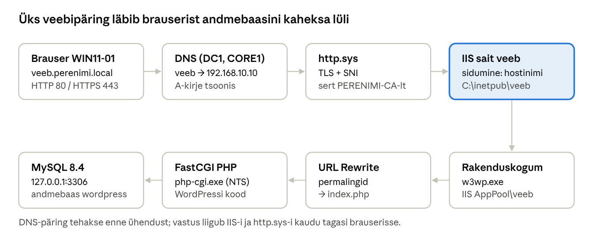

## 17. IIS ja WordPress

IIS (*Internet Information Services*) on Windows Serveri veebiserver. Selles peatükis paigaldame DC1-le IIS-i, PHP ja MySQL-i ning nende peale WordPressi saidi aadressil `veeb.perenimi.local`. Esmalt töötab sait HTTP-ga; peatükis 18 anname sellele oma CA sertifikaadi ja lülitame ümber HTTPS-ile.



*Joonis: WordPressi päringu teekond IIS-is · 8 lüli*

IIS ise PHP-d ei käivita: ta annab `.php` päringu FastCGI kaudu edasi `php-cgi.exe`-le, mis loeb andmed MySQL-ist ja tagastab valmis HTML-i.

### 17.1 Mõisted

| Termin (EN) | Selgitus | Näide laboris |
| --- | --- | --- |
| Veebisait (*site*) | IIS-i üksus, millel on füüsiline kaust ja üks või mitu sidumist. | `veeb` → `C:\inetpub\veeb` |
| Sidumine (*binding*) | Määrab, millised päringud saidile jõuavad: protokoll + IP + port + hostinimi (*host header*). Mitu saiti saavad jagada sama IP-d ja porti, kui hostinimi erineb. | `http:*:80:veeb.perenimi.local` |
| SNI (*Server Name Indication*) | TLS-i laiendus, millega brauser ütleb hostinime juba ühenduse alguses; võimaldab mitut HTTPS-saiti ühel IP-l eri sertifikaatidega. | HTTPS sidumisel sees |
| Rakenduskogum (*application pool*) | Eraldatud tööprotsess (`w3wp.exe`), milles saidi kood jookseb. Igal saidil oma kogum = ühe saidi viga ei mõjuta teist. | `veeb` |
| Kogumi identiteet (*ApplicationPoolIdentity*) | Virtuaalne konto, mille nimel kogum töötab; failisüsteemis kujul `IIS AppPool\<kogum>`. Võrgus esineb arvutikontona (`DC1$`). | `IIS AppPool\veeb` |
| http.sys | Windowsi kerneli draiver, mis võtab HTTP-päringud vastu, teeb TLS-i ja suunab päringu õigesse kogumisse. | Port 80 ja 443 |
| Moodul / käsitleja (*module / handler*) | Moodulid töötlevad iga päringut (autentimine, logimine, URL Rewrite); käsitleja otsustab, kes vastava faili­tüübi töötleb. | `*.php` → FastCGI |
| FastCGI | Protokoll, millega IIS edastab PHP-päringud välisele interpretaatorile `php-cgi.exe` ja hoiab protsesse korduvkasutuseks käigus. | `C:\PHP\php-cgi.exe` |
| PHP NTS / TS | *Non Thread Safe* ja *Thread Safe* PHP versioon. IIS + FastCGI puhul kasutatakse **NTS** versiooni. | PHP 8.4 NTS x64 |
| Vaikedokument (*default document*) | Fail, mis avatakse, kui URL lõppeb kaustaga. | `index.php` |
| `web.config` | Saidi või kausta XML-seadistusfail (sarnane Apache `.htaccess`-iga). | URL Rewrite reeglid |
| URL Rewrite | IIS-i lisamoodul, mis muudab või suunab URL-e reeglite järgi. Vajalik WordPressi „ilusate“ permalinkide ja HTTP→HTTPS suunamise jaoks. | `/2026/11/uudis/` → `index.php` |
| WordPress | PHP-s kirjutatud sisuhaldussüsteem, mis hoiab sisu MySQL/MariaDB andmebaasis. | `veeb.perenimi.local` |
| `wp-config.php` | WordPressi seadistusfail: andmebaasi ühendus, turvavõtmed, saidi aadress. | `C:\inetpub\veeb\wp-config.php` |

### 17.2 Versioonid ja nõuded

WordPressi hostingu käsiraamat soovitab uuele WordPress 7.x paigaldusele **PHP 8.4 või 8.5**, **MySQL 8.4 LTS** või **MariaDB 10.11 / 11.4 / 11.8 LTS**; MySQL 8.0 elutsükkel lõppes 30.04.2026 ([WordPress hosting handbook](https://make.wordpress.org/hosting/handbook/compatibility/version/7-0/)). Enne laborit kontrolli versioone uuesti, sest need muutuvad. Laboris kasutame:

| Komponent | Versioon | Allikas |
| --- | --- | --- |
| PHP | 8.4, **NTS x64** zip | windows.php.net |
| Visual C++ Redistributable | 2015–2022 (v14) x64 | Microsofti koduleht |
| MySQL | Community Server 8.4 LTS, MSI (või MariaDB 11.4 LTS MSI) | dev.mysql.com / mariadb.org |
| IIS URL Rewrite | 2.1 x64 | iis.net |
| WordPress | viimane stabiilne zip | wordpress.org |

Kuna labori võrgus pole tavaliselt internetti, laadi failid alla oma arvutis ja too need DC1-le (nt jagatud kausta või ISO-tõmmisfaili kaudu).

### 17.3 DNS-kirje

> **NB!** Allpool on sama töö kahel viisil: **A) GUI** ja **B) PowerShell**. Piisab ühest – kui teed GUI juhendi järgi, pole PowerShelli osa vaja (ja vastupidi). See kehtib kõigi peatüki 17 alajaotuste kohta.

#### Variant A: GUI (samm-sammult)

1. DC1: *Tools → DNS* → *Forward Lookup Zones → perenimi.local* → paremklikk **New Host (A or AAAA)...**.
2. *Name* `veeb`, *IP address* `192.168.10.10` (märgi *Create associated pointer (PTR) record*) → *Add Host* → *Done*.
3. Kontroll: kliendi käsureal `nslookup veeb.perenimi.local`.

#### Variant B: PowerShell

```powershell
# DC1-l: veeb.perenimi.local -> DC1 IP
Add-DnsServerResourceRecordA -ZoneName "perenimi.local" -Name "veeb" -IPv4Address 192.168.10.10
Resolve-DnsName veeb.perenimi.local
```

### 17.4 IIS ja PHP

#### Variant A: GUI (samm-sammult)

1. DC1 *Server Manager → Add Roles and Features* → server **DC1** → *Server Roles*: **Web Server (IIS)** → *Add Features* → *Role Services*, märgi lisaks vaikimisi valikutele:
   - *Common HTTP Features* → **HTTP Redirection**;
   - *Security* → **URL Authorization** ja **Windows Authentication**;
   - *Application Development* → **CGI** (see paigaldab FastCGI);
   - *Management Tools* → **IIS Management Console** (vaikimisi märgitud) → *Install*.
2. Topeltklikk `C:\Install\vc_redist.x64.exe` → nõustu litsentsiga → *Install* → *Close*.
3. Paremklikk PHP zip-failil → **Extract All...** → sihtkaust `C:\PHP` → *Extract*. Kaustas `C:\PHP` tee failist `php.ini-production` koopia ja nimeta see `php.ini` (File Exploreris lülita sisse *View → Show → File name extensions*, et laiend oleks näha).

#### Variant B: PowerShell

```powershell
# 1. IIS koos CGI (FastCGI), haldusvahendi, suunamise ja Windowsi autentimisega
Install-WindowsFeature Web-Server, Web-CGI, Web-Http-Redirect, Web-Windows-Auth, Web-Url-Auth -IncludeManagementTools

# 2. Visual C++ Redistributable (PHP vajab seda)
C:\Install\vc_redist.x64.exe /install /quiet /norestart

# 3. PHP lahti C:\PHP ja php.ini tootmismallist
Expand-Archive C:\Install\php-8.4.*-nts-Win32-vs17-x64.zip -DestinationPath C:\PHP
Copy-Item C:\PHP\php.ini-production C:\PHP\php.ini
```

Muuda failis `C:\PHP\php.ini` järgmised read (eemalda rea algusest `;`):

```ini
extension_dir = "C:\PHP\ext"
extension=curl
extension=fileinfo
extension=gd
extension=intl
extension=mbstring
extension=mysqli
extension=openssl
extension=exif
extension=zip
zend_extension=opcache
opcache.enable=1
cgi.force_redirect = 0
cgi.fix_pathinfo = 1
fastcgi.impersonate = 1
date.timezone = Europe/Tallinn
memory_limit = 256M
upload_max_filesize = 32M
post_max_size = 32M
expose_php = Off
```

**FastCGI ja PHP käsitleja** – jälle kaks samaväärset viisi, tee üks neist.

**Variant A: GUI**

1. *Tools → Internet Information Services (IIS) Manager* → vasakult server **DC1**.
2. Topeltklikk **Handler Mappings** → paremal **Add Module Mapping...**:
   - *Request path* `*.php`, *Module* **FastCgiModule**, *Executable* `C:\PHP\php-cgi.exe`, *Name* `PHP-FastCGI`;
   - *Request Restrictions...* → *Mapping*: märgi *Invoke handler only if request is mapped to* → **File or folder** → OK → OK;
   - küsimusele „Do you want to create a FastCGI application for this executable?“ vasta **Yes**.
3. Tagasi serveri vaatesse → topeltklikk **FastCGI Settings** → `C:\PHP\php-cgi.exe` → *Edit...* → *Instance MaxRequests* `10000` → OK.
4. Serveri vaates topeltklikk **Default Document** → *Add...* `index.php` → vali see → *Move Up*, kuni see on nimekirjas esimene.

**Variant B: PowerShell**

```powershell
# 4. FastCGI rakendus ja *.php käsitleja serveri tasemel
Import-Module WebAdministration
Add-WebConfiguration -Filter /system.webServer/fastCgi -PSPath IIS:\ `
  -Value @{fullPath='C:\PHP\php-cgi.exe'; instanceMaxRequests=10000}
New-WebHandler -Name "PHP-FastCGI" -Path "*.php" -Verb "*" -Modules FastCgiModule `
  -ScriptProcessor "C:\PHP\php-cgi.exe" -ResourceType Either -PSPath IIS:\
Add-WebConfigurationProperty -Filter /system.webServer/defaultDocument/files -PSPath IIS:\ `
  -Name . -Value @{value='index.php'} -AtIndex 0
```

### 17.5 MySQL ja andmebaas

Paigalda MySQL 8.4 MSI: teenus `MySQL84`, port 3306, tugev `root` parool. Kuna andmebaasi kasutab ainult sama serveri PHP, lisa faili `C:\ProgramData\MySQL\MySQL Server 8.4\my.ini` sektsiooni `[mysqld]` rida `bind-address=127.0.0.1` ja taaskäivita teenus – nii pole MySQL võrgust üldse kättesaadav.

```sql
-- "C:\Program Files\MySQL\MySQL Server 8.4\bin\mysql.exe" -u root -p
CREATE DATABASE wordpress CHARACTER SET utf8mb4 COLLATE utf8mb4_unicode_ci;
CREATE USER 'wp_kasutaja'@'localhost' IDENTIFIED BY 'TugevParool123!';
GRANT ALL PRIVILEGES ON wordpress.* TO 'wp_kasutaja'@'localhost';
FLUSH PRIVILEGES;
```

WordPressi kasutaja saab õigused **ainult oma andmebaasile** (vähima õiguse põhimõte). Ära kasuta WordPressis `root` kontot.

### 17.6 Sait, rakenduskogum ja õigused

#### Variant A: GUI (samm-sammult)

1. **Rakenduskogum:** IIS Manager → *DC1 → Application Pools* → paremal **Add Application Pool...** → *Name* `veeb`, *.NET CLR version* **No Managed Code**, *Managed pipeline mode* *Integrated* → OK.
2. **WordPress:** paremklikk WordPressi zip-failil → *Extract All...* → `C:\Install\wp` → liiguta tekkinud kaust `wordpress` asukohta `C:\inetpub` ja nimeta see `veeb`.
3. **Sait:** paremklikk *Sites* → **Add Website...** → *Site name* `veeb`, *Application pool* *Select...* → `veeb`, *Physical path* `C:\inetpub\veeb`; *Binding*: *Type* http, *Port* 80, *Host name* `veeb.perenimi.local` → OK.
4. **Anonüümne kasutaja:** vali sait `veeb` → topeltklikk **Authentication** → *Anonymous Authentication* → *Edit...* → **Application pool identity** → OK.
5. **NTFS-õigused:** paremklikk `C:\inetpub\veeb` → *Properties → Security → Edit... → Add...* → kirjuta `IIS AppPool\veeb` → *Check Names* → OK → jäta **Read & execute** → OK. Kaustal `C:\inetpub\veeb\wp-content` lisa samale kontole **Modify**.

#### Variant B: PowerShell

```powershell
# Rakenduskogum ilma .NET-ita (PHP ei vaja .NET CLR-i)
New-WebAppPool -Name veeb
Set-ItemProperty IIS:\AppPools\veeb -Name managedRuntimeVersion -Value ''

# WordPress lahti
Expand-Archive C:\Install\wordpress-*.zip -DestinationPath C:\Install\wp
Move-Item C:\Install\wp\wordpress C:\inetpub\veeb

# Sait hostinimega veeb.perenimi.local
New-Website -Name veeb -PhysicalPath C:\inetpub\veeb -ApplicationPool veeb -Port 80 -HostHeader veeb.perenimi.local

# Anonüümne kasutaja = rakenduskogumi identiteet (siis vajab NTFS-õigust ainult üks konto)
Set-WebConfigurationProperty -PSPath MACHINE/WEBROOT/APPHOST -Location veeb `
  -Filter system.webServer/security/authentication/anonymousAuthentication -Name userName -Value ''

# NTFS: lugemine kogu saidile, muutmine ainult wp-content kaustale (üleslaadimised, pluginad)
icacls C:\inetpub\veeb /grant "IIS AppPool\veeb:(OI)(CI)RX"
icacls C:\inetpub\veeb\wp-content /grant "IIS AppPool\veeb:(OI)(CI)M"
```

### 17.7 WordPressi seadistus

Kopeeri `wp-config-sample.php` → `wp-config.php` ja muuda:

```php
define( 'DB_NAME', 'wordpress' );
define( 'DB_USER', 'wp_kasutaja' );
define( 'DB_PASSWORD', 'TugevParool123!' );
define( 'DB_HOST', '127.0.0.1' );
define( 'DB_CHARSET', 'utf8mb4' );
// Asenda 8 võtmerida (AUTH_KEY ... NONCE_SALT) juhuslike väärtustega:
// https://api.wordpress.org/secret-key/1.1/salt/
define( 'FS_METHOD', 'direct' );   // pluginate paigaldus ilma FTP-ta
```

Seejärel ava WIN11-01 brauseris `http://veeb.perenimi.local` ja läbi paigaldusviisard: saidi nimi, administraatori kasutajanimi (**mitte** `admin`), tugev parool, e-post.

**Permalingid:** loo saidi juurkausta `web.config` (vajab URL Rewrite moodulit):

```xml
<?xml version="1.0" encoding="UTF-8"?>
<configuration>
  <system.webServer>
    <rewrite>
      <rules>
        <rule name="WordPress" patternSyntax="Wildcard">
          <match url="*" />
          <conditions>
            <add input="{REQUEST_FILENAME}" matchType="IsFile" negate="true" />
            <add input="{REQUEST_FILENAME}" matchType="IsDirectory" negate="true" />
          </conditions>
          <action type="Rewrite" url="index.php" />
        </rule>
      </rules>
    </rewrite>
  </system.webServer>
</configuration>
```

Seejärel WordPressis *Settings → Permalinks → Post name*.

### 17.8 Tõrkeotsing

| Sümptom | Põhjus ja lahendus |
| --- | --- |
| Brauser näitab IIS-i vaikelehte | Hostinimi ei klapi: kontrolli sidumist ja DNS-i, `Get-WebBinding -Name veeb` |
| PHP-kood laaditakse alla või näidatakse tekstina | `*.php` käsitleja puudub (17.4) |
| 500 – *FastCGI process exited unexpectedly* | VC++ Redistributable puudu või vale PHP (TS/x86): käivita `C:\PHP\php-cgi.exe -v` |
| *Error establishing a database connection* | Vale kasutaja/parool, MySQL teenus seisab, `mysqli` laiendus pole lubatud |
| Pildi üleslaadimine ebaõnnestub | `IIS AppPool\veeb` puudub `wp-content` Modify õigus |
| Permalingid annavad 404 | URL Rewrite moodul või `web.config` puudub |

IIS-i logid: `C:\inetpub\logs\LogFiles\W3SVC<id>\`. Täpsem vigade jälgimine: *Failed Request Tracing* (IIS Manager → saidi *Failed Request Tracing Rules*).

### Labor 15. IIS ja WordPress

**Eesmärk:** paigaldada DC1-le IIS, PHP ja MySQL ning WordPress aadressile `http://veeb.perenimi.local`; piirata alamkaust `sisene` AD rühmaga.

**Sammud:**

1. Loo DNS-kirje `veeb` (17.3) ja kontrolli WIN11-01-l `Resolve-DnsName veeb.perenimi.local`.
2. Paigalda IIS ja lisad (17.4 samm 1). Ava WIN11-01-l `http://dc1.perenimi.local` – näha on IIS-i vaikeleht.
3. Paigalda VC++ Redistributable, PHP ja seadista `php.ini`. Kontrolli: `C:\PHP\php.exe -m` näitab laiendeid `mysqli`, `openssl`, `gd`, `intl`.
4. Registreeri FastCGI, käsitleja ja vaikedokument (17.4 samm 4).
5. Paigalda MySQL 8.4, sea `bind-address` ja loo andmebaas ning kasutaja (17.5).
6. Paigalda URL Rewrite moodul.
7. Loo rakenduskogum, sait ja õigused (17.6). Peata IIS-i *Default Web Site* (`Stop-Website 'Default Web Site'`).
8. Loo testfail `C:\inetpub\veeb\info.php` sisuga `<?php phpinfo();` ja ava `http://veeb.perenimi.local/info.php`. Kui PHP info leht avaneb, **kustuta fail** (see paljastab serveri seaded).
9. Seadista `wp-config.php` ja `web.config` (17.7) ning läbi WordPressi paigaldus WIN11-01 brauseris.
10. Loo kaks postitust, lülita sisse permalingid *Post name* ja kontrolli, et postituse URL on kujul `/postituse-nimi/`.
11. Lae üles pilt (testib `wp-content` õigusi).
12. **Rühmapõhine ligipääs (16.7):** loo kaust `C:\inetpub\veeb\sisene` lihtsa `index.html`-iga („Intranet – ainult DL\_APP\_Intranet“) ja selle `web.config` autoriseerimisreegliga. IIS Manageris: `sisene` → *Authentication*: Anonymous = Disabled, Windows = Enabled. Käivita `setspn -S HTTP/veeb.perenimi.local DC1`.
13. Testi: `kati.karu` (IT, Intranet rühmas) → `http://veeb.perenimi.local/sisene` avaneb; `mari.maasikas` (Raamatupidamine) → *401.2 / 401.3 Unauthorized*.

**Kontrollpunkt:** WordPressi avaleht ja postitused avanevad, pilt laaditakse üles, `/sisene` avaneb ainult `DL_APP_Intranet` liikmetele, `info.php` on kustutatud.

**Küsimused:**

1. Kuidas teab IIS, millisele saidile päring kuulub, kui mitu saiti kasutavad sama IP-d ja porti 80?
2. Miks on igal saidil oma rakenduskogum ja mis konto nimel PHP jookseb?
3. Miks antakse Modify õigus ainult `wp-content` kaustale?
4. Miks on MySQL seotud aadressiga 127.0.0.1?
5. Mis vahe on PHP NTS ja TS versioonil ning miks IIS-is kasutatakse NTS-i?

---

[← 16. Rakenduste ligipääs AD rühmade järgi](16-rakenduste-ligipaas-ad-ruhmadega.md) · [Sisukord](../README.md) · [18. AD CS sertifikaadiasutus ja HTTPS →](18-ad-cs-ja-https.md)
