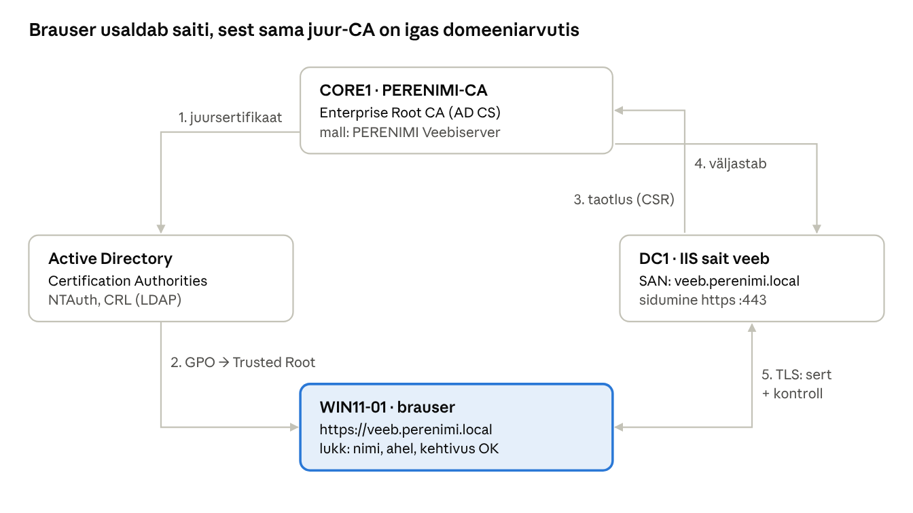

## 18. AD CS sertifikaadiasutus ja HTTPS

HTTPS vajab sertifikaati, mida brauser **usaldab** ja mille nimi **klapib** aadressiga. Avalikud CA-d (nt Let's Encrypt) ei väljasta sertifikaate `.local` nimedele, sest neid nimesid ei saa internetis kontrollida. Lahendus on oma sertifikaadiasutus: **Active Directory Certificate Services (AD CS)**. Ettevõtte CA (*Enterprise CA*) on AD-ga integreeritud ning selle juursertifikaat jõuab automaatselt iga domeeniarvuti usaldatud juursertifikaatide hulka. Seetõttu näitab brauser `https://veeb.perenimi.local` puhul lukku ilma hoiatuseta.

### 18.1 Mõisted

| Termin (EN) | Selgitus |
| --- | --- |
| PKI (*Public Key Infrastructure*) | Avaliku võtme taristu: CA-d, sertifikaadid, mallid, tühistusnimekirjad ja reeglid, mis koos võimaldavad usaldust. |
| Võtmepaar | **Privaatvõti** jääb serverisse ja on salajane; **avalik võti** on sertifikaadis ja nähtav kõigile. Privaatvõtmega allkirjastatut saab kontrollida avaliku võtmega. |
| Sertifikaat (X.509) | CA allkirjastatud dokument, mis seob avaliku võtme nimega (nt `veeb.perenimi.local`) ja kehtivusajaga. |
| CA (*Certification Authority*) | Sertifikaadiasutus, mis kontrollib taotlust ja allkirjastab sertifikaadi oma privaatvõtmega. |
| Juur-CA / vahe-CA | Juur-CA (*root*) sertifikaat on iseendale allkirjastatud ja usalduse alus. Vahe-CA (*subordinate / issuing*) sertifikaadi allkirjastab juur-CA. Tootmises on juur-CA tavaliselt võrgust väljas (*offline root*) ja sertifikaate väljastab vahe-CA. |
| Enterprise / Standalone CA | *Enterprise CA* kasutab AD-d: mallid, automaatne taotlemine, avaldamine AD-s, taotleja tuvastamine Kerberosega. *Standalone CA* töötab ilma AD-ta, taotlused kinnitatakse käsitsi. |
| Sertifikaadimall (*certificate template*) | Enterprise CA reeglistik: milleks sertifikaat on (EKU), võtme pikkus, kehtivus, kust tuleb nimi, kes tohib taotleda (*Enroll*). |
| CSR (*Certificate Signing Request*) | Sertifikaadi taotlus: sisaldab avalikku võtit ja soovitud nimesid, allkirjastatud taotleja privaatvõtmega. |
| Subject / CN | Sertifikaadi omaniku nimi, nt `CN=veeb.perenimi.local`. |
| SAN (*Subject Alternative Name*) | Nimede loend, mille jaoks sertifikaat kehtib. **Brauserid kontrollivad ainult SAN-i**, mitte CN-i: ilma SAN-ita annab Chrome/Edge vea `NET::ERR_CERT_COMMON_NAME_INVALID`. |
| EKU (*Enhanced Key Usage*) | Lubatud kasutus. Veebiserverile **Server Authentication** (1.3.6.1.5.5.7.3.1). |
| Kehtivus | Algus- ja lõppkuupäev; aegunud sertifikaati brauser ei aktsepteeri. |
| CRL / CDP | *Certificate Revocation List* – tühistatud sertifikaatide nimekiri; *CRL Distribution Point* – aadress (LDAP või HTTP), kust nimekirja saab. |
| AIA | *Authority Information Access* – kust saab väljastaja sertifikaadi (ahela loomiseks) ja OCSP aadressi. |
| Usaldatud juursertifikaadid (*Trusted Root Certification Authorities*) | Arvuti sertifikaadihoidla, mille CA-sid Windows ja brauserid usaldavad. Enterprise CA juur lisatakse sinna domeeniarvutites automaatselt. |
| Automaatne taotlemine (*autoenrollment*) | GPO-ga sisse lülitatud funktsioon, millega arvutid/kasutajad taotlevad ja uuendavad sertifikaate ise. |
| TLS-käepigistus (*handshake*) | Ühenduse alguses saadab server sertifikaadi, brauser kontrollib seda ja lepitakse kokku krüpteerimisvõti. |
| Thumbprint | Sertifikaadi räsi, mille järgi Windows sertifikaati tuvastab (nt IIS sidumisel). |

### 18.2 Mida brauser kontrollib

Kui WIN11-01 avab `https://veeb.perenimi.local`, kontrollib brauser serveri sertifikaadil viit asja. Kõik peavad õnnestuma, muidu tuleb hoiatus.

1. **Nimi:** kas aadressiribal olev nimi on sertifikaadi SAN-is (`DNS=veeb.perenimi.local`)?
2. **Ahel ja usaldus:** kas sertifikaadi allkiri viib usaldatud juur-CA-ni (`PERENIMI-CA` on kliendi *Trusted Root* hoidlas)?
3. **Kehtivus:** kas täna on kehtivusaja sees?
4. **Kasutus:** kas EKU sisaldab *Server Authentication*?
5. **Tühistus:** kas sertifikaat pole CRL-is (Windows kontrollib CDP kaudu)?

Lisaks tõestab server, et tal on sertifikaadile vastav **privaatvõti** – seetõttu ei saa keegi teine sertifikaati lihtsalt kopeerida ja kasutada.



*Joonis: PKI usaldusahel laboris · CA, AD, veebiserver ja klient*

Sammud 1–2 toimuvad üks kord CA paigaldamisel, sammud 3–4 iga veebiserveri sertifikaadi puhul ja samm 5 iga HTTPS-ühenduse alguses.

### 18.3 Hierarhia valik

| Variant | Ehitus | Kus kasutada |
| --- | --- | --- |
| Üheastmeline (**laboris**) | Enterprise Root CA väljastab ise sertifikaate | Labor, väike keskkond |
| Kaheastmeline (soovitus) | Offline Standalone Root CA → Enterprise Subordinate CA | Tootmine: juure privaatvõti on võrgust väljas ja kaitstud |

CA nime ja serveri nime ei saa pärast paigaldust muuta. Vali CA nimi läbimõeldult: laboris `PERENIMI-CA`.

### 18.4 CA paigaldus CORE1-le

```powershell
# CORE1-l, kontoga, mis on Enterprise Admins rühmas
Install-WindowsFeature ADCS-Cert-Authority -IncludeManagementTools
Install-AdcsCertificationAuthority -CAType EnterpriseRootCA -CACommonName "PERENIMI-CA" `
  -CryptoProviderName "RSA#Microsoft Software Key Storage Provider" -KeyLength 4096 `
  -HashAlgorithmName SHA256 -ValidityPeriod Years -ValidityPeriodUnits 10 -Force

# Kontroll
certutil -CAInfo
Get-Service CertSvc

# DC1-le haldusvahendid: certsrv.msc (CA), certtmpl.msc (mallid), pkiview.msc (PKI tervis)
Install-WindowsFeature RSAT-ADCS -IncludeAllSubFeature
```

Paigaldus avaldab juursertifikaadi AD konfiguratsioonipartitsiooni (*Certification Authorities* ja *NTAuth*). Domeeniarvutid laadivad selle oma *Trusted Root* hoidlasse järgmise rühmapoliitika värskendusega.

### 18.5 Sertifikaadimall veebiserverile

Vaikimisi *Web Server* malli ei muudeta, vaid tehakse sellest koopia (DC1-l `certtmpl.msc`):

1. Paremklikk **Web Server** → *Duplicate Template*.
2. *Compatibility*: Certification Authority **Windows Server 2016**, Certificate recipient **Windows 10 / Windows Server 2016**.
3. *General*: Display name `PERENIMI Veebiserver` (malli nimi tekib automaatselt: `PERENIMIVeebiserver`), Validity **2 years**.
4. *Cryptography*: Provider category *Key Storage Provider*, minimaalne võtme pikkus **2048**, algoritm RSA, räsi SHA256.
5. *Subject Name*: **Supply in the request** (taotleja annab nime ja SAN-i ise).
6. *Security*: lisa `DC1$` arvutikonto (või rühm `GG_Veebiserverid`, kuhu DC1 kuulub) õigustega **Read** ja **Enroll**.
7. *Request Handling*: *Allow private key to be exported* – ainult kui sertifikaat tuleb teise serverisse kolida (muidu jäta välja).
8. Avalda mall CA-s: `certsrv.msc` → ühenda CORE1 → *Certificate Templates* → paremklikk *New → Certificate Template to Issue* → `PERENIMI Veebiserver`. PowerShellis CORE1-l: `Add-CATemplate -Name "PERENIMIVeebiserver" -Force`.

> **Turvamärkus:** malli puhul, kus nimi tuleb taotlusest (*Supply in the request*), võib taotleja küsida sertifikaati **mis tahes nimele**. Seetõttu anna *Enroll* õigus ainult veebiserveritele, mitte kõigile (nt *Domain Computers* või *Authenticated Users*). Liiga laialt lubatud mallid on tuntud AD rünnete (nn ESC1) allikas.

### 18.6 Sertifikaadi taotlemine DC1-l

GUI: `certlm.msc` (kohaliku arvuti sertifikaadid) → *Personal → Certificates* → paremklikk *All Tasks → Request New Certificate* → *Active Directory Enrollment Policy* → märgi `PERENIMI Veebiserver` → *More information is required...* →

- *Subject name*: Type **Common name**, Value `veeb.perenimi.local` → *Add*
- *Alternative name*: Type **DNS**, Value `veeb.perenimi.local` → *Add*
- *OK → Enroll*

PowerShellis (sama tulemus):

```powershell
$cert = Get-Certificate -Template "PERENIMIVeebiserver" -SubjectName "CN=veeb.perenimi.local" `
  -DnsName "veeb.perenimi.local" -CertStoreLocation Cert:\LocalMachine\My
$cert.Certificate | Format-List Subject, DnsNameList, Issuer, NotAfter, Thumbprint
```

### 18.7 HTTPS IIS-is ja WordPressis

```powershell
# HTTPS sidumine SNI-ga (SslFlags 1) ja sertifikaadi sidumine
New-WebBinding -Name veeb -Protocol https -Port 443 -HostHeader veeb.perenimi.local -SslFlags 1
$c = Get-ChildItem Cert:\LocalMachine\My | Where-Object { $_.DnsNameList.Unicode -contains 'veeb.perenimi.local' } |
     Sort-Object NotAfter -Descending | Select-Object -First 1
(Get-WebBinding -Name veeb -Protocol https).AddSslCertificate($c.Thumbprint, 'My')
Get-WebBinding -Name veeb
```

GUI-s: IIS Manager → *veeb → Bindings → Add*: Type `https`, Host name `veeb.perenimi.local`, *Require Server Name Indication*, SSL certificate `veeb.perenimi.local`.

**HTTP → HTTPS suunamine:** lisa `web.config` reeglite algusesse (enne WordPressi reeglit):

```xml
<rule name="HTTPS-suunamine" stopProcessing="true">
  <match url="(.*)" />
  <conditions>
    <add input="{HTTPS}" pattern="off" />
  </conditions>
  <action type="Redirect" url="https://{HTTP_HOST}/{R:1}" redirectType="Permanent" />
</rule>
```

**WordPress:** *Settings → General* → *WordPress Address (URL)* ja *Site Address (URL)* = `https://veeb.perenimi.local`. Alternatiiv `wp-config.php`-s: `define('WP_HOME','https://veeb.perenimi.local'); define('WP_SITEURL','https://veeb.perenimi.local');`. Varem lisatud piltide aadressid jäävad andmebaasis `http://` kujule; need parandab nt otsi-asenda plugin.

**Kliendi usaldus:** domeeniarvutid saavad `PERENIMI-CA` juursertifikaadi automaatselt (`gpupdate /force` või `certutil -pulse` kiirendab). Firefox kasutab oma sertifikaadihoidlat: kui see näitab hoiatust, luba Windowsi juursertifikaatide kasutamine (`about:config` → `security.enterprise_roots.enabled` = true või Firefoxi poliitika *ImportEnterpriseRoots*).

### 18.8 Kontroll ja tõrkeotsing

```powershell
# WIN11-01: kas juur-CA on usaldatud?
Get-ChildItem Cert:\LocalMachine\Root | Where-Object Subject -like '*PERENIMI-CA*'
# Serveri sertifikaadi ahel ja tühistuskontroll (ekspordi sert DC1-lt veeb.cer failiks)
certutil -verify -urlfetch C:\Labor\veeb.cer
# Kas HTTPS vastab?
Invoke-WebRequest https://veeb.perenimi.local -UseBasicParsing | Select-Object StatusCode
```

| Sümptom | Põhjus ja lahendus |
| --- | --- |
| `NET::ERR_CERT_AUTHORITY_INVALID` | Klient ei usalda CA-d: arvuti pole domeenis, GPO pole värskendunud (`certutil -pulse`), või sertifikaat on iseallkirjastatud |
| `NET::ERR_CERT_COMMON_NAME_INVALID` | Nimi puudub SAN-ist või avati vale nimega (nt `https://dc1...`) |
| Mall ei ole taotlemisel näha | Mall pole CA-s avaldatud või DC1-l puudub *Enroll* õigus (arvuti grupimuudatus vajab taaskäivitust) |
| `certutil -verify` HTTP CDP viga | Vaikimisi HTTP CDP osutab CA veebikataloogile, mida pole paigaldatud; domeeniklient kasutab LDAP CDP-d. Tootmises avalda CRL HTTP-serveris |
| Sait ei vasta 443 pordil | HTTPS sidumine puudub või tulemüür; `netsh http show sslcert` |

`pkiview.msc` (*Enterprise PKI*) näitab ühe pilguga, kas CA sertifikaat, AIA ja CDP asukohad on kättesaadavad.

### Labor 16. AD CS ja HTTPS

**Eesmärk:** luua oma sertifikaadiasutus, väljastada WordPressi saidile domeenis usaldatud sertifikaat ja lülitada sait ümber HTTPS-ile.

**Sammud:**

1. Ava enne algust WIN11-01-l `https://veeb.perenimi.local` – ühendus ebaõnnestub (HTTPS sidumist pole). Pane see laboripäevikusse kirja.
2. Paigalda CORE1-le AD CS ja seadista Enterprise Root CA `PERENIMI-CA` (18.4).
3. WIN11-01: `gpupdate /force`, kontrolli, et `PERENIMI-CA` on *Trusted Root* hoidlas (`certlm.msc` või 18.8 käsk).
4. DC1: paigalda `RSAT-ADCS`, loo mall `PERENIMI Veebiserver` (18.5) ja avalda see CA-s.
5. DC1: taotle sertifikaat `veeb.perenimi.local` (GUI või `Get-Certificate`). Vaata `certlm.msc`-s sertifikaadi *Details* vahekaarti: *Subject Alternative Name*, *Enhanced Key Usage*, *Issuer*, kehtivus.
6. CORE1: `certsrv.msc` → *Issued Certificates* – leia väljastatud sertifikaat.
7. Lisa IIS-is HTTPS sidumine ja sertifikaat (18.7).
8. WIN11-01: ava `https://veeb.perenimi.local` – lukk ilma hoiatuseta. Klõpsa lukul → vaata sertifikaadi ahelat (`PERENIMI-CA` → `veeb.perenimi.local`).
9. Lisa HTTP → HTTPS suunamise reegel ja muuda WordPressi aadressid `https://`-ks. Kontrolli, et `http://veeb.perenimi.local` suunatakse HTTPS-ile.
10. **Viga meelega:** ava `https://dc1.perenimi.local` (sama IP, kuid nimi pole SAN-is) – mis hoiatuse brauser annab ja miks?
11. Lisa intraneti tsoon GPO-ga (16.7) ja kontrolli, et `https://veeb.perenimi.local/sisene` avaneb Kati jaoks ilma parooliküsimuseta.
12. Ava `pkiview.msc` ja selgita, millised kirjed on rohelised ja miks HTTP CDP võib olla punane.

**Kontrollpunkt:** sait avaneb HTTPS-iga ilma hoiatuseta, HTTP suunatakse HTTPS-ile, sertifikaadi ahel lõpeb `PERENIMI-CA`-ga, mall lubab taotlemist ainult veebiserverile.

**Küsimused:**

1. Miks ei saa `.local` nimele avalikult CA-lt sertifikaati?
2. Kuidas jõuab `PERENIMI-CA` juursertifikaat Windows 11 klienti, ilma et keegi seda käsitsi paigaldaks?
3. Miks on SAN olulisem kui CN?
4. Miks on ohtlik anda *Supply in the request* mallile *Enroll* õigus kõigile domeeniarvutitele?
5. Miks soovitatakse tootmises kaheastmelist PKI-d ja offline juur-CA-d?

---

[← 17. IIS ja WordPress](17-iis-ja-wordpress.md) · [Sisukord](../README.md) · [19. Kellaaja sünkroniseerimine (W32Time) →](19-kellaaja-sunkroniseerimine.md)
