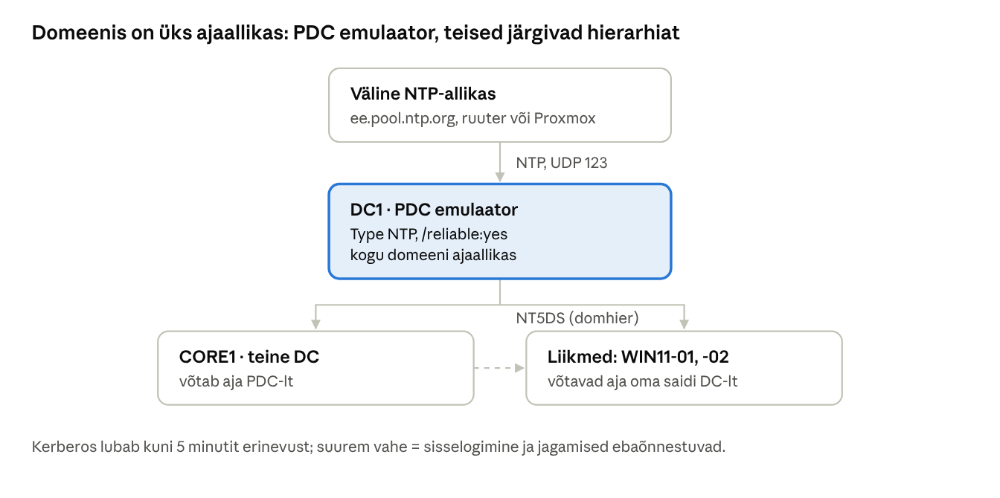

## 19. Kellaaja sünkroniseerimine (W32Time)

Domeenis peab kell olema kõigil arvutitel ühesugune. **Kerberos** lubab vaikimisi kuni **5 minutit** erinevust kliendi ja DC kella vahel; suurema vahe korral ebaõnnestuvad sisselogimine, jagamised ja kaughaldus. Lisaks sõltuvad kellast sertifikaatide kehtivus, AD replikatsioon ja logide võrreldavus (intsidendi uurimisel peab teadma, mis juhtus enne ja mis pärast). Virtuaalmasinate kell triivib, seetõttu on õige seadistus Proxmoxi laboris eriti oluline.

### 19.1 Mõisted

| Termin (EN) | Selgitus |
| --- | --- |
| W32Time (*Windows Time service*) | Windowsi ajateenus, mis toimib NTP kliendi ja serverina. |
| NTP (*Network Time Protocol*) | Aja sünkroniseerimise protokoll, UDP port **123**. |
| Stratum | Kaugus täpsest ajaallikast: 0 = aatomkell/GPS, 1 = sellega ühendatud server, iga järgmine tase +1. |
| Domeenihierarhia (NT5DS, `domhier`) | Vaikimisi režiim domeeniliikmetele: klient võtab aja DC-lt, DC-d võtavad aja **PDC emulaatorilt**, juurdomeeni PDC välisest allikast. |
| NTP-režiim (`Type NTP`) | Arvuti võtab aja käsitsi määratud serveritelt (`NtpServer`). Kasutatakse ainult PDC emulaatoril. |
| PDC emulaator | FSMO roll (vt 2.2), mis on **kogu domeeni ajaallikas**. |
| Usaldusväärne ajaallikas (`/reliable:yes`) | Märge, et see DC on domeeni usaldusväärne ajaserver; teised DC-d eelistavad seda. |
| Lipp `0x8` | NTP serveri järel (`server,0x8`): sünkroniseeri kliendirežiimis (soovitatav väliste serveritega). |
| Triiv (*drift*) | Kella aeglane erinemine õigest ajast. VM-ides suurem, eriti hosti koormuse või ooterežiimi korral. |



*Joonis: aja hierarhia domeenis · väline NTP → PDC → DC-d → liikmed*

Tähtis: **ainult PDC emulaator** seadistatakse välise NTP-serveri järgi. Kõik teised DC-d ja liikmed jäävad domeenihierarhiale. Kui iga arvuti võtaks aja eri allikast, võivad kellad lahku minna.

### 19.2 Proxmoxi eripära

- Proxmox seab Windowsi VM-i riistvarakella (RTC) kohalikule ajale automaatselt, kui VM-i *OS Type* on Windows.
- QEMU guest agent **ei** sünkroniseeri kella pidevalt; aja eest vastutab Windowsi W32Time.
- Proxmoxi host ise sünkroniseerib aega `chrony` abil. Kui laborivõrgust internetti ei ole, saab PDC ajaallikaks olla võrgu lüüs/ruuter (kui sellel on NTP) või viimase abinõuna PDC enda kell (`/reliable:yes` ilma välise allikata) – siis on domeeni sees aeg ühtne, isegi kui see pole täpne.
- Pärast VM-i taastamist hetktõmmisest või pikka peatamist kontrolli alati kella.

### 19.3 Seadistus

> **NB!** Allpool on sama töö kahel viisil: **A) GUI (rühmapoliitikaga)** ja **B) PowerShell / w32tm**. Piisab ühest – kui teed GUI juhendi järgi, pole käsurea seadistust vaja (ja vastupidi). GUI-variant on ka soovitatav, sest seadistus liigub automaatselt kaasa, kui PDC roll kolib teisele DC-le.

#### Variant A: GUI (samm-sammult)

1. **Kes on PDC?** `dsa.msc` → paremklikk `perenimi.local` → **Operations Masters...** → vahekaart **PDC**.
2. **WMI-filter:** `gpmc.msc` → *perenimi.local → WMI Filters* → paremklikk **New...** → nimi `PDC-emulaator` → *Add* → *Namespace* `root\CIMv2`, *Query* `SELECT * FROM Win32_ComputerSystem WHERE DomainRole = 5` (5 = esmane domeenikontroller) → OK → *Save*.
3. **GPO:** paremklikk *Group Policy Objects* → *New* → `C_PDC_Aeg` → paremklikk → **Edit** → *Computer Configuration → Policies → Administrative Templates → System → Windows Time Service → Time Providers*:
   - **Configure Windows NTP Client** → *Enabled*, *NtpServer* `0.ee.pool.ntp.org,0x8 1.ee.pool.ntp.org,0x8`, *Type* **NTP**;
   - **Enable Windows NTP Client** → *Enabled*;
   - **Enable Windows NTP Server** → *Enabled* → sulge redaktor.
4. Vali `C_PDC_Aeg` → vahekaart *Scope* → *WMI Filtering* → vali `PDC-emulaator`.
5. **Lingi:** paremklikk OU-l *Domain Controllers* → *Link an Existing GPO...* → `C_PDC_Aeg`.
6. **CORE1 ja liikmed:** midagi muuta pole vaja – nad kasutavad vaikimisi domeenihierarhiat (*NT5DS*).
7. Kontroll: *Event Viewer → Windows Logs → System*, allikas **Time-Service** (sündmus 35/37). Ajaallika nägemiseks on siiski kiireim `w32tm /query /source` – see on ainult kontroll, mitte seadistus.

#### Variant B: PowerShell / w32tm

```powershell
# Kes on PDC emulaator?
Get-ADDomain | Select-Object PDCEmulator

# DC1 (PDC emulaator): välised NTP-serverid ja usaldusväärne ajaallikas
w32tm /config /manualpeerlist:"0.ee.pool.ntp.org,0x8 1.ee.pool.ntp.org,0x8" /syncfromflags:manual /reliable:yes /update
Restart-Service w32time
w32tm /resync /rediscover

# CORE1 ja kõik liikmed: domeenihierarhia (vaikimisi, siin kinnitame)
w32tm /config /syncfromflags:domhier /update
Restart-Service w32time
w32tm /resync

# Kontroll
w32tm /query /source              # kust aeg tuleb
w32tm /query /status              # stratum, viimane sünkroniseerimine
w32tm /query /configuration       # Type: NTP või NT5DS
w32tm /monitor                    # kõigi DC-de aeg ja nihe
w32tm /stripchart /computer:dc1.perenimi.local /samples:5 /dataonly   # nihe sekundites
```

### 19.4 Tõrkeotsing

| Sümptom | Põhjus ja lahendus |
| --- | --- |
| `w32tm /query /source` näitab *Local CMOS Clock* | Arvuti ei sünkroniseeri kuskilt: liikmel `domhier` puudu või PDC-l NTP-server kättesaamatu (UDP 123 tulemüüris) |
| Liikme kell erineb mitu minutit | W32Time teenus seisab või on käsitsi muudetud; `w32tm /resync /force` |
| Sisselogimisel „The time on this computer is out of sync“ / Kerberose vead | Kella vahe üle 5 min; paranda kell, seejärel `klist purge` |
| Pärast PDC rolli üleviimist on kahes DC-s erinev aeg | Vana PDC on endiselt `Type NTP` – sea see `domhier`-iks või kasuta WMI-filtriga GPO-d |

Logid: *System* logi, allikas **Time-Service** (nt sündmus 35 = sünkroniseerib allikaga, 37 = saab korrektset ajaandmet, 36 = pole ammu sünkroniseerinud).

### Labor 17. Kellaaja sünkroniseerimine

**Eesmärk:** seadistada domeeni ajahierarhia ja näha, mida kella erinevus põhjustab.

**Sammud:**

1. Leia PDC emulaator (`Get-ADDomain`). Käivita igas masinas `w32tm /query /source` ja `w32tm /query /configuration` ning kirjuta tulemused tabelisse (masin, allikas, Type).
2. Seadista DC1 (PDC) välise allika järgi (19.3). Kui laborist internetti pole, kasuta õpetaja antud NTP-serverit või jäta `manualpeerlist` tühjaks ja kasuta ainult `/reliable:yes`.
3. Kontrolli, et CORE1 ja kliendid kasutavad `domhier`-i ja nende allikas on DC.
4. Käivita DC1-l `w32tm /monitor` ja vaata kõigi DC-de nihet.
5. **Katse:** WIN11-02-l peata teenus `Stop-Service w32time` ja nihuta kella: `Set-Date (Get-Date).AddMinutes(10)`. Logi välja ja sisse domeenikasutajana ning ava `\\perenimi.local\Andmed`. Mis juhtub? Vaata `klist`.
6. Käivita `Start-Service w32time; w32tm /resync /force` ja kontrolli, et kell ja ligipääs taastuvad.
7. Loo GPO `C_PDC_Aeg` koos WMI-filtriga (19.3) ja eemalda DC1-lt käsitsi seadistus (`w32tm /config /syncfromflags:domhier /update`). Kontrolli pärast `gpupdate /force`-i, et DC1 on taas `Type NTP` – nüüd GPO kaudu.
8. Leia System logist Time-Service sündmused.

**Kontrollpunkt:** DC1 allikas on väline NTP-server (või kohalik usaldusväärne kell), kõigi teiste allikas on DC; `w32tm /monitor` näitab nihet alla ühe sekundi.

**Küsimused:**

1. Miks seadistatakse välise allika järgi ainult PDC emulaator?
2. Mis juhtus sammus 5 ja miks?
3. Milleks on GPO-l WMI-filter `DomainRole = 5`?
4. Miks on kella õigsus oluline ka sertifikaatide ja logide jaoks?

---

[← 18. AD CS sertifikaadiasutus ja HTTPS](18-ad-cs-ja-https.md) · [Sisukord](../README.md) · [20. WSUS – uuenduste tsentraalne haldus →](20-wsus.md)
