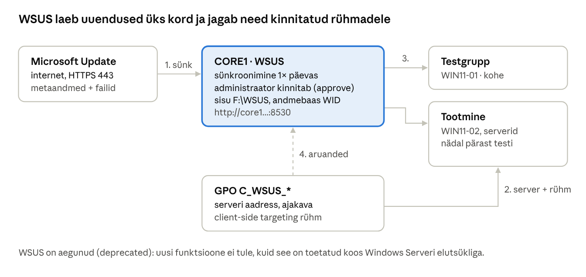

## 20. WSUS – uuenduste tsentraalne haldus

WSUS (*Windows Server Update Services*) on Windows Serveri roll, mis laeb Microsofti uuendused **üks kord** alla ja jagab need kohalikus võrgus arvutitele. Administraator otsustab, **milline uuendus millisele arvutirühmale** ja millal paigaldatakse. Nii saab uuendusi enne testida, säästab internetiliiklust ja näeb ühest kohast, millised arvutid on uuendamata.

**Staatus:** Microsoft teatas 2024. aasta septembris WSUS-i aegumisest (*deprecation*), mis tähendab, et uusi funktsioone ei arendata, kuid olemasolevad funktsioonid ja uuenduste edastamine WSUS-i kaudu jäävad alles; roll on olemas ka Windows Server 2025-s. Microsoft soovitab pikemas plaanis pilvetööriistu (Windows Autopatch, Intune, Azure Update Manager). Võrgust eraldatud keskkondades ja õppimiseks on WSUS endiselt asjakohane, sest selle mõisted (kinnitamine, rollid, testrühm) kehtivad ka uuemates lahendustes.

### 20.1 Mõisted

| Termin (EN) | Selgitus |
| --- | --- |
| Sünkroonimine (*synchronization*) | WSUS laeb Microsoft Update'ist uuenduste metaandmed (ja kinnitatud uuenduste failid). |
| Tooted ja klassid (*products, classifications*) | Millised tooted (nt *Windows 11*, *Microsoft Server operating system-21H2*) ja millist tüüpi uuendused (*Security Updates*, *Critical Updates*, *Updates*, *Definition Updates*) sünkroniseeritakse. Vali vähem = vähem ketast. |
| Kinnitamine (*approval*) | Administraatori otsus: *Approved for Install* rühmale X, *Not approved* või *Declined*. Klient paigaldab ainult kinnitatud uuendusi. |
| Arvutirühm (*computer group*) | WSUS-i sisene rühm, millele uuendusi kinnitatakse (nt Testgrupp, Tootmine). Ei ole AD rühm. |
| Server-side / client-side targeting | Arvuti paigutatakse rühma kas WSUS-i konsoolis käsitsi või GPO-ga (kliendi seade ütleb rühma nime). Laboris kasutame GPO-d. |
| Upstream / downstream | Suures võrgus saab WSUS võtta uuendusi teiselt WSUS-ilt (nt harukontor keskkontorist). |
| WID / SQL Server | WSUS-i andmebaas: *Windows Internal Database* (vaikimisi, piisav kuni tuhandeid kliente) või SQL Server. |
| Sisu kaust (*content directory*) | Kus hoitakse uuendusfaile. Peab olema NTFS ja piisavalt suur. Laboris `F:\WSUS`. |
| Asendatud uuendus (*superseded*) | Vanem uuendus, mille uuem kumulatiivne uuendus asendab. Need tuleb regulaarselt tagasi lükata, muidu WSUS aeglustub. |
| Tähtaeg (*deadline*) | Kuupäev, mille järel paigaldus ja taaskäivitus sunnitakse. |



*Joonis: WSUS töövoog · sünkroonimine, kinnitamine, arvutirühmad*

**Uuendusringid (*update rings*):** kinnita uuendus esmalt väikesele testrühmale (IT ja mõni tavaarvuti). Kui nädala jooksul probleeme pole, kinnita see tootmisrühmale. Domeenikontrollereid uuenda ükshaaval.

### 20.2 Paigaldus CORE1-le

WSUS vajab sünkroonimiseks **internetiühendust** (otse või proksi kaudu) ning vähemalt mitukümmend GB vaba ruumi. Kui laboris internetti pole, saab seadistada serveri, GPO ja rühmad ning näha klientide aruandeid, kuid uuendusi alla ei laeta.

```powershell
# CORE1-l: roll koos WID andmebaasiga
Install-WindowsFeature UpdateServices -IncludeManagementTools
New-Item F:\WSUS -ItemType Directory
& "C:\Program Files\Update Services\Tools\wsusutil.exe" postinstall CONTENT_DIR=F:\WSUS

# DC1-l haldusvahend (WSUS konsool ühendub core1.perenimi.local:8530)
Install-WindowsFeature UpdateServices-RSAT
```

### 20.3 Seadistus PowerShelliga

```powershell
$w = Get-WsusServer -Name core1.perenimi.local -PortNumber 8530

# Keeled
$conf = $w.GetConfiguration()
$conf.AllUpdateLanguagesEnabled = $false
$conf.SetEnabledUpdateLanguages("en")
$conf.Save()

# Esmalt laadi ainult kategooriate nimekiri
$sub = $w.GetSubscription()
$sub.StartSynchronizationForCategoryOnly()

# Tooted ja klassid (kui kategooriate sünk on lõppenud)
Get-WsusProduct | Where-Object { $_.Product.Title -in 'Windows 11', 'Microsoft Server operating system-21H2' } | Set-WsusProduct
Get-WsusProduct | Where-Object { $_.Product.Title -eq 'Windows' } | Set-WsusProduct -Disable
Get-WsusClassification | Where-Object { $_.Classification.Title -in 'Security Updates','Critical Updates','Updates','Definition Updates' } | Set-WsusClassification

# Automaatne sünkroonimine öösiti ja esimene sünk
$sub.SynchronizeAutomatically = $true
$sub.SynchronizeAutomaticallyTimeOfDay = (New-TimeSpan -Hours 1)
$sub.NumberOfSynchronizationsPerDay = 1
$sub.Save()
$sub.StartSynchronization()

# Arvutirühmad
$w.CreateComputerTargetGroup('Testgrupp')
$w.CreateComputerTargetGroup('Tootmine')

# Kinnita turvauuendused testrühmale
Get-WsusUpdate -Classification Security -Approval Unapproved -Status FailedOrNeeded |
  Approve-WsusUpdate -Action Install -TargetGroupName 'Testgrupp'

# Hooldus (iga kuu): asendatud ja aegunud uuendused tagasi, kasutamata failid ära
Invoke-WsusServerCleanup -DeclineSupersededUpdates -DeclineExpiredUpdates -CleanupObsoleteUpdates -CleanupUnneededContentFiles
```

GUI-s: DC1-l *Windows Server Update Services* konsool → *Connect to Server* `core1.perenimi.local`, port 8530. Esmase seadistuse saab teha ka viisardiga *Options → WSUS Server Configuration Wizard*. *Options → Computers*: vali **Use Group Policy or registry settings on computers** (client-side targeting).

### 20.4 GPO klientidele

Loo arvutirühmad AD-s: `GG_WSUS_Test` (WIN11-01) ja `GG_WSUS_Tootmine` (WIN11-02, CORE1, DC1). Seejärel kolm GPO-d:

| GPO | Link ja filter | Seaded (*Computer → Policies → Admin Templates → Windows Components → Windows Update*) |
| --- | --- | --- |
| `C_WSUS` | Domeen (kõik arvutid) | *Manage updates offered from Windows Server Update Service → Specify intranet Microsoft update service location*: `http://core1.perenimi.local:8530` (mõlemale väljale); *Do not connect to any Windows Update Internet locations* = Enabled; *Manage end user experience → Configure Automatic Updates* = 4 (Auto download and schedule install), kell 03:00 |
| `C_WSUS_Test` | Domeen, turvafilter `GG_WSUS_Test` | *Enable client-side targeting*: `Testgrupp` |
| `C_WSUS_Tootmine` | Domeen, turvafilter `GG_WSUS_Tootmine` | *Enable client-side targeting*: `Tootmine` |

Arvutirühma liikmesuse muutus jõustub arvuti taaskäivitamisel. Kliendil kontrolli registrist `HKLM\SOFTWARE\Policies\Microsoft\Windows\WindowsUpdate`, käivita otsing (*Settings → Windows Update → Check for updates* või `UsoClient StartScan`) ja vaata logi: `Get-WindowsUpdateLog` (loob töölauale `WindowsUpdate.log`).

### 20.5 Tõrkeotsing

| Sümptom | Põhjus ja lahendus |
| --- | --- |
| Klient ei ilmu WSUS-i konsooli | GPO pole rakendunud (`gpresult /r`), port 8530 suletud, vale aadress; oota kuni 22 h või käivita otsing kliendil |
| Klient on rühmas *Unassigned Computers* | WSUS-is pole valitud client-side targeting või rühma nimi GPO-s ei kattu WSUS-i rühmaga |
| Sünkroonimine ebaõnnestub | Internet/proksi puudub; *Options → Update Source and Proxy Server* |
| WSUS konsool on väga aeglane või viskab vigu | Asendatud uuendused tagasi lükkamata; käivita `Invoke-WsusServerCleanup`, vajadusel suurenda IIS-i rakenduskogumi `WsusPool` mälupiiri |
| Ketas täis | Liiga palju tooteid/keeli valitud; vali vähem ja tee puhastus |

### Labor 18. WSUS

**Eesmärk:** paigaldada WSUS, suunata kliendid GPO-ga WSUS-i rühmadesse ja kinnitada uuendused uuendusringide kaupa.

**Sammud:**

1. Kontrolli CORE1-l `F:` kettal vaba ruumi (vähemalt 20 GB) ja internetiühendust (`Test-NetConnection go.microsoft.com -Port 443`).
2. Paigalda WSUS ja tee `postinstall` (20.2). Paigalda DC1-le WSUS konsool ja ühenda CORE1-ga.
3. Seadista keel, tooted (Windows 11, Server 2022), klassid ja sünkroonimise ajakava; käivita esimene sünk.
4. Loo WSUS-i rühmad *Testgrupp* ja *Tootmine* ning vali *Use Group Policy or registry settings on computers*.
5. Loo AD rühmad `GG_WSUS_Test`, `GG_WSUS_Tootmine` ja lisa arvutid. Loo kolm GPO-d (20.4).
6. Taaskäivita kliendid, kontrolli registrit ja käivita `UsoClient StartScan`.
7. WSUS-i konsoolis: kontrolli, et WIN11-01 on Testgrupis ja WIN11-02 Tootmises. Vaata aruannet *Computer Status Summary*.
8. Kinnita turvauuendused ainult Testgrupile. Kontrolli, et WIN11-01 laeb need alla ja WIN11-02 mitte.
9. Kinnita samad uuendused Tootmisele (simuleeri nädalast testiperioodi).
10. Käivita hooldus `Invoke-WsusServerCleanup` ja pane kirja, mitu uuendust tagasi lükati.

**Kontrollpunkt:** mõlemad kliendid on õiges WSUS-i rühmas, annavad aru ja saavad ainult neile kinnitatud uuendusi.

**Küsimused:**

1. Mis kasu on uuendusringidest (test → tootmine)?
2. Mis vahe on WSUS-i arvutirühmal ja AD rühmal? Kuidas need laboris seotud on?
3. Miks tuleb asendatud uuendused tagasi lükata?
4. Mida tähendab WSUS-i aegumine (deprecation) ja mis on selle alternatiivid?

---

[← 19. Kellaaja sünkroniseerimine (W32Time)](19-kellaaja-sunkroniseerimine.md) · [Sisukord](../README.md) · [21. WiFi ja 802.1X: NPS ja RADIUS →](21-wifi-8021x-nps.md)
