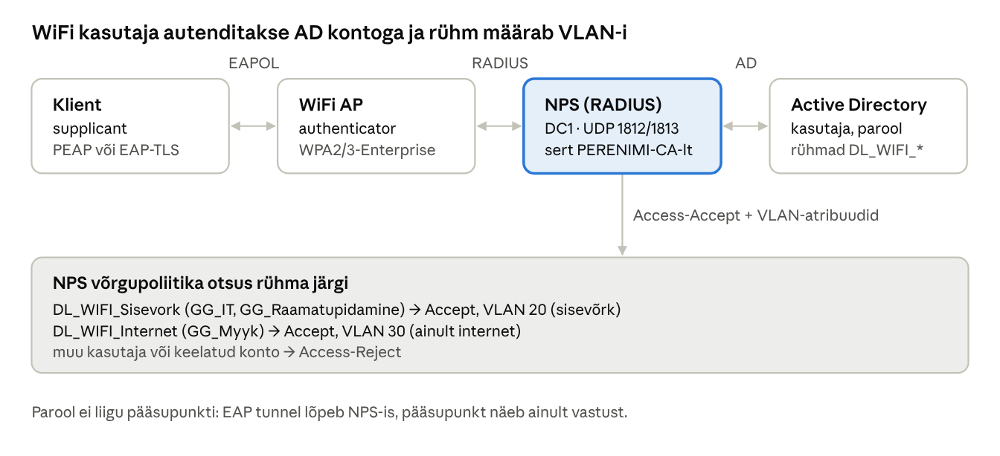

## 21. WiFi ja 802.1X: NPS ja RADIUS

Kodune WiFi kasutab ühist parooli (**WPA2/WPA3-Personal**, PSK). Ettevõttes on see halb: kui töötaja lahkub, tuleb parool kõigil vahetada, ja pole teada, kes võrgus on. **WPA2/WPA3-Enterprise** (802.1X) autendib iga kasutaja või arvuti **tema enda AD kontoga**. Kui konto keelatakse, kaob ka WiFi ligipääs, ning AD rühm saab määrata, millisesse võrku (VLAN) kasutaja satub. Windows Serveris täidab autentimisserveri rolli **NPS** (*Network Policy Server*), mis on Microsofti RADIUS-server. Sama lahendus sobib ka VPN-i (nt FortiGate) ja juhtmega 802.1X autentimiseks.

> **Laboris pole WiFi riistvara.** Proxmoxi VM-idel ei ole WiFi kaarti ega pääsupunkti. Seetõttu seadistame NPS-i, sertifikaadi, võrgupoliitikad ja GPO WiFi-profiili täielikult, kuid pääsupunkti asemel saadab RADIUS-päringuid testtööriist WIN11-01-lt. Kui koolil on päris pääsupunkt või FortiGate, saab selle lisada RADIUS-kliendiks samamoodi.

### 21.1 Mõisted

| Termin (EN) | Selgitus |
| --- | --- |
| 802.1X | IEEE standard võrguühenduse autentimiseks enne, kui seade võrku pääseb (WiFi ja juhtmega). |
| Supplicant | Klient, kes autendib (Windowsi WLAN AutoConfig teenus). |
| Authenticator | Seade, mille kaudu ühendatakse (WiFi pääsupunkt, kontroller, kommutaator, FortiGate). Ise otsust ei tee, vaid küsib RADIUS-serverilt. |
| Autentimisserver | RADIUS-server, mis kontrollib kasutajat ja otsustab: NPS. |
| RADIUS | Autentimisprotokoll authenticatori ja serveri vahel: UDP **1812** (autentimine) ja **1813** (arvestus/*accounting*). Sõnumid: *Access-Request*, *Access-Challenge*, *Access-Accept*, *Access-Reject*. |
| RADIUS-klient | NPS-i vaatest seade, mis saadab RADIUS-päringuid (pääsupunkt, mitte sülearvuti!). Tuvastatakse IP-aadressi ja **jagatud saladuse** (*shared secret*) järgi. |
| EAP / EAPOL | *Extensible Authentication Protocol* – raamistik autentimismeetodite jaoks. EAPOL = EAP kohtvõrgu kaudu kliendi ja pääsupunkti vahel. |
| PEAP-MSCHAPv2 | Levinuim meetod: NPS esitab **serveri sertifikaadi**, luuakse krüpteeritud TLS-tunnel ja selle sees kontrollitakse kasutajanime ja parooli. |
| EAP-TLS | Tugevaim meetod: ka klient tõendab end **sertifikaadiga** (arvuti- või kasutajasertifikaat AD CS-ist), parooli ei kasutata. |
| Ühenduse päringupoliitika (*connection request policy*) | NPS-i reegel: kas päringut töödeldakse kohapeal või saadetakse teisele RADIUS-serverile. |
| Võrgupoliitika (*network policy*) | NPS-i reegel: **tingimused** (nt Windowsi rühm, *NAS Port Type* = Wireless), **piirangud** (lubatud EAP meetod) ja **seaded** (RADIUS-atribuudid, nt VLAN). Poliitikaid kontrollitakse järjekorras, esimene sobiv otsustab. |
| Dünaamiline VLAN | NPS saadab vastuses atribuudid *Tunnel-Type* = VLAN, *Tunnel-Medium-Type* = 802, *Tunnel-Pvt-Group-ID* = VLAN-i number; pääsupunkt paneb kliendi sellesse VLAN-i. |



*Joonis: 802.1X WiFi autentimine · klient, pääsupunkt, NPS ja AD*

**Miks serveri sertifikaat on tähtis:** PEAP-i puhul peab klient kontrollima, et ta räägib õige NPS-iga (sertifikaat `PERENIMI-CA`-lt, nimi `dc1.perenimi.local`). Kui klient sertifikaati ei kontrolli, saab ründaja teha sama nimega võltsvõrgu (*evil twin*) ja püüda kinni kasutajate parooliräsid. Seetõttu seadistatakse WiFi-profiil GPO-ga, mitte kasutaja käsitsi.

### 21.2 NPS-i paigaldus ja sertifikaat

NPS paigaldatakse DC1-le (laboris; tootmises soovitatavalt eraldi serverile või kahele serverile tõrkekindluse jaoks).

```powershell
# DC1-l
Install-WindowsFeature NPAS -IncludeManagementTools
# Registreeri NPS AD-s (lisab DC1 rühma "RAS and IAS Servers", et NPS saaks lugeda kasutajate sissehelistamisõigusi)
netsh nps add registeredserver
```

Sertifikaat (vt peatükk 18): CORE1 CA-l avalda mall **RAS and IAS Server** (`certsrv.msc` → *Certificate Templates → New → Certificate Template to Issue*). Mall lubab taotleda rühmal *RAS and IAS Servers*, kuhu DC1 eelmise käsuga lisati. Taaskäivita DC1 (rühmaliikmesus) ja taotle sertifikaat: `certlm.msc` → *Personal → Request New Certificate* → *RAS and IAS Server*. Sertifikaadi nimi on DC1 FQDN.

### 21.3 RADIUS-kliendid ja rühmad

```powershell
# AD rühmad (AGDLP)
$ou = "OU=Ryhmad,OU=Labor,DC=perenimi,DC=local"
New-ADGroup DL_WIFI_Sisevork -GroupScope DomainLocal -Path $ou
New-ADGroup DL_WIFI_Internet -GroupScope DomainLocal -Path $ou
Add-ADGroupMember DL_WIFI_Sisevork -Members GG_IT, GG_Raamatupidamine
Add-ADGroupMember DL_WIFI_Internet -Members GG_Myyk

# RADIUS-kliendid: päris pääsupunkt (kui olemas) ja laboris testklient WIN11-01
New-NpsRadiusClient -Name "AP-Labor" -Address 192.168.10.50 -SharedSecret "Pikk-Juhuslik-Saladus-1"
New-NpsRadiusClient -Name "Test-WIN11-01" -Address 192.168.10.150 -SharedSecret "Pikk-Juhuslik-Saladus-2"
Get-NpsRadiusClient
```

Jagatud saladus peab olema pikk ja juhuslik ning igal RADIUS-kliendil erinev.

### 21.4 Võrgupoliitikad

Kiireim viis on viisard: `nps.msc` → *NPS (Local)* → *Standard Configuration*: **RADIUS server for 802.1X Wireless or Wired Connections** → *Configure 802.1X* → *Secure Wireless Connections*. Viisard loob ühenduse päringupoliitika ja võrgupoliitika. Seejärel täienda poliitikaid:

| Poliitika (järjekord) | Tingimused | Piirangud | Seaded (RADIUS-atribuudid) |
| --- | --- | --- | --- |
| 1. `WiFi-Sisevork` | Windows Groups = `DL_WIFI_Sisevork`; NAS Port Type = Wireless – IEEE 802.11 | EAP: **PEAP** (serveri sertifikaat DC1), sisemine meetod EAP-MSCHAPv2 | Tunnel-Type = VLAN, Tunnel-Medium-Type = 802, Tunnel-Pvt-Group-ID = **20** |
| 2. `WiFi-Internet` | Windows Groups = `DL_WIFI_Internet`; NAS Port Type = Wireless | sama | Tunnel-Pvt-Group-ID = **30** |
| 3. `LABOR-Test-PAP` (**ainult laboris**) | Client Friendly Name = `Test-WIN11-01`; Windows Groups = `DL_WIFI_Sisevork` või `DL_WIFI_Internet` | **PAP** (krüpteerimata, testtööriista jaoks) | nagu 1/2 |
| (vaikimisi) | — | — | Deny |

Kasutaja omadustes (ADUC → *Dial-in*) peab olema *Control access through NPS Network Policy* (vaikimisi). PAP-poliitika on vajalik ainult selleks, et lihtne testtööriist saaks NPS-i otsuseid näidata; tootmises seda **ei tehta**.

### 21.5 WiFi-profiil GPO-ga

GPO `C_WiFi` (OU Arvutid): *Computer → Policies → Windows Settings → Security Settings → Wireless Network (IEEE 802.11) Policies* → *Create A New Wireless Network Policy for Windows Vista and Later Releases* → *Add → Infrastructure*:

- *Connection*: SSID `PERENIMI-WiFi`, *Connect automatically*.
- *Security*: Authentication **WPA2-Enterprise** (või WPA3-Enterprise, kui pääsupunkt toetab), Encryption **AES**, meetod **Microsoft: Protected EAP (PEAP)**, *Authentication mode*: **User or Computer authentication**.
- *Properties* (PEAP): **Verify the server's identity by validating the certificate**, *Connect to these servers*: `dc1.perenimi.local`, *Trusted Root CA*: `PERENIMI-CA`, *Notifications*: Don't ask user to authorize new servers. Sisemine meetod *EAP-MSCHAP v2* → *Automatically use my Windows logon name and password*.

GPO rakendub ka arvutites, kus WiFi kaarti pole – profiil lihtsalt ei aktiveeru. Kontroll WiFi-kaardiga arvutis: `netsh wlan show profiles`.

### 21.6 Logid ja tõrkeotsing

NPS-i otsused on DC1 **Security** logis: **6272** = ligipääs lubatud, **6273** = keelatud. Sündmuses on *Network Policy Name* ja *Reason Code*. Mugavam vaade: Event Viewer → *Custom Views → Server Roles → Network Policy and Access Services*. Arvestuse logid: `C:\Windows\System32\LogFiles\IN*.log`.

| Sümptom / Reason Code | Põhjus ja lahendus |
| --- | --- |
| NPS ei logi midagi | Päring ei jõua: vale IP RADIUS-kliendis, tulemüür UDP 1812, vale port |
| 6273, Reason 16 | Vale kasutajanimi või parool |
| 6273, Reason 48 | Ükski võrgupoliitika ei sobinud (rühm, NAS Port Type, järjekord) |
| 6273, Reason 66 | Kliendi autentimismeetod ei vasta poliitika piirangutele (nt PAP vs PEAP) |
| „Authenticator“ näitab vale saladust | Jagatud saladus ei kattu (NPS-is ja seadmes peab olema täpselt sama) |
| Klient ei ühendu, logis TLS viga | NPS-il pole sertifikaati, sertifikaat aegunud või klient ei usalda CA-d |

### Labor 19. NPS ja WiFi 802.1X

**Eesmärk:** seadistada NPS RADIUS-serveriks, võrgupoliitikad AD rühmade ja VLAN-ide kaupa ning GPO WiFi-profiil; testida autentimist RADIUS-testtööriistaga.

**Eeldused:** Labor 16 (AD CS) on tehtud. WIN11-01-le on lubatud paigaldada RADIUS-testtööriist (nt tasuta **NTRadPing**; Linuxi masinas sobib `radtest`).

**Sammud:**

1. Paigalda DC1-le NPS ja registreeri see AD-s (21.2).
2. Avalda CA-s mall *RAS and IAS Server*, taaskäivita DC1 ja taotle sertifikaat. Kontrolli `certlm.msc`-s.
3. Loo rühmad `DL_WIFI_Sisevork`, `DL_WIFI_Internet` ja RADIUS-kliendid (21.3).
4. Käivita 802.1X viisard (*Secure Wireless Connections*), vali RADIUS-klient `AP-Labor`, meetod PEAP DC1 sertifikaadiga, rühm `DL_WIFI_Sisevork`. Nimeta poliitika `WiFi-Sisevork` ja lisa VLAN 20 atribuudid.
5. Kopeeri poliitika `WiFi-Internet`-iks (rühm `DL_WIFI_Internet`, VLAN 30).
6. Loo laboripoliitika `LABOR-Test-PAP` (21.4) ja pane see järjekorras esimeseks.
7. WIN11-01-l käivita testtööriist: server 192.168.10.10, port 1812, saladus `Pikk-Juhuslik-Saladus-2`, kasutaja `mari.maasikas` ja tema parool → *Access-Accept*, atribuudis *Tunnel-Pvt-Group-ID* = 20.
8. Korda kasutajaga `liis.lepp` → *Access-Accept*, VLAN 30.
9. Proovi vale parooliga ja kasutajaga, kes pole ükski WiFi rühmas (loo testkasutaja) → *Access-Reject*. Leia DC1 Security logist sündmused 6272/6273 ja nende *Reason Code*.
10. Keela ADUC-s Mari konto ja testi uuesti → *Access-Reject*. Luba konto tagasi.
11. Loo GPO `C_WiFi` WiFi-profiiliga (21.5) ja kontrolli `gpresult /h`-ga, et see rakendub WIN11-01-le.
12. **Lõpetuseks kustuta või keela poliitika `LABOR-Test-PAP`.**

**Kontrollpunkt:** NPS vastab Access-Accept õige VLAN-iga vastavalt rühmale ja Access-Reject vale parooli, keelatud konto ja rühmata kasutaja korral; Security logis on vastavad 6272/6273 sündmused; GPO WiFi-profiil on loodud.

**Küsimused:**

1. Mis vahe on WPA2-Personal ja WPA2-Enterprise lahendusel? Mis juhtub WiFi ligipääsuga, kui töötaja konto keelatakse?
2. Kes on 802.1X-is supplicant, authenticator ja autentimisserver? Kes neist on NPS-i jaoks RADIUS-klient?
3. Miks peab WiFi-profiil kontrollima NPS-i serveri sertifikaati?
4. Mis vahe on PEAP-MSCHAPv2 ja EAP-TLS meetodil?
5. Miks on PAP-poliitika ainult laboris lubatud?

---

[← 20. WSUS – uuenduste tsentraalne haldus](20-wsus.md) · [Sisukord](../README.md) · [Osa II allikad →](22-osa-2-allikad.md)
